## Introduction

Every time we released the mobile app (iOS and Android) and the macOS desktop app, I archived in Xcode, uploaded with Transporter, and dragged an AAB into the Play Console. Doing four targets — iPhone, iPad, Android and Mac — by hand made it easy to miss one.

So I brought in fastlane, so that **merging to main finishes with the upload to each store**. This post walks through the setup in order.

## 1. Why fastlane 🧐

| Option | Pros | Cons |
|---|---|---|
| Manual (Transporter, Play Console) | Nothing to set up | A person has to do it every time, and mistakes happen |
| Xcode Cloud | Managed by Apple, easy to set up | iOS and macOS only; Android is separate |
| Codemagic / Bitrise | CI built for mobile, nice UI | Dependency on an external service, cost, CI split in two |
| gradle-play-publisher | Everything stays inside Gradle | Android only |
| **fastlane** | One tool for both stores, plugs into our existing GitHub Actions | Ruby dependency, behavior differences between versions |

fastlane was the only option that let us keep our existing CI (GitHub Actions) and handle iOS, Android and macOS with one tool.

**The good**
- It authenticates with an App Store Connect **API key**, so it runs in CI without two-factor authentication.
- TestFlight upload (`upload_to_testflight`), store version prep (`deliver`), Play upload (`upload_to_play_store`) and profile provisioning (`get_provisioning_profile`) already exist as actions.
- Lanes are Ruby code, so branching and reuse are easy.

**The not so good**
- **Ruby and Bundler** show up in a Kotlin, Flutter and Node repository.
- Behavior shifts subtly between versions, so you have to pin the version.
- There's implicit behavior — for example, it reads a `.env` from a parent folder on its own (section 6).
- Some actions don't support API keys. `produce`, which creates the app record, needs an Apple ID login, so creating the app is done by hand in the console.

## 2. What you need 🔑

{: width="1100" height="520" }

| For | What | Notes |
|---|---|---|
| Apple | App Store Connect API key (Issuer ID, Key ID, `.p8`) | Users and Access → Keys. Role: "App Manager" |
| Apple | Distribution certificate `.p12` and its password | Provisioning profiles are fetched on demand with the API key |
| Google | Play service account JSON | Grant the service account app permissions in the Play Console |
| Google | Upload keystore, password, alias | For signing the AAB |
| Google | **Upload the first AAB by hand in the console** | The API rejects an app that has no builds at all |

Files are base64-encoded and stored as GitHub secrets. The secrets don't live at the repository level but in an **Environment that only main can access** (`store`), so workflows on other branches can't read the signing keys.

```bash
base64 -i AuthKey_XXXXXX.p8 | pbcopy        # ASC_KEY_P8_BASE64
base64 -i distribution.p12 | pbcopy          # APPLE_DIST_CERT_P12_BASE64
base64 -i upload-keystore.jks | pbcopy       # ANDROID_UPLOAD_KEYSTORE_BASE64
```

## 3. Installation 📦

```ruby
# Gemfile — CI only ever uses it through bundle exec
source "https://rubygems.org"
gem "fastlane", "2.241.1"
```

Pin the exact version and commit `Gemfile.lock` too. fastlane is a process that handles signing keys, so it's right to pin its transitive gems as well, and since behavior changes between minor versions, it prevents "the upload that worked yesterday fails today". In CI, `ruby/setup-ruby` with `bundler-cache: true` handles installation and caching in one step.

## 4. Three lanes in the Fastfile 🛠️

{: width="1100" height="600" }

### iOS

```ruby
def asc_api_key
  app_store_connect_api_key(
    key_id: ENV.fetch("ASC_KEY_ID"),
    issuer_id: ENV.fetch("ASC_ISSUER_ID"),
    key_content: ENV.fetch("ASC_KEY_P8_BASE64"),
    is_key_content_base64: true
  )
end

platform :ios do
  lane :release do |options|
    api_key = asc_api_key
    setup_ci                                  # temporary keychain, CI only
    import_certificate(certificate_path: ENV.fetch("APPLE_DIST_CERT_PATH"),
                       certificate_password: ENV.fetch("APPLE_DIST_CERT_PASSWORD"),
                       keychain_name: "fastlane_tmp_keychain", keychain_password: "")
    get_provisioning_profile(api_key: api_key, app_identifier: APP_ID, platform: "ios")

    # The repo uses Automatic signing (for local development) — switch to manual only for release builds
    update_code_signing_settings(path: "ios/Runner.xcodeproj", use_automatic_signing: false,
                                 team_id: TEAM_ID, code_sign_identity: "Apple Distribution",
                                 profile_name: lane_context[SharedValues::SIGH_NAME])
    build_app(workspace: "ios/Runner.xcworkspace", scheme: "Runner", export_method: "app-store")

    upload_to_testflight(api_key: api_key, skip_waiting_for_build_processing: false)
    deliver(api_key: api_key, app_version: options[:version], build_number: options[:build].to_s,
            skip_binary_upload: true, skip_screenshots: true,
            submit_for_review: false)          # a person submits for review
  end
end
```

Two things matter here. The certificate only goes into the **temporary keychain** created by `setup_ci`, so nothing is left on the runner, and the profile isn't kept as a secret but **fetched on demand** with the API key.

`deliver` only attaches the build to the version when it submits for review. With submission off, the build isn't attached, so the lane attaches it directly at the end via Spaceship (fastlane's App Store Connect API client).

### Android

```ruby
platform :android do
  lane :release do
    upload_to_play_store(
      package_name: APP_ID,
      json_key_data: ENV.fetch("PLAY_SERVICE_ACCOUNT_JSON"),
      track: ENV.fetch("PLAY_TRACK", "production"),   # personal accounts use alpha during the closed testing period
      release_status: "draft",                        # a person starts the rollout
      aab: "build/app/outputs/bundle/release/app-release.aab",
      skip_upload_metadata: true, skip_upload_images: true, skip_upload_screenshots: true
    )
  end
end
```

Gradle signs the AAB beforehand with the upload keystore. Personal developer accounts only get access to production after a closed test with 12 testers for 14 days, so I moved the track out into a repository variable.

### macOS (Electron)

```ruby
platform :mac do
  lane :profile do
    setup_ci
    import_certificate(...)                   # sigh needs the certificate to pick a profile
    begin
      get_provisioning_profile(api_key: asc_api_key, app_identifier: APP_ID,
                               platform: "macos", output_path: "build")
    ensure
      delete_keychain(name: "fastlane_tmp_keychain")
    end
    FileUtils.cp(lane_context[SharedValues::SIGH_PROFILE_PATH], "build/embedded.provisionprofile")
  end

  lane :release do |options|
    upload_to_testflight(api_key: asc_api_key, app_platform: "osx", pkg: mas_pkg)
    # then, as with iOS, deliver(submit_for_review: false) + attach the build
  end
end
```

electron-builder handles signing and building the pkg; fastlane only fetches the profile and uploads.

### Automate up to the upload, and stop there

At first I automated all the way through submitting for review. I rolled that back after six days, because builds would go into review automatically while I was still polishing the store copy and screenshots in the console. Now **upload and version prep are automatic, and a person clicks "Add for Review"**. If a version is already in review, preparing the new version is skipped.

## 5. Wiring it into GitHub Actions ⚙️


```yaml
build-ios:
  runs-on: macos-latest
  environment: ${{ needs.setup.outputs.store == 'true' && 'store' || '' }}   # secrets only on main
  steps:
    - name: Check store secrets
      run: |
        [ -z "$ASC_KEY_ID" ] && echo "::warning::No App Store secrets, skipping upload" && exit 0
    - uses: ruby/setup-ruby@v1
      with: { ruby-version: '3.3', bundler-cache: true, working-directory: app }
    - name: Upload to App Store
      working-directory: app
      run: |
        printf '%s' "$APPLE_DIST_CERT_P12_BASE64" | base64 --decode > "$APPLE_DIST_CERT_PATH"
        bundle exec fastlane ios release version:"$VERSION" build:"$BUILD_NUMBER"
```


- **Missing secrets don't fail the job; it warns and skips.** You can merge the workflow before the secrets are in place.
- **main never cancels mid-upload.** `concurrency.cancel-in-progress` is only on for dev. If an upload is cut off halfway, a half-processed build is left in the store.
- The decoded `.p12` goes in `RUNNER_TEMP` and is deleted in an `always()` step.

## 6. Five things that broke on the first run ⚠️

Store uploads only run on main, so there's no way to verify them on dev. The first run broke at step after step, and I fixed all of them the same day.

| # | Symptom | Cause | Fix |
|---|---|---|---|
| 1 | `Errno::EISDIR` right after the iOS lane starts | If `fastlane/` has no `.env*`, fastlane reads **`.env` in the parent folder** — which was the app's config **folder** | Add `fastlane/.env.default` (comments only) to stop the lookup |
| 2 | Fetching the macOS profile fails | `get_provisioning_profile`'s `filename` only accepts `.mobileprovision`, even on macOS | Fetch with the default name and copy from the path in `lane_context` |
| 3 | `Could not find a matching code signing identity` | sigh only picks profiles that match a certificate in the keychain | Import the certificate into the temporary keychain before fetching the profile |
| 4 | `Could not find pkg file` | electron-builder 26.18 moved the pkg from `release/` to `release/mas-universal/` | Search for the pkg under `release/` |
| 5 | Timeout before `build_app` | On a slow runner, `xcodebuild -showBuildSettings` exceeds the default wait | `FASTLANE_XCODEBUILD_SETTINGS_TIMEOUT=60`, `..._RETRIES=5` |

Since these only reproduce on main, I settled on a way to fix them: branch a hotfix off `origin/main`, fix it there, and sync the same commit to dev.

## Wrapping up

- To handle iOS, Android and macOS with one existing GitHub Actions setup, fastlane is the shortest path. In exchange, accept the Ruby dependency and version-to-version behavior changes, and pin the version.
- Authenticate with an App Store Connect API key and a Play service account. Certificates go only into a temporary keychain; profiles are fetched on demand.
- Secrets live in a main-only Environment. If they're missing, warn and skip; never cancel main mid-upload.
- Automate up to the upload; a person clicks submit for review.

## Update (2026-11-02)

Android testers now get every version right away, like TestFlight. The build goes to Play's **internal testing** track with `release_status: "completed"`, and then the same build is promoted to the closed testing track as a draft (the API rejects re-uploading the same versionCode, hence promotion). Play has no equivalent of picking a build in a testing app, so I also extract a universal APK from the same AAB with bundletool and upload it to Firebase App Distribution with the `firebase_app_distribution` plugin. The two installs are signed with different keys (Play uses Google's app signing key, the APK uses the upload key), so they can't be installed over each other on the same device.

> References
> - [fastlane docs](https://docs.fastlane.tools/)
> - [fastlane: App Store Connect API](https://docs.fastlane.tools/app-store-connect-api/)
> - [fastlane: upload_to_play_store (supply)](https://docs.fastlane.tools/actions/upload_to_play_store/)
> - [fastlane: setup_ci](https://docs.fastlane.tools/actions/setup_ci/)
> - [GitHub Actions: Using environments for deployment](https://docs.github.com/en/actions/deployment/targeting-different-environments/using-environments-for-deployment)
> - [Firebase App Distribution with fastlane](https://firebase.google.com/docs/app-distribution/android/distribute-fastlane)
{: .prompt-info }
