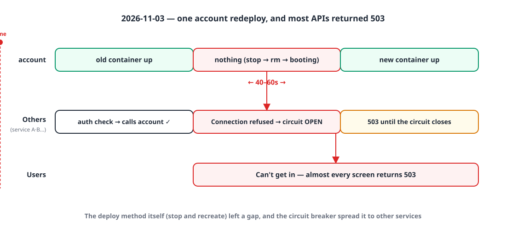

## Introduction

These days I build and run a business SaaS (10 backends, 7 web apps, 6 marketing sites) mostly on my own.
It all runs on **a single** on-prem server, which hosts dev, prd and the GitHub Actions self-hosted runner together.

Until recently, deploys worked like this:

- GitHub Actions builds a Docker image and pushes it to GHCR with a `latest-dev` or `latest-prd` tag
- **Watchtower** on the server notices the new `latest` image and recreates the container
- **Caddy** in front routes each domain and path to the container's host port

It was simple, needed no attention, and served us well for a long time.
Then one day I redeployed a single backend and **most of our services started returning 503**.

This post is about what came after: looking for a zero-downtime deploy method, picking **Kamal**, and what happened while moving 23 services × 2 environments over to it.
I hope it's useful to anyone running an on-prem server alone or with a small team.

## 1. What happened 🔥

{: width="1100" height="560" }

The problem was how Watchtower recreates containers.
It **stops** the container with that name, **removes** it, and then **runs** a new one.
A Spring Boot backend takes 40–60 seconds to start, so for that whole window the service simply doesn't exist.

Normally that just meant one service was down for about a minute. This time, the service I redeployed was the **account service**.

{: width="1100" height="520" }

Every other service checks permissions against account on every request.
For the 40–60 seconds account was gone, every one of those calls failed with `Connection refused`, the **circuit breaker on internal calls opened**, and almost every API returned 503 until it closed again.
For users, the business app was simply unreachable.

The root causes:

- The deploy method itself **creates a gap** (stop and recreate)
- It finishes **without checking whether the new container is ready** (no health check)
- Every deploy is tagged `latest`, so it's hard to tell **which version is running and what to roll back to**

So I set this goal:

> Switch traffic only **after the new version is ready**, and always be able to **roll back to the previous version**.
> And since I run this alone, **the tooling has to be simple and free**.

## 2. What were the options? 🧐

### Option 1️⃣ Build blue-green myself on the current setup

Change `deploy.sh` to start the new container on a different port, swap Caddy's upstream once its health check passes, then stop the old container.

- 👍 Keeps the Docker and Caddy we already use
- 👎 Port allocation, waiting for health checks, swapping Caddy config, rolling back on failure, locking concurrent deploys: **I'd have to build and maintain all of it myself**

I wasn't confident managing 23 services × 2 environments with a hand-written script like that.

### Option 2️⃣ Kamal

[Kamal](https://kamal-deploy.org) is a deploy tool from 37signals (the company behind Basecamp and HEY).
The server only needs Docker; the deploying side **connects over SSH and runs docker commands**.
Each server runs a small proxy called `kamal-proxy`, which **only switches traffic once the new container passes its health check.**

- 👍 Free, one config file (YAML), no management daemon living on the server
- 👍 Rollback = redeploy the previous version
- 👎 There's **one kamal-proxy per server**, so running several environments on the same server takes some care (more on that below)

### Option 3️⃣ Coolify / Dokploy

Self-hosted PaaS tools that give you a Heroku- or Vercel-like experience on your own server.
Connect a Git repo in the web UI and they handle everything from build to deploy.

- 👍 Nice UI, with zero-downtime deploys and rollback built in
- 👎 **Another management platform (database, dashboard, proxy) lives on the server**, and that platform itself needs running and backing up
- 👎 The Caddy and GitHub Actions pipeline we already have would need reworking to fit the platform's way of doing things

### Option 4️⃣ Docker Swarm

Docker's built-in orchestration; `docker service update` does rolling updates.

- 👍 Nothing extra to install, just Docker
- 👎 Containers have to be redefined as stacks and services instead of `docker run`, networks become overlay networks, and so on. **The change is large**
- 👎 Overkill for a single server, and the ecosystem has shrunk a lot

(Kubernetes / k3s crossed my mind briefly, but for one server run by one person it was far too heavy, so I ruled it out right away.)

### Side by side

| | Hand-rolled blue-green | **Kamal** | Coolify / Dokploy | Docker Swarm |
|---|---|---|---|---|
| Cost | Free | **Free** | Free (self-hosted) | Free |
| What else lives on the server | Nothing | **Just kamal-proxy** | A whole management platform | Swarm manager |
| Zero downtime · health checks | Build it yourself | **Built in** | Built in | Built in |
| Rollback | Build it yourself | **Redeploy previous version** | From the UI | `service rollback` |
| Keeps the current setup (Docker · Caddy · Actions) | ○ | **○** | △ | △ |
| Scope of change | Small (but you write it) | **Small** | Large | Large |

## 3. Why Kamal 💡

In the end I went with **Kamal**.

1. **The current setup stays almost exactly as it is.** Docker images, GHCR, GitHub Actions and Caddy all stay; Kamal only takes over "how containers get swapped".
2. **There's almost nothing new to run on the server.** The only resident is kamal-proxy, and a deploy is just an SSH session. When you run things alone, "one more system to manage" is a cost in itself.
3. **The zero-downtime mechanism is simple, so it's easy to understand and debug.**

{: width="1100" height="520" }

The new version's container starts next to the old one, and kamal-proxy waits until `/actuator/health` returns 200 before switching traffic.
The old container finishes in-flight requests (drain) and then stops.
Requests only ever go **to the container that's ready**, so there's no gap.

4. **It still works when the servers get split.** I'm planning to split dev and prd onto two servers soon, and with Kamal that only means changing the target host.

Each service's config is split into one shared file and one per-environment file.

```yaml
# deploy/kamal/deploy.account-backend.yml (shared)
service: account-backend
image: my-org/account-backend
require_destination: true

proxy:
  app_port: 8080
  path_prefix: /api/account
  healthcheck:
    path: /actuator/health
    interval: 2
    timeout: 5
drain_timeout: 30
```

```yaml
# deploy/kamal/deploy.account-backend.prd.yml (per environment)
image: my-org/account-backend   # dev uses the account-backend-dev package
servers:
  web:
    hosts:
      - <%= ENV.fetch("KAMAL_HOST_PRD") %>
    cmd: --spring.profiles.active=prd
    stop_timeout: 40
    options:
      env-file:
        - /srv/env/backend-prd
      network: app-network
proxy:
  hosts:
    - example.com
    - kamal-proxy-prd
```

On the Spring Boot side I added `server.shutdown: graceful` and `spring.lifecycle.timeout-per-shutdown-phase: 20s`, so that on a shutdown signal the app stops accepting new requests, finishes the ones in flight, and then exits.

## 4. Problems I hit while moving over 🤦🏻‍♂️

This is where the real work started.
Most examples in the Kamal docs assume "one app per server", so there was a fair amount to solve to fit my setup.

### 4-1. SSH on the server is only open over Tailscale

Kamal gets into the server over SSH.
But for security my server **only allows SSH over Tailscale (a private VPN)**, so GitHub-hosted runners can't reach it.

Luckily we were already running GitHub Actions on a **self-hosted runner**, and that runner was on the same tailnet.
So I let the runner SSH to the server by its tailnet name, and narrowed the access as much as possible:

- I created a dedicated `deploy` user, and its public key uses `from="<runner's tailnet IP>",restrict` to **limit where connections can come from and block forwarding.**
- The private key isn't stored on the server, only in a GitHub secret.
- The secret is an **Environment secret**, not a repository secret: only jobs on the `dev` branch get the dev key, and only jobs on `main` get the prd key. Jobs running on PRs or feature branches never receive a server key at all.

> **One gotcha**: our deploy job was called as a reusable workflow (`workflow_call`), and right after moving to Environment secrets every deploy failed with `Could not parse PKey`.
> When you call a reusable workflow, the caller has to pass `secrets: inherit` for Environment secrets to be visible. Running it manually (`workflow_dispatch`) worked fine, which is why I missed it at first.

### 4-2. How do services call each other?

Services used to call each other by **container name**, like `http://account-backend-dev:8080`.
But Kamal adds the version to the container name (`account-backend-web-dev-a1b2c3d`), so the name changes on every deploy.

My first idea was to attach the old name as a Docker network alias, but an alias is registered in DNS **as soon as the container starts**.
That means internal calls would go to a new container that's still booting (40–60 seconds). That's exactly how the outage happened in the first place.

{: width="1100" height="560" }

So I made **service-to-service calls go through kamal-proxy too**.
Change the environment variable to something like `BASE_URL_ACCOUNT=http://kamal-proxy/api/account`, and kamal-proxy only routes to containers that have passed their health check.
External and internal requests now follow the same rules, which actually made things simpler.

### 4-3. Running dev and prd on one server

There's **one kamal-proxy per server**.
I'd originally planned to adopt Kamal for prd when it moved to its new server, but that split was still a few weeks away, so I decided to put both dev and prd on Kamal on the current server.

The catch was that dev and prd use **the same paths** (`/api/account`).
So on top of paths, I **split the environments by Host.**

{: width="1100" height="600" }

- External requests: Caddy passes the Host (`dev.example.com` / `example.com`) through as is
- Internal requests: dev uses `http://kamal-proxy/...`, prd uses `http://kamal-proxy-prd/...`. I gave the kamal-proxy container a second network alias, `kamal-proxy-prd`, so the address you call becomes the Host

Reading the kamal-proxy source, I found something to be careful about.
When kamal-proxy looks up a route by the request's Host, it tries **the exact Host → `*.domain` → apps registered without a Host**, in that order.
So if even one app leaves `proxy.hosts` empty, it becomes the "default", and requests for the other environment whose Host doesn't match can leak into it.
I therefore **set the Host explicitly in all 46 config files**, and confirmed that a request to kamal-proxy with an unknown Host returns 404.

One more thing: Kamal's helper containers (accessories) are named `<service>-<name>`, **without the environment**. dev and prd would collide on the same server with the same names, so I prefixed the prd ones with `prd-`.

### 4-4. Something that isn't HTTP: SMTP

The mail service also accepts SMTP (465) for mail clients that log in with app passwords.
kamal-proxy only handles HTTP, so it can't do a zero-downtime switch for SMTP.
On top of that, host port 465 can only be bound by one container, so Kamal's approach of running old and new containers side by side doesn't work either.

{: width="1100" height="500" }

So I run two SMTP containers (a and b) with **HAProxy** in front.
HAProxy binds 465 and passes TCP straight through (it doesn't terminate TLS). On deploy, it **restarts a → checks the log to confirm SMTP is up → restarts b.** While one is down, HAProxy sends traffic to the other, so the port is never closed.

But behind HAProxy, the SMTP server sees the HAProxy container's IP as the client address.
We show a "last used IP" for each app password, so I couldn't just let that go.
HAProxy's `send-proxy` sends the original IP in a PROXY protocol header, and since the SMTP library we use (SubEthaSMTP) doesn't support it, I **implemented a socket that reads the header and then starts TLS** myself.

### 4-5. Scheduled jobs run twice during the overlap

A zero-downtime deploy also means the old and new containers **run side by side for a while**.
If a batch server's `@Scheduled` job fires during that window, both containers run it at the same time.
Running the 11:50 PM stock calculation or a notification send twice is bad news.

I solved this by putting a **ShedLock** lock on every scheduled job.
Why the lock lives in the database the batch server already uses, `lockAtLeastFor` to stop duplicates even when a job finishes quickly, graceful shutdown so running jobs aren't cut off, and a test so future jobs don't miss the lock: it got long enough that I wrote it up as a separate post first.

> 👉 [Stopping scheduled jobs from running twice during zero-downtime deploys with ShedLock](/posts/shedlock-scheduled-lock/)

### 4-6. Dropping the `latest` tag

To roll back, you need to know exactly *which* version you're going back to.
So I changed image tags from `latest` to **the 7-character commit hash**, and split the GHCR packages by environment (`account-backend-dev` / `account-backend`).
Now the container name alone tells you which commit is running, and rolling back is just re-running the deploy in Actions with the previous hash.

### 4-7. Monitoring relied on container names too

After the move, I opened Grafana and found **34 Service Down alerts**.
The services were fine, but Prometheus was scraping metrics from **old container names** like `account-backend-dev:8080`, and log alerts were also picking services by container-name patterns.

- Metrics scraping isn't on the request path, so here I fixed it by adding back a network alias (`<service>-<env>`).
- For logs, I build `service` and `env` labels from the labels Kamal puts on containers (`service`, `destination`), so alerts still match even though container names change on every deploy.

I learned that the fact that "container names change" hides in more places than you'd think.

## 5. How I moved over 🚚

I didn't move everything at once, but **one service at a time**. Account, the one that caused the outage, went first, and the steps were the same every time:

1. Use Kamal to start the new container **next to the old one** (the old container is still serving requests at this point)
2. On the server, call kamal-proxy directly with `curl -H 'Host: …' 127.0.0.1:11080/…` to check it
3. Point Caddy at kamal-proxy → external requests now go through Kamal
4. Change the other services' env to `http://kamal-proxy/...` and redeploy them → internal requests go through Kamal too
5. Remove the old container

Since the old container stays alive until the very end, if anything goes wrong midway I can revert Caddy and be back where I started within a second.
I moved 23 dev and 23 prd services this way, and finally deleted Watchtower and each service's `deploy.sh`.

Here's the final CI/CD:

{: width="1100" height="620" }

## 6. Results ✨

- **No more gap during deploys.** Redeploying account doesn't affect any other service.
- **Rollback is easy.** Run Kamal Deploy in Actions with the previous commit hash and it rolls back the same way.
- **There's one deploy path.** dev deploys on a dev merge, prd on a main merge, and even the monitoring containers deploy the same way (as Kamal accessories).
- **Ready to split the servers.** When the prd server arrives, I only need to point `KAMAL_HOST_PRD` at it.

## Wrapping up

Looking back while writing this, the core of the whole thing was less about the tool and more about one principle: **switch only once the new version is ready**.
Kamal was the cheapest way to add that principle to my existing setup, and every other problem (internal calls, two environments on one server, SMTP, scheduled jobs, monitoring) came from two facts: **"two versions run side by side for a while"** and **"container names change"**.

Even for a small service run by one person, a single deploy can take everything down. This time I really learned that.
I hope this helps anyone wrestling with the same thing. 🙇🏻‍♂️

> References
> - [Kamal documentation](https://kamal-deploy.org/docs/)
> - [kamal-proxy](https://github.com/basecamp/kamal-proxy)
> - [Stopping scheduled jobs from running twice during zero-downtime deploys with ShedLock](/posts/shedlock-scheduled-lock/)
> - [HAProxy PROXY protocol](https://www.haproxy.org/download/2.8/doc/proxy-protocol.txt)
