## TL;DR

- **Problem**: changing a single backend often meant a deploy of 30+ minutes. When I measured it, **44 of 73 dev deploys redeployed all 10 services**.
- **Cause**: ① the shared module every service uses (core) held **one response-code enum**, so adding a single code for a single feature redeployed all 10; ② the `chown -R` at the end of the Dockerfile produced **a fresh 145MB layer every time**.
- **Fix**: split response codes into per-service enums, deploy each image as soon as it's ready, and turn the build cache back on. Web and Flutter now build and check only the changed packages and their consumers, based on **the real dependency graph**.
- **Result**: full backend deploy **35.6 min → 13.7 min**, full CI on a dev push 15.4 min → 10.5 min. A Flutter feature PR now checks 2 packages instead of 10.

## Introduction

After [moving to zero-downtime deploys with Kamal](/posts/kamal-zero-downtime/), the gaps during deploys were gone, but now **how long deploys took** started to stand out.
I'd change one line in the backend, merge it, and often wait more than 30 minutes for it to reach dev.

I could have shrugged and said "it's probably because touching core redeploys everything", but this time I decided to **measure first**.
If you fix things without knowing where the time goes, you can't tell whether the fix worked either.

The setup:

- Backend: 10 Kotlin + Spring Boot services, a Gradle multi-module build (shared `core` + per-service `-api`/`-domain`)
- Web: 13 Next.js apps (pnpm workspace + Turborepo); mobile: 10 Flutter packages
- CI/CD: GitHub Actions self-hosted runner → GHCR → Kamal, on one server

## Where the time was going: measuring 73 runs 📏

**Deploy time was almost proportional to "how many services were deployed", and the biggest driver of that number was a single enum in the shared module.**

I kept the measurement simple. For the 73 successful dev backend deploys between 2026-10-15 and 11-08, I:

1. pulled each job's start and end times with `gh api .../runs` and `.../jobs`,
2. extracted **the changed paths** with a `git diff` between the previous successful run's commit and this one,
3. and matched up "which paths changed, and how many services got deployed".

Here's what came out:

| Metric | Value |
|---|---|
| Share of full 10-service deploys | **44 / 73 runs (60%)** |
| One full deploy (median) | **35.6 min** (image build·push 24.9 min + Kamal 9.2 min) |
| Regression | deploy time ≈ **5.9 min + 3.45 min × number of services** |
| Image push per service (median) | 55s (max 117s) |

At 3.45 minutes per service, cutting full deploys was the biggest lever. Counting the paths that triggered full deploys:

{: width="1100" height="560" }

1. **`ExceptionCode.kt` and `SuccessCode.kt` in `core`**: two enums holding 1,350 response codes. Every feature added a code, so building a feature for the approval service also redeployed the sales service.
2. **Changes to deploy pipeline files**: we were mid-migration to Kamal and editing workflows a lot. That alone caused 13 full deploys.
3. Things **in core that only some services use**, like the internal account client, the permission enum (`RoleType`) and auth configuration.

On top of that, two more costs hit every time regardless of service count. Image pushes took oddly long (more on that below), and Kamal deploys only started **after every image push had finished**, then ran one service at a time.

### Simulate before fixing

With the "changed paths" data for 73 runs, I could recompute how many services each run would have deployed under different rules (based on an average of 30.7 minutes per run).

| Change | Expected saving |
|---|---|
| Look only at each service's `src/main`; skip commits that only touch the pipeline | -12% |
| Map core contents only to the services that actually use them | -15% |
| **Split response codes per service** | **-26%** |
| All of the above + Dockerfile fix + deploy each image when ready | **-47% (16.3 min)** |

Splitting response codes was the biggest single win, and together with the rest the prediction was close to half. I fixed things in that order.

## Splitting core's response-code enum per service ✂️

**I left only interfaces in core and moved 962 codes used by a single service into an enum in that service's `-api` module.** The `code` string in the response JSON doesn't change, so neither the API contract nor the frontend types change.

```kotlin
// core: interfaces only
interface ApiResponseCode { val name: String; val httpStatus: HttpStatus; val message: String }
interface ApiErrorCode : ApiResponseCode

// account-api: codes only this service uses
enum class AccountExceptionCode(
    override val httpStatus: HttpStatus,
    override val message: String,
) : ApiErrorCode {
    USER_TRANSFER_SAME_COMPANY(BAD_REQUEST, "..."),
    // ...
}
```

`CustomException` and the response DTOs now take the `ApiErrorCode` interface instead of the enum. Only three kinds of codes stayed in core:

- Codes shared by several services
- Validation codes whose names are assembled from field names (`*_FIELD_REQUIRED`)
- Codes used by domain modules (domain modules don't have spring-web, so they can't use `HttpStatus`. That's why the service enums live in `-api`)

As a result, core went from 1,350 response codes to **388**.

My worry with scattered enums was **name collisions**. If two codes share the same `code` string but mean different things, the frontend gets confused. So each module has a `ResponseCodeNamesTest` that checks for collisions with core, and since `-api` modules don't have compile dependencies on each other, it scans the other modules' sources with a regex.

Right after merging this one PR, a full deploy went from **35.6 min → 18.2 min**. After that I did the same thing for the permission enum (into its own `:role` module), the sales service's internal client (into a `:sales-client` module), and Providers used by only one service (into that service).

> Only the account, batch and MCP services depend on the permission enum at runtime. The other services use **string constants** like `SalesRoles.ADMIN`. If a constant drifts from `RoleType` a test breaks, and even if one slips through, it fails toward "deny".

## One `chown -R` line in the Dockerfile was pushing 145MB every time 🐳

**A `RUN chown -R` after `COPY` rewrites every copied file into a new layer, so that layer is pushed fresh every time even when dependencies haven't changed.** With `COPY --chown`, a code-only deploy pushes just the 14MB application layer.

{: width="1100" height="520" }

```dockerfile
# before — the final chown -R rewrites dependencies (130MB) + app (14MB) into a new 145MB layer
COPY --from=extract /extract/extracted/dependencies/ ./
COPY --from=extract /extract/extracted/application/ ./
RUN groupadd --system --gid 10001 app && useradd ... app && \
    chown -R app:app /app

# after — create the user first and set the owner while copying
RUN groupadd --system --gid 10001 app && useradd ... app
WORKDIR /app
RUN chown app:app /app
COPY --from=extract --chown=app:app /extract/extracted/dependencies/ ./
COPY --from=extract --chown=app:app /extract/extracted/application/ ./
```

The push per service went from **55 seconds → about 4 seconds**. Across 10 services, that alone is several minutes.

In the same vein, I switched the BuildKit registry cache from `mode=max` to `mode=min`. `mode=max` also exports intermediate stages (the extract stage that unpacks the jar), but that stage's output differs on every build, so it never got reused and **exporting alone took 60 seconds**.

```yaml
- cache-to: type=registry,ref=ghcr.io/<owner>/<image>:buildcache-dev,mode=max
+ cache-to: type=registry,ref=ghcr.io/<owner>/<image>:buildcache-dev,mode=min
```

For the canary service, the docker step went from 129s to 44s, and cache export from 60s to 11s.

## Deploying each image as soon as it's ready 🚚

**I moved the Kamal deploy into a composite action, so each service's image-push job deploys right away, inside that same job, as soon as its push finishes.** Before, a deploy job ran one service at a time, only after all 10 pushes were done.

{: width="1100" height="560" }

Deploys that land on the same server at the same time are queued by the server-level `flock` we already had. So it becomes "push in parallel, deploy serially in order of arrival".

I also rewrote **the rules that decide what to deploy**. Paths fall into three groups:

```yaml
shared:   ['backend/core/src/main/**', 'backend/core/build.gradle',
           'backend/build.gradle', 'backend/docker/**']          # → full deploy
pipeline: ['.github/workflows/backend-publish-dev.yml',
           '.github/actions/kamal-deploy/**']                    # → one canary only
account-api: ['backend/account-api/**', 'backend/account-domain/**',
              'backend/role/src/main/**',
              'deploy/kamal/deploy.account-backend*.yml']         # → that service only
```

{: width="1100" height="560" }

- Even for core, only `src/main` and build files count. **Commits that only change core tests don't deploy.**
- **Commits that only change the deploy process deploy just one canary service.** One is enough to see whether the deploy script broke.
- The baseline commit is "the last successful run triggered by a **push event**". If a manual partial deploy became the baseline, any undeployed changes in between would be skipped.
- For when you really do need everything, `workflow_dispatch` takes a `modules` input (empty means all).

### Cache compilation, run tests uncached

dev pushes and the nightly CI had been running with `--no-build-cache`. The reason was "tests that break depending on the date only show up without the cache", but it meant core and domain were compiled from scratch every time.
What we actually needed was **only the tests running uncached**.

```groovy
tasks.withType(Test).configureEach {
    if (project.hasProperty('noTestCache')) {
        outputs.cacheIf { false }
        outputs.upToDateWhen { false }
    }
}
```


```yaml
GRADLE_CACHE: --build-cache
GRADLE_TEST_CACHE: ${{ github.event_name == 'pull_request' && '-PtestCache' || '-PnoTestCache' }}
```


## Web and Flutter: only what the real dependency graph says is affected 📦

**For web and Flutter, instead of path rules, "changed packages + the apps that use them" is computed from the real dependency graph the package manager already knows.** Mapping paths by hand like the backend would mean updating rules every time a workspace package is added.

For web, it follows workspace dependencies in `package.json` out to **transitive consumers**. It looks at both the previous and current graph, so a change that removes a dependency isn't missed either.

```python
while True:
    expanded = selected | {
        d["name"] for d in graph.values()
        if any(selected.intersection(d.get(k, {})) for k in DEPENDENCIES)
    }
    if expanded == selected:
        break
    selected = expanded
```

Paths that are hard to reason about (the lockfile, Turborepo config, the shared Dockerfile) trigger everything; changes to only tests or READMEs build nothing. Images are built with `turbo prune <app> --docker` so only each app's context is sent, which took the sales app's Docker context from **about 98MB → 16.7MB**.

Flutter does the same calculation from `flutter pub deps --json` and `package_config.json`. The key is not parsing pubspec files yourself.

{: width="1100" height="540" }

Once you have the graph, **how you split packages directly becomes your build scope**. The record-sharing UI was used by only 3 apps but lived in the shared `ui` package, so every change to it checked and deployed all 11 apps that use `ui`. I split it out into a `@my/records` package, cutting the impact down to 3 (and added a test that stops `ui` from re-exporting records).

| Target | Before | After |
|---|---|---|
| PR checks when a Flutter feature package changes | 10 packages | **2** (feature + shell) |
| Apps affected by a record UI change | 11 | **3** |
| Web app Docker context (sales app) | ~98MB | **16.7MB** |
| Push unrelated to any app (only `.gitignore` changed) | Full mobile build | **Skipped in 16s** |

## Traps I fell into 🪤

**KSP silently left out some QueryDSL Q classes, and that went into the build cache.** After turning the build cache back on, builds with the same inputs kept failing like this:

```text
e: Unresolved reference 'Q…'
```

It seems to happen when KSP runs concurrently in the same daemon under `--parallel`, but the real problem was that **an incomplete output that finished without errors got stored in the cache**. Once it's in there, the same inputs keep pulling that output back. I made KSP tasks non-cacheable (`outputs.cacheIf { false }`) and turned KSP off for modules without entities. It costs a few seconds to 20 seconds per module, in exchange for no more unreproducible failures.

**Korean file names come out quoted from `git diff --name-only`.** When they're C-style escaped like `"app/\355\225\234..."`, they don't match `startswith("app/")` and silently drop out of the check. I switched to `-z` and split on NUL.

```python
changed = check_output(
    ["git", "diff", "--name-only", "--no-renames", "-z", merge_base, "HEAD"]
).split("\0")
```

**The GitHub API's `status=success` filter once returned a run from weeks earlier.** If the baseline jumps back weeks, every change since then counts as "changed" and you get a full deploy. I now fetch recent runs without the filter and pick the right one in `jq`.

## Results ✨

| Measurement | Before | After |
|---|---|---|
| Full deploy of all 10 backends | 35.6 min (median) | **13.7 min** |
| Full CI on a dev push | 15.4 min (median) | **10.5 min** |
| Image push per service | 55s | **about 4s** |
| Full deploy of all 13 web apps | 32.4 min (median, 6 runs) | 19 min (1 run) |
| Whole Android AAB job | 19 min | 11 min 26s (1 run) |

Step by step: 18.2 minutes after splitting response codes, 15.9 after the build cache, 13.7 after cleaning up core. That's a bit better than the simulation predicted (16.3 minutes).

That said, these numbers **aren't from a controlled experiment**. Most "after" values are single observations, and runner load and cache state weren't the same. The web comparison in particular only matched the number of apps and was the first run filling a fresh cache, so I'm deliberately not quoting it as something like "41% faster". Repeated measurements are something to build up from here.

There's still work left. The internal account client is still in core (9 modules use different methods of it) and needs splitting per consumer, and PR CI and deploy jobs sharing the same runner's Gradle cache will only be solved with a dedicated deploy runner.

## Summary

- If deploys are slow, first **pair run history with `git diff`** and count "what changed, and how many services got deployed". For me it was one enum in a shared module.
- In a monorepo, **what you put in shared modules is your deploy scope**. Code used by one service belongs in that service.
- In a Dockerfile, replace `chown -R` after `COPY` with `COPY --chown`. Otherwise the whole layer gets rewritten.
- If you need "tests without cache", don't turn off the whole build cache; take **only the Test tasks** out of it.
- For impact analysis, **the package manager's real dependency graph** ages better than hand-written path rules.

> References
> - [Zero-downtime deploys on an on-prem server with Kamal](/posts/kamal-zero-downtime/)
> - [Docker — COPY --chown](https://docs.docker.com/reference/dockerfile/#copy---chown---chmod)
> - [Docker — Cache storage backends (mode=min/max)](https://docs.docker.com/build/cache/backends/)
> - [Gradle — Build Cache](https://docs.gradle.org/current/userguide/build_cache.html)
> - [Turborepo — prune](https://turborepo.com/docs/reference/prune)
