## TL;DR

- **Problem**: deploys were automated with Kamal, but env was still **a file on the server**. We edited it with vi on the server, so nobody could tell which copy was the source of truth, the local copy was stale, and sometimes someone changed env and forgot to redeploy.
- **Fix**: each GitHub Environment holds **the whole env file as one Secret (a bundle)**. The deploy job validates that bundle, atomically rewrites the server file, and then runs `kamal deploy`.
- **Safeguards**: values never end up in any log; on failure, only **a line number and a fixed category code** are logged. On the first cutover, the bundle is compared with the old server file, and if they differ the deploy stops **before any container is swapped**.
- **Result**: in both dev and prd, 10 backends, 13 web apps and monitoring all deploy from bundles. Splitting dev and prd onto separate servers only means changing one Variable (`KAMAL_HOST`).

## Introduction

I [moved to zero-downtime deploys with Kamal](/posts/kamal-zero-downtime/) and [cut deploy time](/posts/monorepo-deploy-time-reduction/).
But one part of the deploy process was still done by hand: **env files**.

The `env-file:` in our Kamal config pointed at files on the server like `~/app/env/app-backend-dev`, and changing a value meant SSHing in, editing it with vi, and redeploying.

- Since we edited on the server, **nobody knew where the source of truth was**. The local web env had 9 keys; the real file on the server had 43.
- Change env but **forget to redeploy**, and nothing changes. We actually had an outage once because someone forgot to restart the marketing site.
- Deploy keys were scattered across Repository Secrets with `_DEV` and `_PRD` suffixes.

So I set this goal:

> The single source of truth for env is GitHub. Change it, and the next deploy applies it.
> But **no separate Secret per key**. One env file = one Secret.

Avoiding per-key Secrets was simple: there are dozens of keys, so registering and changing them is tedious, and the workflow would have to list every key name, meaning every new key would also require a workflow change.

## The whole env file as one Environment Secret 🔐

**I created two GitHub Environments, dev and prd, and gave both a Secret with the same name, so "which Environment the job runs in" decides the value.** The workflow only needs the name; it doesn't tell environments apart by suffix.

{: width="1100" height="580" }

| Environment (deployment branch rule) | Secrets | Variables |
|---|---|---|
| `development` (dev branch only) | `BACKEND_ENV`, `FRONTEND_ENV`, `MCP_LINK_ENV`, `LIVEKIT_ENV`, `APP_ENV`, `KAMAL_SSH_KEY`, `KAMAL_KNOWN_HOSTS`, `AWS_S3_BUCKET` | `KAMAL_HOST` |
| `production` (main branch only) | Same as above + `MONITORING_ENV` | `KAMAL_HOST` |

The bundle format is plain `KEY=VALUE` lines. **It's never executed by a shell** (no `source`), so `$` and quotes never get interpolated or re-encoded.

With a deployment branch rule on the Environment, only jobs running on main can read prd Secrets. As a bonus, I generated fresh deploy keys for each environment (the original private key for the old one no longer existed anywhere).

## How the deploy job rewrites the server env file 🔁

**The deploy job validates the bundle, masks the values, sends it to the server over SSH stdin, writes it to a temp file and swaps it in atomically with `rename`. Then it runs `kamal deploy`.** Kamal itself is unchanged; it just reads the server's `env-file` as before.

{: width="1100" height="600" }

1. Take a server-level `flock`. dev and prd still share a server, so deploys queue up in a single line.
2. Create `known_hosts` and the SSH config in a `umask 077` temp directory, removed by a `trap` at the end.
3. `sync.py` parses and validates the bundle, and registers every value with `::add-mask::`.
4. Wrap the bundle in JSON and send it **over SSH stdin**. No values are in the command-line arguments (argv), and SSH's stdout and stderr are discarded.
5. On the server, `remote_sync.py` writes a temp file in `~/.app-env/` (directory 700, files 600, symlinks rejected) and swaps it in with `os.replace`.
6. `kamal deploy`. The bundle environment variables are not passed to Kamal's child processes.

```bash
# Kamal only needs the server file. Strip the variables holding bundles from the child process
kamal() {
  env -u BUNDLE -u MCP_LINK_BUNDLE -u APNS_AUTH_KEY_P8 -u LIVEKIT_BACKEND_BUNDLE kamal "$@"
}
```

On the Kamal side only the paths changed. `.kamal/secrets` holds just two lines, the registry password and the SSH key; app env goes through the server file instead of Kamal's `env.secret`.

```yaml
servers:
  web:
    options:
      env-file:
        - /home/deploy/.app-env/app-backend-dev
        - /home/deploy/.app-env/mcp-link-dev
ssh:
  key_data: [KAMAL_SSH_KEY]
  keys_only: true
```

I didn't use `env.secret` because it requires listing every key name in the Kamal config, the same reason I avoided per-key Secrets.

One thing to remember: **`env-file` is only read when a container is created**. If you only change a Secret, you have to redeploy the same version for it to take effect. Fortunately that redeploy is zero-downtime too, so it's no big deal.

### The web apps need env at build time

Next.js **bakes `NEXT_PUBLIC_*` values into the image at build time**. So for the web apps the server file isn't enough; the build needs env too.

The bundle is written to a file outside the build context (`$RUNNER_TEMP`) and passed only to the build stage through a BuildKit secret mount. It never ends up in an image layer, and an `always()` step deletes it after the build.

```dockerfile
# mount the secret at the app's .env only for the duration of the build, then delete any .env copied into the standalone output
RUN --mount=type=secret,id=frontend_env,target=/app/apps/${APP}/.env,required=true \
    pnpm run build && find .next/standalone -name '.env*' -delete
```

The catch is that **the secret's contents aren't part of BuildKit's cache key**. Change the Secret, and if the cache still matches, the build is skipped and you get an image with the old values baked in. So `no-cache-filters: builder` forces the build stage to always rerun, and I split the Dockerfile into a dependency stage and a build stage to keep the `pnpm install` cache.

## Hide the values, keep the failure reason 🕵️

**Logs contain no values, and nothing that could be a value. Instead, they record "which line, and what kind of failure" as a fixed code.** At first I was so worried about leaking values that I didn't even report where a failure happened, and then when something failed there was nothing I could fix.

### Bundle validation: only line numbers and allowlisted key names

The bundle parser is fairly strict:

- Rejects control characters, CRLF, an `export` prefix, and whitespace around `=`
- Keys must match `^[A-Za-z_][A-Za-z0-9_]*$`; rejects empty bundles and **duplicate keys**
- Rejects web values with leading/trailing whitespace or `$ # ' " \` (Next's dotenv and Docker interpret these characters differently)
- For app config bundles, checks that URLs point to **that environment's exact host** → a dev address in a prd bundle is rejected

Error messages include the line number, but include the key name only if it's on **an allowlist of names that are safe to show**. If a line is malformed, the key position might actually contain a secret value.

```python
if key in result:
    label = f' {key}' if key in DIAGNOSTIC_KEYS else ''   # print only allowlisted names
    raise BundleValidationError(
        f'line {line_number}: duplicate variable name{label}; '
        f'first defined at line {first_lines[key]}')
```

This paid off right away. All 13 web dev deploy jobs failed at the env step at once, with no clue at first; only after adding line numbers did this message show up:

```text
line 51: duplicate variable name NEXT_PUBLIC_..._WS_URL; first defined at line 46
```

I'd added the same key twice while editing the Secret in the GitHub UI.

### Failures as fixed category codes

Kamal output and server-side sync failures are thrown away and replaced with **a single category code**.

```text
::warning::Kamal deploy failed (exit 1); category=SSH_HOST_KEY_UNKNOWN; command and error text suppressed
::error::Environment sync failed: LEGACY_VALUE_MISMATCH
```

The server script reports the reason through its exit code.

```python
class RemoteStatus(IntEnum):
    SYMLINK_REJECTED = 40
    UNSAFE_TARGET_DIRECTORY = 41
    LEGACY_FILE_MISSING = 44
    LEGACY_KEY_MISSING_FROM_BUNDLE = 46
    LEGACY_VALUE_MISMATCH = 47
    REMOTE_PERMISSION_DENIED = 48
    # ...
```

Kamal output is mapped to one of 20-odd categories such as `SSH_HOST_KEY_MISMATCH`, `SSH_AUTHENTICATION_FAILED`, `HEALTHCHECK_FAILED` and `CONTAINER_BOOT_FAILED`, falling back to `UNCLASSIFIED_KAMAL_ERROR` if none fits.
Before the codes, all 13 jobs just said `Environment sync failed`, so there was no telling whether the cause was server permissions or the bundle format.

## First cutover: stop before swapping containers if the old server values differ 🛑

**If the new path has no file yet and the old server file exists, the bundle and the old file are compared in memory, and the deploy stops if a key is missing or a value differs.** This makes sure a mistake while registering the bundle can't swap production containers onto wrong values.

{: width="1100" height="600" }

```python
def verify_legacy(path, selected, *, allow_value_changes=False):
    values = parse_legacy(path)
    for key in values:
        if key not in selected:
            raise SyncRejected(RemoteStatus.LEGACY_KEY_MISSING_FROM_BUNDLE)
    if not allow_value_changes and any(selected[k] != v for k, v in values.items()):
        raise SyncRejected(RemoteStatus.LEGACY_VALUE_MISMATCH)
```

- If neither the old file nor the new file exists (a new server), the file is created from the bundle alone.
- If the new file already exists, there's no comparison. From then on, the bundle is the source of truth.

And it did catch something. **The first deploys of the 13 prd web apps and monitoring stopped with `LEGACY_VALUE_MISMATCH`.** The image builds had succeeded, and it stopped right before swapping containers, so the services weren't affected at all.

I had one rule here: **never delete the old file or loosen validation just to get past the comparison.** Instead, a human decided which side was right. For monitoring, the GitHub Secret was the newer one. For web, the local prd env file was the source, so I checked it without printing any values (43 keys, 6 required keys, no dev addresses) and re-registered it as the Secret.

Then I built a separate manual adoption workflow that "accepts only value differences".

```yaml
on:
  workflow_dispatch:
    inputs:
      frontend:   { type: boolean }
      monitoring: { type: boolean }
jobs:
  adopt:
    if: github.ref == 'refs/heads/main' && (inputs.frontend || inputs.monitoring)
    environment: production
    env: { KAMAL_ADOPT_LEGACY_VALUES: 'true' }
    steps:
      - name: Require production publishers to finish   # abort if a deploy is in progress
      # ...
      - run: python3 deploy/env/sync.py frontend prd
```

- Adoption mode only turns on for main, prd, a manual run, and web or monitoring.
- All it allows is **differing values**. Missing keys, missing files, symlinks and permission problems still fail.
- It doesn't delete the old file or restart any container. It only writes the file to the new path.
- **It stops if a deploy is in progress.** A deploy job that started with the old Secret mustn't overwrite the file that was just adopted. The first attempt did in fact stop at this step; I reran it after the deploy finished and it passed.

## Pinned the SSH host key, still got `SSH_HOST_KEY_UNKNOWN` 🔑

**SSHKit looks for the intersection of keys registered under both the `hostname` and the `IP`, so a perfectly valid pin registered under the hostname alone was treated as an "unknown key".** I fixed it by pinning the lookup name with `HostKeyAlias`.

I'd made host key verification strict (`StrictHostKeyChecking yes`) and put the key in the `KAMAL_KNOWN_HOSTS` Secret under the registered hostname. Then all 10 dev backends failed at the Kamal step. There were no category codes yet, so the log said nothing; only after adding the categories did I see it was `SSH_HOST_KEY_UNKNOWN`.

{: width="1100" height="520" }

With Kamal 2.12 / SSHKit 1.25 / Net::SSH 7.3, SSHKit looks up known_hosts with `hostname,IP` and only accepts **keys present under both**. If the key is registered under the hostname only, the intersection is empty and you get unknown.

Rather than loosen verification, I generate an SSH config that pins the lookup name to the registered hostname and hand it to Kamal.

```bash
printf 'Host *\n  HostKeyAlias %s\n  StrictHostKeyChecking yes\n  UserKnownHostsFile %s\n  GlobalKnownHostsFile /dev/null\n  ForwardAgent no\n' \
  "$host" "$ssh_dir/known_hosts" > "$KAMAL_SSH_CONFIG"
```

```yaml
ssh:
  config: <%= ENV["KAMAL_SSH_CONFIG"] ? ENV["KAMAL_SSH_CONFIG"].inspect : "false" %>
```

After the fix, I reproduced four cases offline (unknown before the fix, a correct pin passing after it, a different key giving mismatch, an unregistered host giving unknown) to confirm **it's just as strict as before**.

## Results and what's left ✨

- In both dev and prd, 10 backends, 13 web apps and monitoring deploy from bundles. Since then I've moved the MCP link config, the LiveKit config YAML and the APNs key (`.p8`) over the same path.
- There's now one way to change env: **edit the Secret in GitHub → redeploy**. No more SSHing into the server.
- When something fails, not a single value is visible, yet **which line and what kind of failure** is obvious at a glance.
- Splitting dev and prd onto separate servers only means changing the Environment Variable `KAMAL_HOST`.

A few caveats I learned along the way:

- If you change a web Secret and then only rerun the failed jobs (Re-run failed jobs), **the old image gets deployed as is**. Public config is baked in at build time, so you must rebuild everything.
- If you forget `secrets: inherit` when calling a reusable workflow, Environment Secrets come through empty and every deploy fails.

What's left: cleaning up the old `~/app/env` directory (after confirming nothing references it with a read-only audit script), deleting unused Repository Variables and Secrets, and splitting dev and prd onto separate servers.

## Summary

Q. If I manage env files with GitHub Secrets, do I need a Secret per key?
A. No. Put the whole env file in one Secret and have the deploy job parse, validate and write it to the server file. Adding a key doesn't require touching the workflow.

Q. How do I keep dev and prd values apart?
A. Create two GitHub Environments with a Secret of the same name in each, and the value depends on which Environment the job runs in. Add a deployment branch rule so prd Secrets can only be read from main.

Q. How can I find out why something failed without logging Secret values?
A. Print only line numbers, allowlisted key names and fixed category codes instead of values. On a malformed line the key position might hold a value, so don't print key names carelessly either.

Q. I added known_hosts for Kamal and still get `SSH_HOST_KEY_UNKNOWN`.
A. It may be because SSHKit looks up keys by the intersection of `hostname,IP`. Add `HostKeyAlias <registered hostname>` to the SSH config to pin the lookup name.

> References
> - [Zero-downtime deploys on an on-prem server with Kamal](/posts/kamal-zero-downtime/)
> - [Measuring and cutting monorepo deploy time, from a 35-minute full backend deploy to 13](/posts/monorepo-deploy-time-reduction/)
> - [GitHub — Managing environments for deployment](https://docs.github.com/en/actions/managing-workflow-runs-and-deployments/managing-deployments/managing-environments-for-deployment)
> - [Kamal — SSH configuration](https://kamal-deploy.org/docs/configuration/ssh/)
> - [Docker — Build secrets](https://docs.docker.com/build/building/secrets/)
