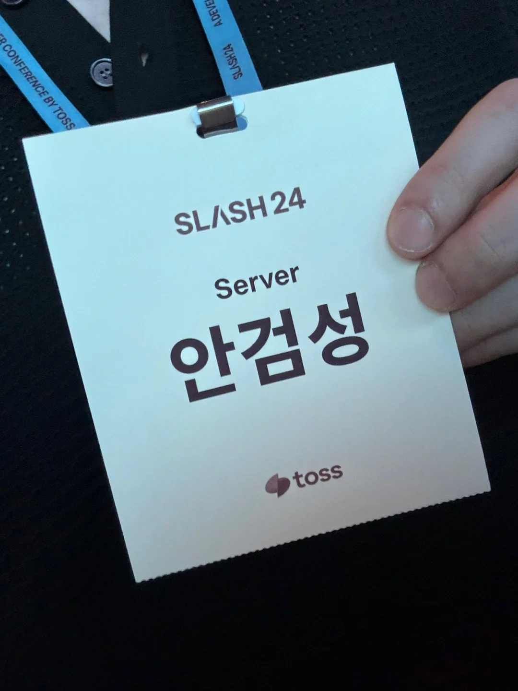
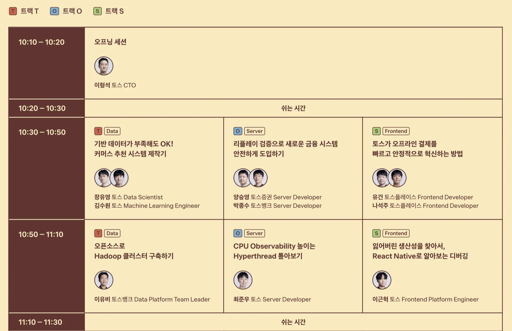
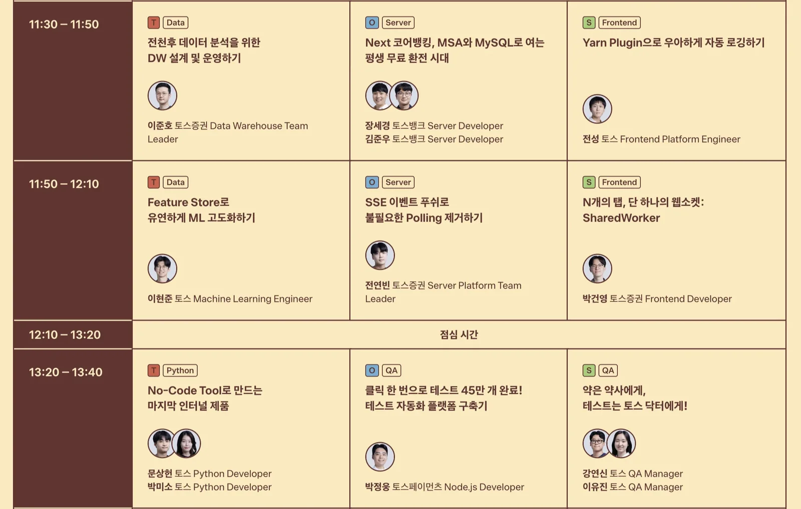
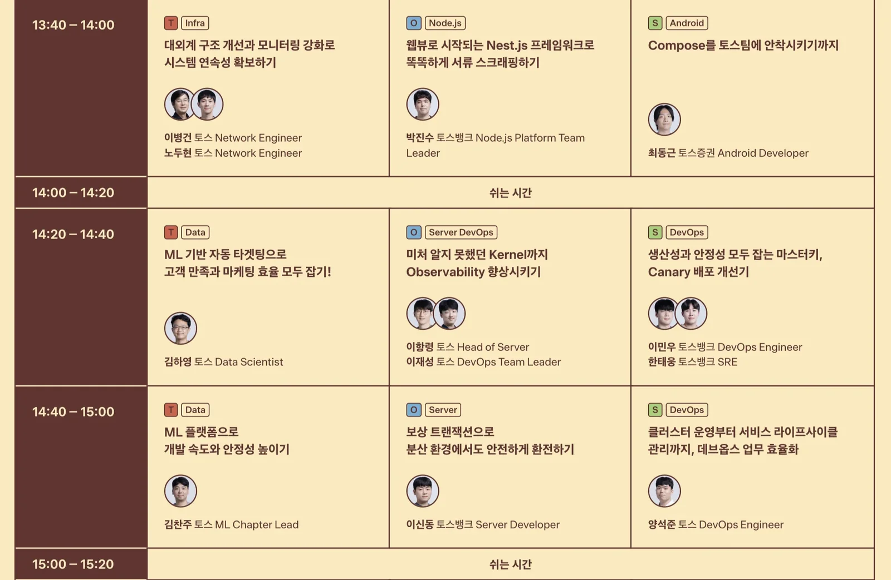
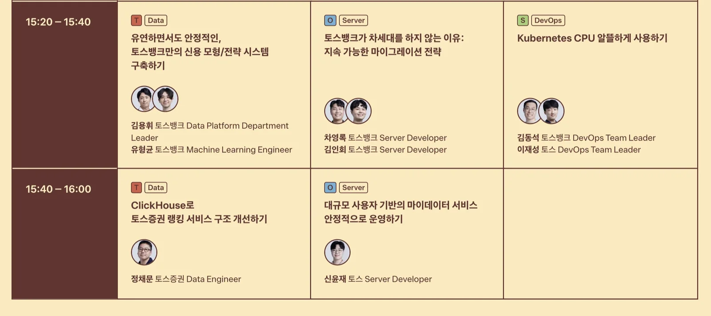
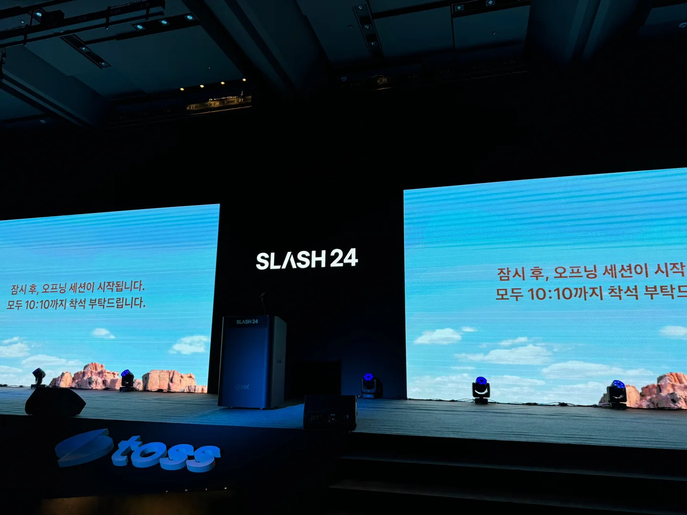
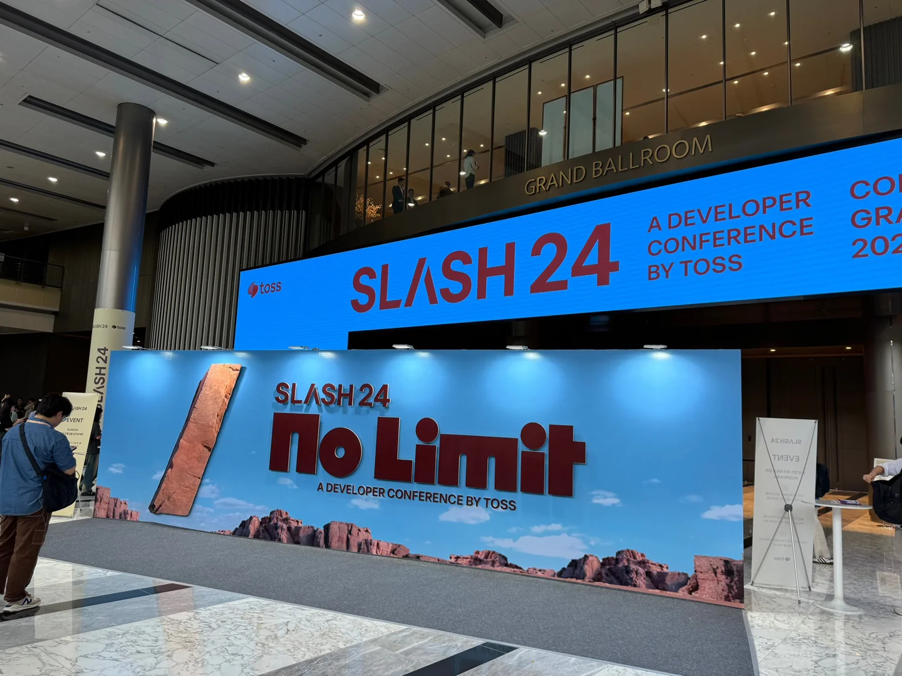

## Introduction

Toss is one of Korea's biggest fintech companies; it started as a money-transfer app and now runs a bank (Toss Bank), a brokerage (Toss Securities) and more. SLASH is its annual engineering conference, and seats are given out by lottery. This year I got lucky and won one for SLASH24!

{: width="1080" height="1440" }

These are notes on the topics I found interesting in the server sessions and what I took from them. I wrote up three sessions in detail:

| # | Session | Speakers | Key idea |
|---|---|---|---|
| 2 | Safely rolling out a new financial system with replay verification (리플레이 검증으로 새로운 금융 시스템 안전하게 도입하기) | Seungyoung Yang, Jongsu Park | Automating migration checks with Read/Write Verifiers |
| 3 | Next-gen core banking: free currency exchange for life with MSA and MySQL (Next 코어뱅킹, MSA와 MySQL로 여는 평생 무료 환전 시대) | Sekyung Jang, Junwoo Kim | MySQL instead of Oracle, transactions in the application layer |
| 4 | Safe currency exchange in a distributed system with compensating transactions (보상 트랜잭션으로 분산 환경에서도 안전하게 환전하기) | Shindong Lee | Orchestration Saga and compensating transactions |

## 1. Timetable 🕐

I'm a server developer, so naturally I hit subscribe hard on the server track.

{: width="1600" height="1034" }

{: width="1600" height="1018" }

{: width="1600" height="1043" }

{: width="1600" height="713" }

## 2. Safely rolling out a new financial system with replay verification 🔁

> Speakers: Seungyoung Yang, Jongsu Park

This talk was about moving a huge monolithic ledger written in C to a Kotlin-based MSA ledger. Since it's a migration, the core constraint is that the API specs, DB schema and main business logic all have to stay the same.

Looking for ways to make the migration easier, they automated **testing, verification and checking**, and the heart of that automation was the **Read Verifier** and the **Write Verifier**.

### Read Verifier

1. A request comes in through the Gateway, and the existing C monolith responds.
2. When the monolith's response arrives, the Gateway sends the request and response to the Verifier via Kafka.
3. The Verifier sends the same request to the Kotlin MSA server and gets its response.
4. Finally, the Verifier checks whether the two responses match and records the result.

### Write Verifier

1. When a request reaches the Gateway, the Kotlin MSA server intercepts it.
2. The MSA server saves its processing result, converts its CUD queries into read queries, and saves those too.
3. The MSA server rolls back the transaction and responds to the Gateway.
4. The Gateway sends the request to the existing monolith and gets its response.
5. The Gateway responds to the client and asks the Verifier to verify.
6. The Verifier pulls the processing result and read queries from Redis and compares them with the data actually written to the DB.

You could also run two full copies of the DB and compare the data, but they said storing and maintaining that data is costly. And because the Write Verifier runs synchronously and would affect the live service, they only ran it in the development environment.

> They collected queries with [P6Spy](https://github.com/p6spy/p6spy) and used [ANTLR](https://github.com/antlr/antlr4) to parse CUD queries and turn them into read queries.
{: .prompt-tip }

### Supporting tools

To make verification accurate, they built an admin feature for reviewing verification history, plus a bot that reports periodically so edge cases get noticed.

### What I took away

- A migration gets much safer when you can automatically compare "does the same request get the same response?"
- Write verification can be done without actually writing: roll back, then turn the writes into read queries and compare the results.

## 3. Next-gen core banking: free currency exchange for life with MSA and MySQL 🏦

> Speakers: Sekyung Jang, Junwoo Kim

Like other banks, Toss Bank was using Oracle for its stability. Oracle brings reliability, stability, scalability, performance and decades of accumulated know-how. But it has a single point of failure, it's expensive, and scaling out is limited.

So, to replace Oracle, Toss Bank decided to manage transactions efficiently with application-layer techniques like Redis distributed locks and the Saga pattern over Kafka.

When they were planning a foreign-currency service, they decided to build it on MySQL instead of Oracle. The key piece is the **transaction architecture**. The talk used the money flow of a currency exchange as the example; an exchange request passes through these servers:

| Server | How it's handled |
|---|---|
| FX server | Receives the customer's request and responds |
| KRW deposit server | Synchronous (withdraw KRW) |
| Foreign-currency deposit server | Synchronous (deposit foreign currency) |
| P&L server | Async via Kafka |
| Accounting server | Async via Kafka |

### The exchange request transaction

1. The customer sends an exchange request to the FX server.
2. The FX server asks the KRW deposit server to withdraw won and gets a response.
3. The FX server then asks the foreign-currency deposit server to deposit the foreign currency and gets a response.
4. The FX server responds to the customer.
5. The servers after that handle internal accounting, so they're processed asynchronously via Kafka.

Done the old way, this whole process would have been wrapped in a single transaction, and exchanges would have been very slow.

### What I took away

- Keep only the steps the customer's response actually needs in the synchronous path and split internal processing off asynchronously, and the transaction scope shrinks.
- Moving the transactional guarantees a DB used to provide into the application layer (distributed locks, Saga) is a real option.

## 4. Safe currency exchange in a distributed system with compensating transactions 💱

> Speaker: Shindong Lee

This talk was also about the currency exchange service, and its core was **compensating transactions**.

### 2PC vs Saga

**Two-Phase Commit (2PC)**

- A coordinator asks two or more servers whether they can commit (voting), and the servers reply.
- If every server acks, i.e. agrees to commit, the commit goes ahead.

**Saga pattern**

- Run each service's small transactions one after another.
- If a step fails, run compensating transactions.

|     | 2 Phase Commit | Saga |
| --- | --- | --- |
| Pros | Strong consistency | High availability High scalability |
| Cons | Low availability Low scalability | Intermediate states are visible Compensating transactions must be implemented |

The speaker's team chose the Saga pattern. There are two flavors of Saga:

- **Choreography Saga**: messages are delivered to each service through a message broker.
- **Orchestration Saga**: one server acts as the orchestrator and sends messages to the others, master/slave style.

They had an exchange server that could take on the orchestration role, so they went with Orchestration Saga. In other words, the exchange server, as orchestrator, talks to the KRW account server and the foreign-currency account server.

### Implementing exchange with Saga

1. When an exchange request arrives, the exchange server sends a withdrawal request to the KRW account server.
2. On a successful withdrawal response, it sends a deposit request to the foreign-currency account server.

### Compensating transactions

An exchange has to handle failed deposits and withdrawals, whether the failure is expected or not. That's where compensating transactions come in. Deposits and withdrawals can fail for reasons like these:

| Expected failures | Unexpected failures (errors) |
| --- | --- |
| Insufficient balance Balance certificate being issued Account closed Customer/account transaction restrictions | Server error (5XX response/timeout) Network error Message produce/consume failure |

A compensating transaction kicks in like this:

1. The exchange server sends a withdrawal request to the KRW account server and gets a success response.
2. It sends a deposit request to the foreign-currency account server, which fails.
3. It runs a compensating transaction on the KRW account server: re-depositing the amount withdrawn in step 1.

Steps 1 and 2 are synchronous over HTTP, but to send the failure response to the client quickly, the withdrawal cancellation is handled asynchronously via Kafka. All it has to guarantee is balance consistency, so they chose Kafka messaging.

> The withdrawal must come first, not the deposit. Suppose you deposit the foreign currency first and then the KRW withdrawal fails, so you need to cancel the deposit. If a card company's charge comes in between and spends that foreign currency, cancelling the deposit can push the foreign-currency account negative.
{: .prompt-warning }

### What I took away

- Order matters in compensating transactions. Do the step that's safe to undo (the withdrawal) first.
- You can return failures fast and run the compensation asynchronously while still keeping things consistent.

## 5. Other sessions 📝

Honestly, every talk was gold, but some were beyond what I could fully digest. I'll leave the next two as keywords.

### Improving observability all the way down to the kernel (미처 알지 못했던 Kernel까지 Observability 향상시키기)

> Speakers: Hangryeong Lee, Jaeseong Lee

This was a very low-level talk about going down to the kernel to analyze how computing resources are used so they can be used more efficiently, and it was really impressive. The keywords I took away:

- eBPF helps with kernel analysis.
- Page faults eat up a lot of time.
- NUMA lets you monitor memory access.
- iptables turned out to be a problem, so they switched to IPVS.

### Reliably running a MyData service with a huge user base (대규모 사용자 기반의 마이데이터 서비스 안정적으로 운영하기)

> Speaker: Yoonjae Shin

The last talk covered circuit breakers. (MyData is Korea's open-banking-style program that lets users pull their financial data from other institutions into one app.) The keywords I took away:

- They built a Coordinator to manage outbound traffic.
- They used a circuit breaker called Resilience, but it had problems.
- They implemented the circuit breaker as a separate server.

## 6. Photos from the event 📸

{: width="1440" height="1081" }

{: width="1440" height="1081" }

## Wrap-up

Compared with conferences I'd been to before, I understood quite a lot more this time. I could feel proud of how much I've grown... but mostly it was a reality check. Toss really does have a lot of masters. Hearing about the trial and error they went through and how relentlessly they dug into problems turned into a good dose of self-reflection.

- A legacy migration can be made safe with automated verification that sends the same requests to both systems and compares the results.
- Keep only what the customer's response needs inside a synchronous transaction, and split the rest off asynchronously.
- In a distributed system, Saga and compensating transactions are an alternative to 2PC, and in compensation, order is everything.
- I felt two things at once: I can follow more talks now, and there's far more beyond that left to dig into.

> References
> - SLASH24 - Toss
{: .prompt-info }
