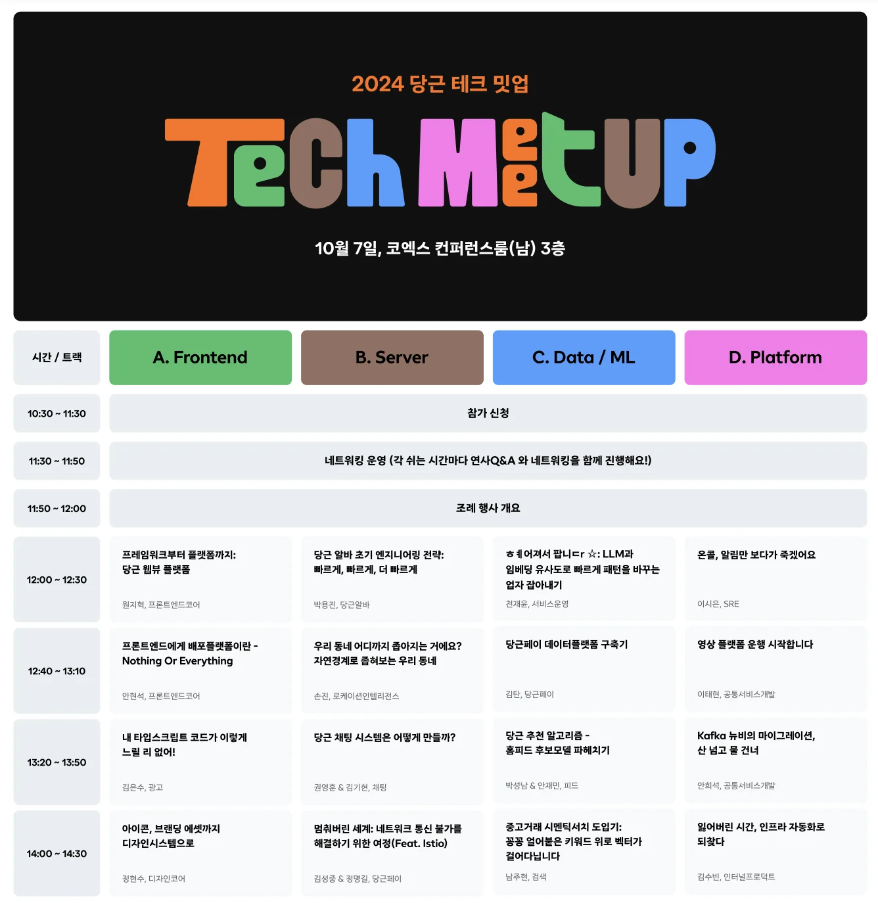
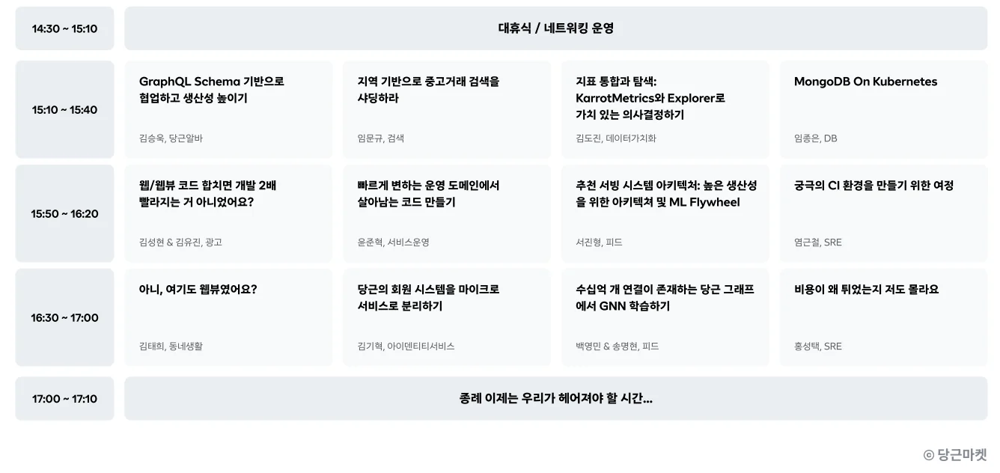
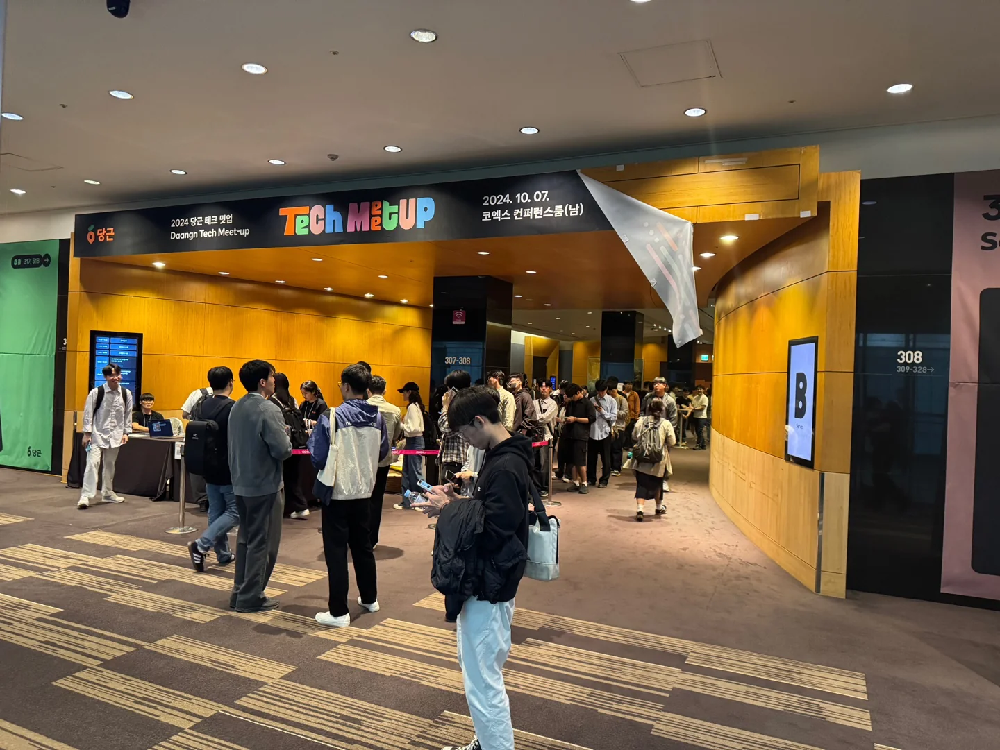
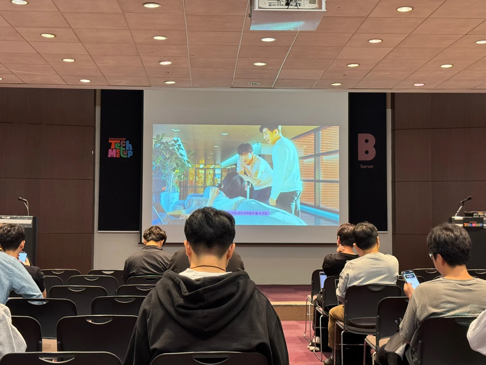
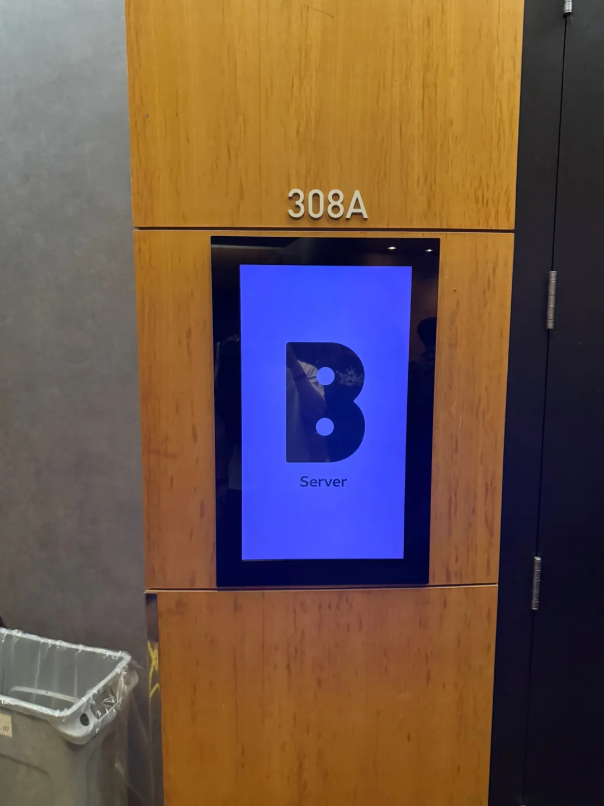

## Introduction

Daangn (known as Karrot outside Korea) is Korea's hyperlocal marketplace app, where neighbors buy and sell secondhand goods, find part-time work and chat. After the Toss conference earlier this year, I also won a seat at Daangn's tech meetup! 🕺🏻

The meetup ran talks and networking sessions side by side, and I joined two of the networking sessions.

{: width="1080" height="1440" }

These are the sessions I wrote up:

| Type | Session | Speakers |
|---|---|---|
| Talk | Daangn Alba's early engineering strategy: fast, faster, even faster (당근알바 초기 엔지니어링 전략: 빠르게, 빠르게 더 빠르게) | Yongjin Park |
| Talk | How do you build Daangn's chat system? (당근 채팅 시스템은 어떻게 만들까?) | Younghoon Kwon, Kihyun Kim |
| Talk | The world stood still: a journey to fix a network outage (feat. Istio) (멈춰버린 세계: 네트워크 통신 불가를 해결하기 위한 여정(Feat. Istio)) | Seongjong Kim, Myeonggil Jeong |
| Networking | Daangn Pay Money Service team | Winter, William |
| Networking | Daangn Pay Account Service team | Woods |

## 1. Timetable 🕐

{: width="1336" height="1374" }

{: width="1336" height="632" }

## 2. Daangn Alba's early engineering strategy: fast, faster, even faster 🏃

> Speaker: Yongjin Park

Daangn Alba is Daangn's part-time job service. Early on, the team had to build the product really fast and analyze it at the same time, which gave them a lot to think about.

### The cost of data analysis

They defined the cost of data analysis in two parts:

- the engineering cost of making analysis possible
- the cost of doing the analysis itself

Analysis normally means extracting existing data and building separate datasets for it, which is a hassle. So instead of extracting data, they used an event-based analytics service. Its advantages:

- No separate storage needed for analysis.
- Data gets stored simply by calling an API at whatever point you want.
- You combine data intuitively on the web instead of in SQL.

### The productivity analysis bought them

- Seeing user feedback quickly lowered the cost of deciding on hypotheses and experiments.
- The understanding of users built up from analysis made communication within the team more efficient.

The tip here: have one person, not two, be both the one asking for an analysis and the one doing it, which removes the needless communication overhead around analysis.

## 3. How do you build Daangn's chat system? 💬

> Speakers: Younghoon Kwon, Kihyun Kim

Daangn's chat system is made of three main components:

- chat server
- push server
- database server

### 1:1 chat

With a single server, the flow looks like this:

1. A user connects to the chat server.
2. The chat server stores the User ID and User Session ID as a key-value pair.
3. The user sends a message to the chat server.
4. The server looks up the recipient's User Session ID by their User ID and delivers the message.

With two or more servers, users may be connected to different servers, so the recipient's session ID may not be in the local memory of the server you're on. There are two ways to solve that:

- Use shared memory to store the IP of the server each user is connected to.
- Do Pub/Sub keyed on user ID.

Once you're past 10 servers, the servers end up in a mesh of connections, complexity grows and scaling gets harder. So they use a message queue. When a message arrives it goes into the queue, and a consumer builds a message relay request that delivers it, asynchronously.

| Number of servers | Finding the session |
|---|---|
| 1 | Key-value in the server's local memory |
| 2 or more | Shared memory (connected server IP) or Pub/Sub by user ID |
| 10 or more | Message queue + asynchronous message relay by consumers |

### Push notifications

- **User not connected**: if the key-value lookup comes back empty, send the message to the push server.
- **Stale data (no user session on the server)**: if the key-value entry is wrong, delete it from the key-value store and send the request to the push server.

### Group chat

Reusing the same structure, a group chat with 1,000 users would have the consumer send 1,000 requests to the servers. So they batch user IDs together. Sending them all in one batch can cause problems like timeouts, though, so they built it to process in chunks.

## 4. The world stood still: a journey to fix a network outage (feat. Istio) 🌐

> Speakers: Seongjong Kim, Myeonggil Jeong

### Losing DB and Redis connections

As traffic grew, DB and Redis connections started dropping.

**Suspected causes**

- Application thread exhaustion
- Longer JVM GC pause times
- Redis or database failures
- AWS maintenance
- CoreDNS failures

**What they did**

1. Internal Service Segregation
2. Event Streaming Pattern
3. Adopting ZGC
4. SQL Query Optimization
5. API Performance Optimization
6. Tuning connection and read timeouts

This stabilized a range of metrics, including CPU usage and query time. But the problem kept happening. When they analyzed it again, though, the times it occurred lined up with deployments, and they concluded it was an Istio problem.

### The final fix

It turned out they had CPU limits set in their Kubernetes environment, and when they removed them, the latency and throttling went away.

## 5. Networking: Daangn Pay Money Service team 🥕

> Hosts: Winter, William

There were many kinds of networking sessions, each with a small group of 6 to 10 people, so they filled up really fast. Luckily I got in line the moment they opened and made it into two.

In this one, the hosts led the conversation across a lot of topics, and most of the participants also worked in fintech.

### "I only trade with Daangn Pay"

What stuck with me was one participant saying they only trade with Daangn Pay, and even say so in their listings. Without Daangn Pay, you have to ask for the other person's bank account number to settle a trade, which is a hassle, and Daangn Pay makes that simple.

Winter and William looked so pleased at that, haha. Their service was being used exactly the way the Money Service team intended, and they happened to hear a user praise it in person, so they must have been really happy. I would have been thrilled in their shoes too, so I was a little envious and also really impressed.

### Moving to Kotlin

They mentioned they'd moved some services to Kotlin where it made sense, so I asked how they'd convinced the rest of the team. They explained that the Money Service team is very open to new technology, and when someone takes the lead, the others follow along well.

## 6. Networking: Daangn Pay Account Service team 🔐

> Host: Woods

### An account master

Woods had the kind of career you could call an account master. I work on an account service at my current company too, so I kept asking about the problems I'd run into before and am still running into now. You don't often get to meet someone with that kind of career, so I asked a lot of questions, and we talked about things like:

- how they manage their JWT tokens
- whether, given the fintech context, there's any extra authentication on top of JWT when handling user requests

I think we talked for more than 15 minutes, and I'm really grateful that Woods thought each question through and answered so kindly. 🥹 He also gave me some keywords to look up later related to my questions:

- TLS Token Binding
- HMAC Key

## 7. Photos from the event 📸

{: width="1440" height="1081" }

{: width="1440" height="1080" }

{: width="1080" height="1440" }

## Wrap-up

- For an early-stage product, cutting the cost of analysis itself with event-based analytics is faster than building separate datasets for analysis.
- How a chat system finds sessions changes with the number of servers: local memory, then shared memory or Pub/Sub, then a message queue.
- If an outage keeps happening after you rule out causes one by one, look at when it happens again. The overlap with deployments led to Istio and CPU limits.
- Meeting a user who praises the service you built, in person, is the kind of reward I envy.
- Chances to ask someone who's worked on the same domain (accounts) for years are rare. TLS Token Binding and HMAC Key are on my list to look up next.

> References
> - Daangn Tech Meetup 2024
{: .prompt-info }
