## Background

Our internal web apps are built with the Next.js App Router, and the browser only ever calls same-origin BFF routes (`app/api/...`). The BFF takes the token from a cookie, turns it into an `Authorization` header and forwards the call to the backend. On login, the BFF sets two cookies: `access_token` and `refresh_token`.

Starting yesterday, odd reports kept coming in for one service. For some accounts the page refreshed forever. For others, **the login response was 200 but they still weren't logged in.** We haven't launched yet, so this only hit the team testing it, but it took four PRs today to peel off three separate causes, and the last one turned out to be a single behavior of the Next.js cookie API. Here they are in order.

## 1. The 401 loop: two cookies with the same name 🔁

{: width="1100" height="560" }

The first report: after the access token expired, three BFF calls (navigation, latest announcements, monthly stats) returned 401 and the page kept retrying. DevTools showed **two** `refresh_token` cookies.

| Name | Domain | Where it came from |
|---|---|---|
| `refresh_token` | `.example.com` | the old shared-cookie setup |
| `refresh_token` | `svc-a.example.com` | the per-service host cookie we had just switched to |

Browsers identify a cookie by **(name, domain, path)** (RFC 6265 §5.3). A different Domain makes it a different cookie, so both live side by side, and a request to `svc-a.example.com` carries both in its `Cookie` header.

Next.js's `req.cookies`, on the other hand, looks cookies up by name. `RequestCookies` parses the `Cookie` header into **a Map keyed by name**, so when two cookies share a name only one survives. Which one depends on the order the browser writes them in the header, and this time the old token won. The refresh route forwarded that old token to the backend and got a 401. Yesterday's fix (delete the cookies when refresh fails) only deleted **the host cookie**, so the old apex cookie stayed, and the next request went down the same path.

```ts
// app/api/account/auth/token/route.ts
const refreshToken = getRefreshToken(req);                 // req.cookies.get → name-keyed Map → one of the two
headers.set("Refresh-Token", `Bearer ${refreshToken}`);
const response = await customFetch(req, `${ACCOUNT_API}/auth/token`, { method: "POST", headers });
```

The fix was obvious: **whenever we write the token cookies, also send headers that expire the old apex cookies**, so a single login or refresh is enough to make the old cookies go away.

```ts
export const expireLegacyApexTokens = (req?: NextRequest, res?: NextResponse) => {
    if (process.env.NODE_ENV !== "production") return;
    const apex = toApexDomain(convertDomain(req));          // svc-a.example.com → .example.com
    if (!apex || !res) return;
    const expired = { path: "/", secure: true, domain: apex, expires: new Date(0) };
    res.cookies.set(COOKIES.ACCESS_TOKEN, "", expired);     // ← same "name" as the live token
    res.cookies.set(COOKIES.REFRESH_TOKEN, "", expired);
};

export const setTokens = (req, res, accessToken?, refreshToken?) => {
    setCookie(COOKIES.ACCESS_TOKEN, accessToken, hostOptions, res);   // host cookie
    setCookie(COOKIES.REFRESH_TOKEN, refreshToken, hostOptions, res);
    expireLegacyApexTokens(req, res);                                 // called right after
};
```

That was merged before lunch. The second report came in that afternoon.

## 2. Self-deletion: login 200, no cookies (round 1) 🫥

On a deployment where an environment variable set the cookie Domain to the apex (`.example.com`), **the login response was 200 but not a single cookie was stored.** With no token, the middleware bounced `/home` back to the login page.

The cause was fix #1 itself. When the active Domain is the apex, `setTokens` writes the tokens to the apex, and `expireLegacyApexTokens` immediately expires **the same (name, domain)**. When one response both sets and deletes the same cookie, the browser follows the last instruction, and the result is a deletion.

```ts
// guard added inside expireLegacyApexTokens
const active = cookieDomain(req);
if (active && active.replace(/^\./, "") === apex.replace(/^\./, "")) return;   // would delete the same cookie, so skip
```

In the same PR I also fixed a mismatch where the middleware ignored the environment variable and computed the Domain from the Host alone. And I added a regression test: swap `res.cookies.set` for a `jest.fn()` and inspect the calls.

```ts
const setMock = jest.fn();
const res = { cookies: { set: setMock } } as any as NextResponse;
setTokens(reqWithHost("svc-a.example.com"), res, "access-token", "refresh-token");

const accessSet = setMock.mock.calls.find(c => c[0] === "access_token" && c[1] === "access-token");
expect(accessSet?.[2]?.domain).toBe("svc-a.example.com");    // passes: the call happened
const purged = setMock.mock.calls.filter(c => c[1] === "" && c[2]?.domain === ".example.com");
expect(purged.length).toBeGreaterThan(0);                     // passes: the call happened
```

Green, merged. An hour and 19 minutes later the same symptom showed up on **dev**.

## 3. Self-deletion (round 2): the Map only sees the name 🗝️

Dev has the environment variable empty, so it runs in **host-isolated mode** where the Domain is computed from the Host. The active Domain is `svc-a-dev.example.com` and the apex is `.example.com`. They differ, so the guard from #2 lets the cleanup run. And the tokens still vanished.

I opened the implementation of `NextResponse.cookies`. It's `ResponseCookies` from `@edge-runtime/cookies`, bundled inside Next.js.

```js
var ResponseCookies = class {
  constructor(responseHeaders) {
    this._parsed = new Map();                       // ← the key is the cookie "name"
    for (const cookieString of cookieStrings) {
      const parsed = parseSetCookie(cookieString);
      if (parsed) this._parsed.set(parsed.name, parsed);
    }
  }
  set(...args) {
    const [name, value, cookie] = args.length === 1 ? [args[0].name, args[0].value, args[0]] : args;
    this._parsed.set(name, normalizeCookie({ name, value, ...cookie }));   // ← same name overwrites
    replace(this._parsed, this._headers);
    return this;
  }
};
function replace(bag, headers) {
  headers.delete("set-cookie");                     // ← delete every Set-Cookie header
  for (const [, value] of bag) headers.append("set-cookie", stringifyCookie(value));   // ← and rewrite them from the Map
}
```

{: width="1100" height="640" }

The browser tells cookies apart by (name, domain, path), but `ResponseCookies` tells them apart by **name alone**. The API is modeled on `set()` from the WICG Cookie Store, which simply doesn't anticipate writing two cookies with the same name in one response.

Here's what happened:

1. `res.cookies.set("access_token", realToken, { domain: "svc-a-dev.example.com" })` → goes into the Map's `access_token` slot.
2. `res.cookies.set("access_token", "", { domain: ".example.com", expires: 0 })` → **overwrites the same slot.** The different Domain doesn't matter.
3. `replace()` deletes the headers and rewrites them from the Map. The only `Set-Cookie` that goes out on the wire is the expired apex cookie.

The login succeeded and the backend issued a token, but that token never made it into the response headers. Problems #1 and #2 were really happening on top of this same behavior. The "same (name, domain)" analysis in #2 was right as far as it went, but its condition was too narrow.

### The fix: the second cookie doesn't go through the Map

If you need two cookies with the same name in one response, you can't use `cookies.set`. The expiry header is **appended directly as a raw `Set-Cookie` header**, and it has to come **after** every `cookies.set`. `replace()` wipes all existing headers with `headers.delete("set-cookie")`, so a raw header appended earlier disappears on the next `cookies.set`.

```diff
     } else if (res) {
-        const expired = { path: "/", secure: true, domain: apex, expires: new Date(0) };
-        res.cookies.set(COOKIES.ACCESS_TOKEN, "", expired);
-        res.cookies.set(COOKIES.REFRESH_TOKEN, "", expired);
+        // res.cookies.set is a Map keyed by cookie "name" (@edge-runtime/cookies).
+        // Even with a different Domain, the same name overwrites the token we just issued.
+        // Send the expiry as a separate raw Set-Cookie header, and run this after every res.cookies.set
+        // (ResponseCookies.replace() rewrites the entire set-cookie header).
+        res.headers.append("set-cookie", expiredApexCookie(COOKIES.ACCESS_TOKEN, apex));
+        res.headers.append("set-cookie", expiredApexCookie(COOKIES.REFRESH_TOKEN, apex));
     }
 };
+
+const expiredApexCookie = (name: string, domain: string): string =>
+    `${name}=; Path=/; Domain=${domain}; Secure; Expires=${new Date(0).toUTCString()}`;
```

## 4. Why the test hid the bug 🧪

The regression test from #2 was green with this bug in place, because it replaced `res.cookies.set` with `jest.fn()`. A mock records only **that a call happened**; it doesn't imitate the Map merging entries with the same name. What I wanted to verify was "does the token go out on the wire?", and what I actually verified was "was set called?"

So the test now uses a real `NextResponse` and checks **what ends up in the headers**.

```ts
const res = NextResponse.json({});
setTokens(reqWithHost("svc-a.example.com"), res, "access-token", "refresh-token");
const cookies = res.headers.getSetCookie();

// regression: the live tokens must go out without being overwritten
expect(cookies.find(c => c.startsWith("access_token=access-token"))).toContain("Domain=svc-a.example.com");
expect(cookies.find(c => c.startsWith("refresh_token=refresh-token"))).toContain("Domain=svc-a.example.com");
// the old apex expiry must go out as a separate header too
expect(cookies.filter(c => /^access_token=;/.test(c) && c.includes("Domain=.example.com")).length).toBeGreaterThan(0);
```

Against the pre-fix code, the first `expect` fails, because there is no header starting with `access_token=access-token`. Now it's a test that actually catches the bug.

Two details. The environment variables are read at module load, so each test reloads the module with `jest.isolateModules`, and `NODE_ENV` is faked as `production` with `Object.defineProperty`. And in the jsdom environment `window` exists, so the code takes the browser branch (js-cookie); the test needs `@jest-environment node`.

> At a boundary where an external library's data structure is involved, don't mock the library; verify the output with the real object. A mock proves "it was called", not "it happened".
{: .prompt-tip }

## 5. Today's decisions in one table 📝

| Time | Change | Symptom |
|---|---|---|
| 12:19 | Switch to per-service host cookies, add expiry of the old apex cookies | 401 loop |
| 13:56 | Unify the Domain rule into one function: env var → Host fallback | (refactor) |
| 16:18 | Skip cleanup when the active Domain is the apex, align middleware Domain | Login 200, no cookies (production) |
| 17:37 | Expiry cookies as raw `Set-Cookie`, after every `cookies.set` | Login 200, no cookies (dev) |

The Domain rule ended up like this. It's `?.trim() ||` rather than `??` because the shared env template can supply an empty string.

```ts
export const cookieDomain = (req?: NextRequest): string | undefined => {
    if (process.env.NODE_ENV !== "production") return undefined;
    return process.env.SERVICE_A_COOKIE_DOMAIN?.trim() || convertDomain(req);   // explicit env → otherwise Host
};
```

`toApexDomain`, which extracts the apex from the Host, is a naive function that keeps the last two labels. That's right for `example.com` and wrong for public suffixes like `co.uk`. It's fine for our current domains so I left it, but it's not code to reuse in general.

## Wrapping up

- Browsers distinguish cookies by (name, domain, path), but Next.js's `RequestCookies` and `ResponseCookies` distinguish them **by name only**. During a transition where two cookies with the same name are in flight, that difference is the bug.
- On the read side, only one of two same-named cookies is read. On the write side, setting the same name twice sends only the last one, and because `replace()` rewrites every header, raw headers appended earlier get wiped too.
- If one response has to carry two cookies with the same name, append **raw `Set-Cookie` headers after every `cookies.set`**.
- The test that mocked the library boundary stayed green on top of the bug. Switching to a real `NextResponse` and `headers.getSetCookie()` finally turned it red.

> References
> - [RFC 6265 §5.3 Storage Model](https://datatracker.ietf.org/doc/html/rfc6265#section-5.3)
> - [MDN `Set-Cookie`](https://developer.mozilla.org/en-US/docs/Web/HTTP/Headers/Set-Cookie)
> - [MDN `Headers.getSetCookie()`](https://developer.mozilla.org/en-US/docs/Web/API/Headers/getSetCookie)
> - [Next.js `NextResponse`](https://nextjs.org/docs/app/api-reference/functions/next-response)
> - [`@edge-runtime/cookies` source](https://github.com/vercel/edge-runtime/tree/main/packages/cookies)
> - [WICG Cookie Store API](https://wicg.github.io/cookie-store/)
{: .prompt-info }
