## Background

Our internal web messenger has a Next.js frontend that connects over WebSocket directly to Spring's STOMP SimpleBroker. The client is `@stomp/stompjs`, connection state lives in a zustand store, and when the connection drops a banner at the top says "Disconnected. Reconnecting...".

Between mid-June and today that banner became a problem **four** times. It was the same banner every time, but the cause was different every time, and fixing one exposed the next. Together they cross four layers, library semantics, server configuration, browser policy and state shape, so I'm putting them in one post.

| Date | Symptom | Layer |
|---|---|---|
| 06-14 | Banner flickers in every room at once | stompjs `deactivate()` semantics |
| 06-23 | Frequent drops regardless of tab | Server heartbeat negotiated to `0,0` |
| 07-14 | Drop in a hidden tab → permanently DISCONNECTED | Browser timer throttling |
| 07-24 | Banner stuck right after first entry, input disabled | Where state lives, and an arrival-order race |

## 1. Flapping: deactivate() calls the reconnect again 🔁

{: width="1100" height="600" }

The first implementation turned off stompjs's own reconnect (`reconnectDelay: 0`) and reconnected with exponential backoff from `onWebSocketClose`.

```ts
const MAX_RECONNECT_ATTEMPTS = 10;
let reconnectAttempt = 0;

const config: StompConfig = {
  brokerURL,
  reconnectDelay: 0,                         // built-in reconnect OFF; all reconnecting is our code
  onConnect: () => {
    reconnectAttempt = 0;                    // reset on every success
    onStatusChange?.("CONNECTED");
  },
  onWebSocketClose: () => {
    onStatusChange?.("DISCONNECTED");
    if (reconnectAttempt >= MAX_RECONNECT_ATTEMPTS) { onReconnectAbort?.(); return; }
    const delay = computeReconnectDelay(reconnectAttempt);   // 1s → 2s → … → 30s
    reconnectAttempt += 1;
    setTimeout(() => {
      onStatusChange?.("CONNECTING");
      client.deactivate().then(() => client.activate());     // ← the problem line
    }, delay);
  },
};
```

After a single network drop, the banner kept appearing and disappearing **over and over**. Reconnecting worked; it just never stopped.

The stompjs source shows that `deactivate()`, while waiting for the socket to close, **keeps the app's `onWebSocketClose` and calls it**.

```ts
// @stomp/stompjs src/client.ts (7.3.0)
public async deactivate(options: { force?: boolean } = {}): Promise<void> {
  this._changeState(ActivationState.DEACTIVATING);        // from here on, client.active === false
  if (this._stompHandler && this.webSocket.readyState !== StompSocketState.CLOSED) {
    const origOnWebSocketClose = this._stompHandler.onWebSocketClose;
    retPromise = new Promise<void>((resolve) => {
      this._stompHandler.onWebSocketClose = evt => {
        origOnWebSocketClose(evt);                        // ← the app callback gets called too
        resolve();
      };
    });
  }
  // ...
}
```

So the `deactivate()` inside the reconnect timer calls `onWebSocketClose` again, which schedules another timer. Meanwhile `.then(() => activate())` really does connect, and `onConnect` sets `reconnectAttempt = 0`, so the cap of 10 is never reached. Disconnect and connect keep calling each other. The `deactivate()` on component unmount went down the same path and scheduled a reconnect too, so we also had zombies: no screen, but the socket reopened.

The key was `client.active`.

```ts
get active(): boolean { return this.state === ActivationState.ACTIVE; }
// enum ActivationState { ACTIVE, DEACTIVATING, INACTIVE }
```

This state changes only through `activate()` and `deactivate()` calls; **it doesn't change when the socket drops.** That single value tells "are we shutting down on purpose (DEACTIVATING)?" apart from "did the network drop (ACTIVE, but closed)?"

```diff
     onWebSocketClose: () => {
       onStatusChange?.("DISCONNECTED");
+      // If this is an intentional shutdown (unmount, or the reconnect routine's own deactivate), don't reconnect.
+      // client.active reflects only activate/deactivate; a socket drop doesn't make it false.
+      if (!client.active) return;
       ...
       setTimeout(() => {
+        if (!client.active) return;          // unmounted while waiting: prevent a zombie reconnect
         onStatusChange?.("CONNECTING");
```

## 2. Heartbeat 0,0: if one side says 0, both are off 💓

Ten days after fixing the flapping, the banner started showing up **just often**, without any tab switching. Leave a quiet room open and the connection dropped and reconnected after about a minute.

There were no heartbeats. But stompjs has a 10-second heartbeat by default, so why was it off? Because **STOMP heartbeats are negotiated**.

{: width="1100" height="620" }

The client sends `heart-beat:10000,10000` in the CONNECT frame, but if the server's CONNECTED frame says `heart-beat:0,0`, stompjs gives up in both directions.

```ts
// @stomp/stompjs src/stomp-handler.ts
const [serverOutgoing, serverIncoming] = headers['heart-beat'].split(',').map(v => parseInt(v, 10));
if (this.heartbeatOutgoing !== 0 && serverIncoming !== 0) {   // server says 0 → no PINGs sent
  const ttl = Math.max(this.heartbeatOutgoing, serverIncoming);
  this._pinger = new Ticker(ttl, this._client.heartbeatStrategy, this.debug);
}
if (this.heartbeatIncoming !== 0 && serverOutgoing !== 0) {   // server says 0 → no PONG watching
  const ttl = Math.max(this.heartbeatIncoming, serverOutgoing);
  this._ponger = setInterval(() => { /* disconnect if silent for more than ttl × 2 */ }, ttl);
}
```

The Spring side explains the `0,0`. The `SimpleBrokerMessageHandler` Javadoc says: *"By default this is set to "0, 0" unless the taskScheduler is set, in which case the default becomes "10000,10000"."* And with just `enableSimpleBroker("/topic")`, Spring **doesn't inject** the `messageBrokerTaskScheduler` bean into the SimpleBroker. Set the values without a scheduler and it even blows up with an Assert at startup.

```java
// SimpleBrokerMessageHandler.startInternal() (Spring Framework 7.0.x; same logic since 4.2)
if (this.taskScheduler != null) {
    Duration interval = initHeartbeatTaskDelay();
    if (interval.toMillis() > 0) this.heartbeatFuture = this.taskScheduler.scheduleWithFixedDelay(new HeartbeatTask(), interval);
} else {
    Assert.isTrue(getHeartbeatValue() == null || (getHeartbeatValue()[0] == 0 && getHeartbeatValue()[1] == 0),
            "Heartbeat values configured but no TaskScheduler provided");
}
```

You need both.

```kotlin
// backend WebSocketConfig.kt
val heartbeatScheduler = ThreadPoolTaskScheduler().apply {
    setPoolSize(1)                                   // in Kotlin, threadNamePrefix = ... is a compile error; call the setter
    setThreadNamePrefix("messenger-ws-heartbeat-")
    initialize()
}

override fun configureMessageBroker(registry: MessageBrokerRegistry) {
    registry.enableSimpleBroker("/topic")
        .setHeartbeatValue(longArrayOf(25_000, 25_000))   // 25 s, both directions
        .setTaskScheduler(heartbeatScheduler)             // both are required for it to work
    registry.setApplicationDestinationPrefixes("/app")
}
```

On the client I set `heartbeatIncoming: 25_000, heartbeatOutgoing: 25_000` too, so the negotiated result is 25 seconds. I picked 25 seconds on the assumption that the proxy in front usually has an idle timeout of around 60 seconds; I didn't confirm that assumption from logs. Once heartbeats were flowing, the idle drops went away.

I also adjusted the banner. It waits 1.5 seconds after a drop before showing, and hides immediately on recovery. The initial display state is CONNECTED, which absorbs the flicker right after mount.

```tsx
const BANNER_DEBOUNCE_MS = 1_500;
const [displayStatus, setDisplayStatus] = useState<StompConnectionStatus>("CONNECTED");

useEffect(() => {
  clearTimer();
  if (status === "CONNECTED") { setDisplayStatus("CONNECTED"); return; }      // recovery is immediate
  timerRef.current = setTimeout(() => setDisplayStatus(status), BANNER_DEBOUNCE_MS);
  return clearTimer;
}, [status]);
```

## 3. Hidden tabs: when timers slow down, the reconnect gives up 🌙

Things were quiet for about three weeks. Then a report: "If I work in another tab for a while and come back, the messenger is disconnected and doesn't recover unless I refresh." If the access token had expired in the meantime, it reproduced almost every time.

Browsers throttle main-thread timers in hidden tabs. Chrome slows chained timers down to once a minute after a tab has been hidden for five minutes. That sets off a chain:

1. The 25-second PING `setInterval` gets delayed. The server closes the session if it hears nothing for `max(client send, server receive) × 3`.
2. `onWebSocketClose` → the backoff `setTimeout` for the reconnect is delayed too.
3. If the token has expired, CONNECT is rejected; after 10 of those, `onReconnectAbort` → **permanently DISCONNECTED.**
4. Coming back to the tab doesn't fire anything that would trigger a reconnect.

I changed four things.

```ts
import { Client, TickerStrategy } from "@stomp/stompjs";

const MAX_RECONNECT_DELAY_MS = 30_000;
const computeReconnectDelay = (attempt: number) => Math.min(1000 * 2 ** attempt, MAX_RECONNECT_DELAY_MS);

const reconnect = async () => {
  if (!client.active) return;
  if (getStompAuthHeader() === "" || isAccessTokenExpired()) {        // ① repeating CONNECT with an expired token = repeated rejections
    const refreshed = await handleRefreshTokens();
    if (!refreshed) { scheduleReconnect(); return; }
  }
  if (!client.active) return;
  originalDeactivate().then(() => client.activate()).catch(() => undefined);
};

function scheduleReconnect() {
  clearReconnectTimer();
  const delay = computeReconnectDelay(reconnectAttempt);
  reconnectAttempt += 1;                                             // ② no cap. A messenger must not give up
  reconnectTimer = setTimeout(() => void reconnect(), delay);
}

const reconnectIfDropped = () => {                                   // ③ right away, without waiting for the delayed backoff
  if (!client.active || client.connected) return;
  reconnectAttempt = 0; clearReconnectTimer(); void reconnect();
};
document.addEventListener("visibilitychange", () => { if (document.visibilityState === "visible") reconnectIfDropped(); });
window.addEventListener("online", reconnectIfDropped);

const config: StompConfig = {
  brokerURL, reconnectDelay: 0,
  heartbeatIncoming: 25_000, heartbeatOutgoing: 25_000,
  heartbeatStrategy: TickerStrategy.Worker,                          // ④ PING timer in a Web Worker
  onWebSocketClose: () => { onStatusChange?.("DISCONNECTED"); if (!client.active) return; scheduleReconnect(); },
};
```

**① Check the token before reconnecting.** From 30 seconds before expiry, we refresh first and then CONNECT. A failed refresh can't tell "session expired" from "temporary network error", so we keep trying with backoff. A genuinely expired session gets sent to login by the REST side.

**② No attempt cap.** Giving up after 10 tries only produced a messenger that stayed disconnected forever. The 30-second backoff ceiling stays; only the attempt cap is gone.

**③ Reconnect immediately on return.** On `visibilitychange` and `online`, if we're disconnected, cancel the delayed timer and connect right away.

**④ Worker heartbeat.** stompjs's `TickerStrategy.Worker` runs the PING timer inside a Web Worker built from a Blob URL. Where there's no Worker (Node, jsdom), it automatically falls back to `setInterval`.

```ts
// @stomp/stompjs src/ticker.ts
private shouldUseWorker(): boolean {
  return typeof Worker !== 'undefined' && this._strategy === TickerStrategy.Worker;
}
private runWorker(tick) {
  this._worker = new Worker(URL.createObjectURL(new Blob([this._workerScript], { type: 'text/javascript' })));
  this._worker.onmessage = message => tick(message.data);
}
```

To be precise, only **the outgoing PING** moves to the Worker. The incoming watchdog (ponger) is still a main-thread `setInterval`, so there's still a path where it wakes up late in a hidden tab, concludes "the server went quiet", and disconnects on its own. The immediate reconnect on return from ③ covers that path.

I tripped once during implementation. The external (unmount) `client.deactivate` is wrapped so it also clears the reconnect timer and the `visibilitychange` and `online` listeners. If the internal reconnect uses that wrapped function too, the listeners go away with it and the reconnect-on-return dies. The internal reconnect has to use the original `deactivate`.

## 4. The first-entry race: state in the wrong place 🏁

Ten days later, today, came the strangest report yet. **On first visiting the site** the banner is up and the input is disabled, but switching to another room fixes it. The network tab shows the WebSocket connected just fine.

The problem was where the connection state lived.

```ts
// before: connection state inside each conversation entry
type ConversationState = { messages: MessageResponse[]; connectionStatus: StompConnectionStatus; readState: ReadState };
const defaultConversationState = (): ConversationState =>
  ({ messages: [], connectionStatus: "DISCONNECTED", readState: {} });

setConnectionStatus: (status) => set((state) => {
  const updated = {} as Record<ConversationKey, ConversationState>;
  (Object.keys(state.conversations) as ConversationKey[]).forEach((key) => {   // ← does nothing if there are no entries
    updated[key] = { ...state.conversations[key], connectionStatus: status };
  });
  return { conversations: updated };
}),
```

The entry is first created by the REST history response (`mergeHistory`), with `DISCONNECTED` as the default. The hook that enters a room fires the REST request and then immediately calls `client.activate()`.

```ts
fetchAndMergeLatest(conversationKey);     // REST: browser → BFF → backend → DB
const client = createStompClient({ onStatusChange: setConnectionStatus });
client.activate();                        // WS: browser → backend, direct
```

{: width="1100" height="600" }

On first entry, **WebSocket CONNECTED arrives before REST**. REST takes two hops (browser → BFF route → backend) and involves a DB query plus assembling mentions, attachments and reactions. The WebSocket goes straight to the backend in one hop, and on CONNECT the server only verifies the JWT signature. On the very first visit, REST also pays for the BFF route's cold start and connection setup.

So the order goes like this:

1. WS CONNECTED → `setConnectionStatus("CONNECTED")` iterates over an **empty** `conversations`. Nothing happens.
2. REST response → `mergeHistory` creates the entry with the `DISCONNECTED` default.
3. The connection is already CONNECTED, so no status event comes again. The banner stays up forever, and the input with `disabled={connectionStatus !== "CONNECTED"}` stays locked.

From the second room on, the BFF is warm and REST is faster, while the WebSocket does a fresh TLS handshake and Upgrade every time, so the order flips and everything works. That warm-up explanation is an inference from the code structure; I didn't measure the timings. But it matches the "only on first entry" repro condition exactly.

The fix was to **move the state to where it belongs**. Connection state is a property of the client, not of a conversation.

```ts
// after: a top-level store field
type MessageStore = { conversations: Record<ConversationKey, ConversationState>; connectionStatus: StompConnectionStatus; /* ... */ };
connectionStatus: "DISCONNECTED",
setConnectionStatus: (status) => set({ connectionStatus: status }),

// hook
const connectionStatus = useMessageStore((s) => s.connectionStatus);
```

It's recorded whether or not an entry exists, so the race is simply gone. The "banner flickers in every room at once" symptom from section 1 had the same root. Because connection-level state was copied into a per-resource map, one time it was written everywhere and flickered, and another time it was written nowhere and got stuck.

> Put connection-level state inside a per-resource map and you get a race between "map entry created" and "state event arrived". Keep state at the level it belongs to.
{: .prompt-tip }

## Wrapping up

- **Library semantics.** `deactivate()` calls the app's `onWebSocketClose` as is. `client.active` reflects activate/deactivate intent, not socket state, which makes it the guard that separates an intentional shutdown from a network drop.
- **Server negotiation.** A STOMP heartbeat direction is off if either side says 0. Spring's SimpleBroker needs **both** `setHeartbeatValue` and `setTaskScheduler` to get anything other than 0,0.
- **Browser policy.** Timers in hidden tabs get delayed. Move PING into a Worker, never give up on reconnecting but reconnect immediately on return, and check the token before CONNECT.
- **State shape.** Connection state belongs to the client. Inside per-conversation entries, it got lost depending on arrival order.

All four times, the banner text was the same. Not assuming the same symptom means the same cause, and opening the library source: those are the lessons of these six weeks.

> References
> - [STOMP 1.2 Specification: Heart-beating](https://stomp.github.io/stomp-specification-1.2.html#Heart-beating)
> - [@stomp/stompjs Client API](https://stomp-js.github.io/api-docs/latest/classes/Client.html)
> - [Spring Framework: STOMP Simple Broker](https://docs.spring.io/spring-framework/reference/web/websocket/stomp/handle-simple-broker.html)
> - [Spring `SimpleBrokerRegistration`](https://docs.spring.io/spring-framework/docs/current/javadoc-api/org/springframework/messaging/simp/config/SimpleBrokerRegistration.html)
> - [Chrome: Heavy throttling of chained JS timers beginning in Chrome 88](https://developer.chrome.com/blog/timer-throttling-in-chrome-88)
> - [MDN Page Visibility API](https://developer.mozilla.org/en-US/docs/Web/API/Page_Visibility_API)
{: .prompt-info }
