## Background

Our internal messenger and mail web apps receive realtime frames from a Spring STOMP broker. Both have an **unread badge** in the sidebar, and both started out built the same way: a frame arrives, `+1`.

From mid-June to today, that badge was wrong three times. The first was a design limit, the second was the client hearing the server's fan-out twice, and the third ended with **replacing the approach altogether** without ever pinning the cause down to one thing. All three share a root: treating "number of events that arrived" as "number of unread items".

| Date | App | Symptom |
|---|---|---|
| 06-16 | Messenger | Badge starts at 0 after a refresh |
| 07-24 | Messenger | One DM bumps the badge by 2 |
| 07-28 | Mail | One actual email, badge of 4, reading doesn't lower it |

## 1. The design: badge = frames received this session 🧮

{: width="1100" height="620" }

The first version of unread counted **messages loaded locally**. It could only count messages after my read cursor in rooms I had opened, so rooms I never opened stayed at 0 forever. The server had no unread-count API yet, so on June 16 I changed it to this:

```ts
// stores/unreadStore.ts
export const useUnreadStore = create<UnreadStore>((set) => ({
  counts: {},                              // ← no initial value. 0 after a refresh
  activeKey: null,
  increment: (key) =>
    set((state) => {
      if (state.activeKey === key) return state;                                         // don't count the room being viewed
      return { counts: { ...state.counts, [key]: (state.counts[key] ?? 0) + 1 } };        // ← doesn't know the message id
    }),
  setActiveKey: (key) => set((state) => ({ activeKey: key, counts: key ? withoutKey(state.counts, key) : state.counts })),
}));
```

A global hook, `useGlobalUnread`, subscribes to every channel and DM topic the user is in and calls `increment` on each frame. It ignores the room being viewed, and entering a room clears that room's count.

This design had three limits **from day one**:

1. No initial value. Refresh with 5 unread and it starts at 0.
2. Reading on another device doesn't lower it. Read state lives on the server, but the client never asks.
3. Increments are tied to "a frame arrived". **If the same message's frame arrives twice, the count goes up twice.**

I knew about #1 and moved on. #3 became the common cause of the next two incidents.

## 2. +2 for one DM: the server sends to two topics 📡

On July 24, a report came in: send one DM and the recipient's badge goes up by **2**. Send 3, it goes up by 6. One bubble per message, as expected, but the number doubled. Channels were fine.

The server's DM send code sends to two topics **on purpose**.

```kotlin
// MessageService.sendToDm
val response = buildMessageResponse(message, senderUserId, ...)

// ① room topic — for people who have the chat open
messageBroadcaster.publish(MessengerTopics.dmMessages(dmRoomId), response)            // /topic/dm.{id}

// ② per-recipient user topic — notifications and DM list refresh for recipients without the chat open
publishMessageUserEvents(
    recipientIds = allDmMemberIds.filter { it != senderUserId },
    type = UserEventType.DM_MESSAGE,                                                 // /topic/user.{uid}
    conversationType = ConversationType.DM, conversationId = dmRoomId, messageId = message.id,
)
```

Only people with the chat open subscribe to the room topic, so the user topic is needed to notify recipients who have it closed and to refresh their DM list. As a design, that's right.

The problem was that the global hook subscribed to **both**. It subscribed to every DM room topic the user was in and to the user's own topic, so a message in a room already subscribed to arrived through two paths.

```ts
const handleFrame = (type, id) => (frame) => {
  const msg = JSON.parse(frame.body) as MessageResponse;
  if (msg.senderUserId === currentUserId || msg.parentMessageId != null) return;
  increment(makeConversationKey(type, id));                       // ← ① +1 from /topic/dm.{id}
};

const handleUserEvent = (frame) => {
  const event = JSON.parse(frame.body) as UserConversationEvent;
  if (event.type === "DM_MESSAGE") {
    queryClient.invalidateQueries({ queryKey: dmKeys.all });
    increment(makeConversationKey("dm", event.conversationId));   // ← ② +1 from /topic/user.{me}, same message
  }
};
```

There's only one bubble because the message store dedupes by id. The counter never receives the id, so it can't dedupe. That's where the asymmetry of "only the count doubles" comes from.

The fix is to **count from one path only**. The user event counts only new DM rooms that aren't in the list yet (those have no room topic subscription, so there's no other path), and existing rooms are left to the room topic.

```diff
         if (event.type === "DM_MESSAGE") {
           queryClient.invalidateQueries({ queryKey: dmKeys.all });
-          increment(makeConversationKey("dm", event.conversationId));
+          // Rooms we already subscribe to are counted by handleFrame (/topic/dm.{id}). Counting here too double-counts.
+          // Only count new DMs not yet in the list via the user event — invalidate will resubscribe them shortly.
+          if (!dIds.includes(event.conversationId)) {
+            increment(makeConversationKey("dm", event.conversationId));
+          }
```

> If the server sends one event down several paths, client logic that listens to all of them has to dedupe or count from only one path.
{: .prompt-tip }

## 3. One email, badge of 4: narrowing it down 🔍

Four days later, today, a report came from the mail app. One unread email in the inbox, a badge of **4**, and reading it didn't lower the number.

The mail app's badge was an even simpler counter than the messenger's.

```ts
// stores/mailEventStore.ts
unreadCount: 0,                                                        // (a) no initial value
incrementUnread: () => set((s) => ({ unreadCount: s.unreadCount + 1 })),
resetUnread: () => set({ unreadCount: 0 }),                            // (b) callers in production code: 0
```

`git grep` confirmed there was **not a single line** of production code calling `resetUnread`. Only tests called it. In other words, this badge wasn't "the unread count", it was **"the number of NEW_MAIL frames received this session"**. Receive 4 emails during a session and read 3, and you get exactly what was reported: 1 actual, badge 4. That alone explains the report.

But while it explains "reading doesn't lower it", the "4" could have been a coincidence, so I kept looking for a path where frames arrive more than once.

### 3-1. Swapping the socket on every folder change

```ts
// hooks/useMailRealtime.ts (before)
const backfill = useCallback(() => {
  void queryClient.invalidateQueries({ queryKey: mailListKeys.byFolder(currentFolder) });
}, [queryClient, currentFolder]);                                      // (c) a new function per folder

useEffect(() => {
  backfill();
  const client = createStompClient({ onConnect: () => { subscribe(client); backfill(); } });
  client.activate();
  return () => { subscriptionRef.current?.unsubscribe(); client.deactivate(); };
}, [userId, enabled, subscribe, backfill]);                              // (c) backfill changes → cleanup + rerun
```

Because `backfill` depends on `currentFolder`, every move from inbox → sent → inbox `deactivate`s the old STOMP client and `activate`s a new one. Swapping sockets is wasteful, but the subscription is cleaned up with it, so it isn't a duplicate by itself. For a duplicate, **a cleaned-up client has to still be alive**.

### 3-2. Suspecting StrictMode

With `reactStrictMode: true`, effects run twice in development: mount → cleanup → mount. My first hypothesis was "the first mount's client connects before it's cleaned up and its subscription lingers".

The source said otherwise. React 18.3.1 runs those three steps back to back, **synchronously**, inside `flushPassiveEffectsImpl`. There's no gap for a microtask. And stompjs's `_connect()` rechecks `if (!this.active) return` after `await this.beforeConnect(this)`. If `deactivate()` is called synchronously right after `activate()`, the first client finishes **without ever opening a socket**. StrictMode was innocent. The time spent ruling out that suspicion from the source was the most valuable time of the day.

### 3-3. Zombie sockets: a guard that never got ported

The mail app's `stompClient.ts` was an older copy, **without the `client.active` guard** added to the messenger on June 14. Its close handler looked like this:

```ts
// frontend/apps/mail/lib/stompClient.ts (before) — the messenger's guard wasn't ported
onWebSocketClose: () => {
  onStatusChange?.("DISCONNECTED");
  // (no if (!client.active) return;)
  if (reconnectAttempt >= MAX_RECONNECT_ATTEMPTS) return;
  const delay = computeReconnectDelay(reconnectAttempt);   // attempt 0 → 1000ms
  reconnectAttempt += 1;
  setTimeout(() => {
    client.deactivate().then(() => client.activate());     // even a client closed by unmount comes back 1 s later
  }, delay);
},
```

{: width="1100" height="660" }

The chain goes like this:

1. Folder switch → effect cleanup → `A.deactivate()`. A is connected, so it sends a `DISCONNECT` frame.
2. Spring answers with a `RECEIPT`, the socket closes, and stompjs calls the app's `onWebSocketClose`. That's the behavior covered in the [WebSocket post](/posts/websocket-background-tab-reconnect/).
3. With no guard, one second later it runs `A.deactivate().then(() => A.activate())`. **A reconnects as a zombie.**
4. A's `onConnect` is the old effect's closure, so it calls `subscribe(A)`, and `handleEvent → incrementUnread` is wired up again.

Within a single hook instance, the zombie and the new client share `subscriptionRef`, so the worst it does is hijack the new client's subscription. But this Provider was **mounted separately in three layouts**: mailbox, admin and settings. Moving between sections unmounts the Provider itself, and the client of an unmounted instance becomes a permanent subscriber through its own ref. Each move adds one subscriber, and one NEW_MAIL calls `incrementUnread` (1 + number of zombies) times.

I couldn't confirm from logs whether the path that produced exactly 4 was (b) or (c)+(e). Both hold up in the code, and either way the conclusion was the same: **as long as the client does the counting, it will be wrong.**

## 4. The server counts, events only invalidate 🛠️

{: width="1100" height="560" }

I removed the client counter entirely and added an aggregate query on the server.

```kotlin
// MailMessageRepositoryImpl.kt
override fun countUnreadGroupedByFolder(ownerUserId: Long): Map<Long, Long> =
    queryFactory
        .select(mailMessageEntity.folderId, mailMessageEntity.count())
        .from(mailMessageEntity)
        .where(
            mailMessageEntity.ownerUserId.eq(ownerUserId),
            mailMessageEntity.status.eq(Status.ACTIVE),
            mailMessageEntity.direction.eq(MailDirection.INBOUND),   // sent and draft mail have no read flag, so they'd all count as unread
            readFlagExists(ownerUserId).not(),
        )
        .groupBy(mailMessageEntity.folderId)
        .fetch()
        .associate { t -> (t.get(mailMessageEntity.folderId) ?: 0L) to (t.get(mailMessageEntity.count()) ?: 0L) }

private fun readFlagExists(ownerUserId: Long): BooleanExpression =
    JPAExpressions.selectOne().from(mailMessageFlagEntity)
        .where(mailMessageFlagEntity.messageId.eq(mailMessageEntity.id),
               mailMessageFlagEntity.ownerUserId.eq(ownerUserId),
               mailMessageFlagEntity.isRead.isTrue)
        .exists()
```

The folder list response now carries `unreadCount`, and the sidebar shows it as is. A side effect is that every folder, not just the inbox, now has a badge. (The `aria-label` below is the real Korean UI string; it reads "N unread emails".)

```tsx
function UnreadBadge({ count }: { count: number }) {
  if (count <= 0) return null;
  return <span aria-label={`읽지 않은 메일 ${count}개`}>{count > 99 ? "99+" : count}</span>;
}
// FolderNav: <UnreadBadge count={folder.unreadCount} />
```

Realtime events no longer touch the number. They just **invalidate the query** so the client asks the server again.

```diff
         case "NEW_MAIL":
-          useMailEventStore.getState().incrementUnread();
           void queryClient.invalidateQueries({ queryKey: mailListKeys.byFolder("INBOX") });
+          void queryClient.invalidateQueries({ queryKey: folderKeys.all });   // ask the server for the badge again
           break;
         case "MAIL_STATE_CHANGED":
+          void queryClient.invalidateQueries({ queryKey: folderKeys.all });
 // useMarkRead.onSuccess
+      void queryClient.invalidateQueries({ queryKey: folderKeys.all });
```

That gets rid of all three limits from section 1 at once. The first fetch fills in the initial value, reading on another device lowers it on the next invalidation, and no matter how many times a frame arrives, the number is one server aggregate. Even with zombie sockets around, the worst case is a few extra invalidations; the number stays right. The zombie sockets themselves are tracked as a separate issue.

One small gotcha: the folder list API uses the shared `ListResponse` wrapper, so the field doesn't show up in the SpringDoc spec, and I had to add `unreadCount` by hand to the frontend's hand-written type.

## Wrapping up

- "+1 when a frame arrives" isn't unread, it's **a count of events that arrived**. It has no initial value, doesn't know about reads on other devices, and counts the same message twice if it arrives twice.
- If the server fans one event out to two topics, the client has to count from only one of them.
- I suspected StrictMode, but the React and stompjs source proved it innocent. The real duplicate path was zombie sockets created by a `client.active` guard that was never ported.
- The answer was a different model: **the server counts, and a realtime event is just a signal to ask again.** The mail app switched today; the messenger still uses the counter from section 1.

## Update (2026-11-03)

The messenger now uses the same model. A join between the message table and the read-cursor table counts, per conversation, the messages "after the cursor, excluding my own, excluding replies", and the channel and DM list responses carry `unreadCount`.

```kotlin
.leftJoin(readStateEntity).on(/* same conversation, same user */)
.where(
    messageEntity.status.eq(Status.ACTIVE),
    messageEntity.parentMessageId.isNull,
    messageEntity.senderUserId.ne(userId),
    messageEntity.id.gt(readStateEntity.lastReadMessageId.coalesce(0L)),   // only after the read cursor
)
.groupBy(messageEntity.conversationId)
```

The client's `unreadStore` is **replaced wholesale** with the server values (`replaceCounts`) every time the list refreshes. A frame does an optimistic `+1` and then invalidates the list, so the server value overwrites it shortly after. It also subscribes to the read topic, so reading on another device lowers the count.

I fixed the read **reporting** side too. A room left open in a hidden tab used to mark incoming messages as read automatically. Now it reports reads only when `!document.hidden && document.hasFocus()`, and when the tab is hidden it clears the active room key so that room gets counted as well. A read should only happen in a window a person is actually looking at.

> References
> - [React `<StrictMode>`](https://react.dev/reference/react/StrictMode)
> - [TanStack Query: Query Invalidation](https://tanstack.com/query/latest/docs/framework/react/guides/query-invalidation)
> - [@stomp/stompjs Client API](https://stomp-js.github.io/api-docs/latest/classes/Client.html)
> - [STOMP 1.2 Specification](https://stomp.github.io/stomp-specification-1.2.html)
> - [MDN `Document.hasFocus()`](https://developer.mozilla.org/en-US/docs/Web/API/Document/hasFocus)
> - [Why WebSockets quietly die in background tabs: four causes behind the same banner](/posts/websocket-background-tab-reconnect/)
{: .prompt-info }
