## Background

Our internal service web apps are six Next.js 15 App Router apps plus one login portal. The portal lived at `example.com`, and each service had its own subdomain like `svc-a.example.com` or `messenger.example.com`. They all run as containers behind Caddy on a single server.

Two days ago we decided to unify the addresses: services at `example.com/<svc>`, dev at `dev.example.com/<svc>`. There were three reasons. With the portal and services on the same origin, one login cookie gives us SSO; the CORS, cookie Domain and certificate setup for seven hosts goes away; and the desktop shell and mobile app only have one address to deal with. Rather than bring in an API gateway product, we chose to grow the Caddy config.

This post covers the order we settled on to do that move **without taking the services down**, and the things Next.js's `basePath` doesn't do for you.

## 1. Four stages: both addresses have to be alive at once 🪜

{: width="1100" height="600" }

The core constraint is that "deploying the app image and reloading Caddy can't happen at the same instant". The service has to stay up even during the few minutes between them. So I ordered things so that **the old address and the new address both work** at the end of every stage.

| Stage | What changes | State afterwards |
|---|---|---|
| ① App | `basePath: "/svc"` + a redirect that sends unprefixed requests under the prefix | On the old subdomain, `/x` → 307 → `/svc/x`. Still works |
| ② Caddy | Add a `/svc/*` → service container handle on the portal host (prefix kept) | Both the old address and `example.com/svc` work |
| ③ Links | Flip link generation to the new address via the service list toggle in the shared package | Users arrive at the new address; the old one still responds |
| ④ Cleanup | Remove the old host block from Caddy | Only the new address is left |

What makes ① possible is a rule in Next's `redirects()` with `basePath: false`. That rule matches requests **without** the prefix.

```ts
// apps/admin/next.config.ts
const BASE_PATH = "/admin";

const nextConfig: NextConfig = {
    basePath: BASE_PATH,
    env: { NEXT_PUBLIC_BASE_PATH: BASE_PATH },        // so the browser bundle knows the prefix too
    async redirects() {
        return [
            // Unprefixed request → under the prefix. Old subdomain bookmarks and direct container calls (/health) keep working.
            // 307 preserves the method and body.
            { source: "/", destination: BASE_PATH, basePath: false, permanent: false },
            { source: "/:path((?!admin(?:/|$)).*)", destination: `${BASE_PATH}/:path`, basePath: false, permanent: false },
        ];
    },
};
```

On the Caddy side, we add a path matcher per service to the portal host block. It's `handle`, not `handle_path`, so the prefix is passed through **unstripped** and the app receives it via `basePath`. The matcher is written as `/svc-a /svc-a/*` so that a path like `/svc-ax` goes to the portal.

```caddyfile
example.com {
	@svc-a path /svc-a /svc-a/*
	handle @svc-a {
		import web_edge_apex 10101
	}
	@messenger path /messenger /messenger/*
	handle @messenger {
		import web_edge_apex 10102
	}
	# ... mail 10103, svc-b 10104, admin 10105, ops 10106
	handle {
		import web_edge_apex 10100     # portal
	}
}
```

The toggle for ③ is a single constant in the shared auth package. I merged five copies of the cross-service link code into one function, and only services in this array get path-based addresses.

```ts
// @app/auth/portal.ts
// [] (10-02) → ["admin", "ops"] (10-03 03:06) → all 6 (10-03 10:22)
export const PATH_HOSTED_SERVICES: readonly WebServiceId[] = ["svc-a", "messenger", "mail", "svc-b", "admin", "ops"];

export function serviceBaseUrl(id: WebServiceId, host: string | null | undefined): string {
  const h = hostOnly(host ?? "");
  const basePath = PATH_HOSTED_SERVICES.includes(id) ? `/${id}` : "";
  if (isLocalHost(h)) return `http://localhost:${SERVICE_LOCAL_PORTS[id]}${basePath}`;
  const dev = isDevWebHost(h);
  if (basePath) return `https://${dev ? "dev.example.com" : "example.com"}${basePath}`;   // new address
  return `https://${id}${dev ? "-dev" : ""}.example.com`;                                   // old address
}
```

**Deriving the address from the request's Host** instead of an environment variable is deliberate. Dev, prod and local run the same code, and there's no config file to keep in sync per environment.

The actual sequence: on the night of October 2 I started ① with the admin app. In the small hours of October 3 only the admin and ops apps went all the way to ③; then the remaining four got ① in a single PR, all six reached ③ in the morning, and ④ happened in the afternoon. Why those four went in one PR comes up in section 5.

## 2. Where Next adds the prefix, and where it doesn't 🧭

{: width="1100" height="640" }

With `basePath` set, Next adds the prefix to `next/link`, router navigation, server-side `redirect()`, `_next/*` assets and imported `next/image` sources. That much is in the docs. The trouble is what it **doesn't** prefix.

| Automatic | Manual |
|---|---|
| `<Link href="/x">` | `fetch("/api/x")` |
| `router.push("/x")` | ``, string `src` on `next/image`, `<audio src>` |
| `redirect("/x")` (server) | `<a href="/api/download">` |
| `_next/static/*` | `window.location = "/login"`, `window.open` |
| Imported images | Absolute URLs built in middleware |

### 2-1. Patch fetch once, globally

Browser-side `fetch("/api/...")` calls number 70 in the admin app alone and several hundred overall. Instead of fixing them one by one, I wrap `window.fetch` once in `instrumentation-client.ts`, which runs before hydration.

```ts
// @app/utils/basePath.ts
function prefixedSameOriginUrl(raw: string, base: string, origin: string): string | null {
  const isPath = raw.startsWith("/");
  if (!isPath && !/^https?:/i.test(raw)) return null;
  let url: URL;
  try { url = new URL(raw, origin); } catch { return null; }           // decide using the same rules as the browser
  if (url.origin !== origin || isUnderBasePath(url.pathname, base)) return null;   // other origin, or already prefixed → leave it
  return isPath ? `${base}${raw}` : `${url.origin}${base}${url.pathname}${url.search}${url.hash}`;
}

export function installBasePathFetch(host = typeof window === "undefined" ? undefined : window) {
  const base = basePath();
  if (!base || !host) return () => {};
  const original = host.fetch, origin = host.location.origin;
  host.fetch = (input, init) => {
    if (typeof input === "string") return original.call(host, prefixedSameOriginUrl(input, base, origin) ?? input, init);
    if (input instanceof URL) { /* same handling */ }
    const next = prefixedSameOriginUrl(input.url, base, origin);
    if (!next) return original.call(host, input, init);
    return withUrl(input, next).then((request) => original.call(host, request, init));   // rebuild Requests that have a body
  };
}
```

```ts
// instrumentation-client.ts
import { installBasePathFetch } from "@app/utils/basePath";
installBasePathFetch();   // this app lives under a path prefix. Wrap fetch("/api/…") once, before hydration.
```

Three things mattered. First, the check uses `new URL(raw, origin)`, not string comparison. A string like `"/\host"` is interpreted by the browser as a different origin, so looking only at `startsWith("/")` would prefix it wrongly. That came out of a security review. Second, requests that already carry the prefix (the RSC requests Next sends) are left alone. Third, a `Request` with a body is rebuilt by reading the stream into a new `Request`, because some browsers can't clone a `Request` with a streaming body.

### 2-2. Everything else goes through `withBasePath()`

String `src`, download links and `window.location` get wrapped with a helper. Relative paths, `https:`, `data:` and `//host` are left as they are.

```ts
export function withBasePath(path: string): string {
  const base = basePath();
  if (!base) return path;
  if (!path.startsWith("/") || path.startsWith("//")) return path;
  return `${base}${path}`;
}
```

### 2-3. The middleware pathname has no prefix

This is the easiest one to miss. In middleware, `req.nextUrl.pathname` has **basePath stripped off**. When you build an absolute URL, like the `next=` return URL on a login redirect, you have to add the prefix back.

```diff
 function loginRedirectUrl(req: NextRequest, loginPath: string) {
-    const { pathname, search = "" } = req.nextUrl;
+    const { pathname, search = "", basePath = "" } = req.nextUrl;   // pathname has no prefix
     if (!pathname.startsWith("/api/")) {
-        const portal = portalRedirectFor(host, `${webOrigin(host)}${pathname}${search}`);
+        const portal = portalRedirectFor(host, `${webOrigin(host)}${basePath}${pathname}${search}`);
         if (portal) return portal;
     }
-    return new URL(loginNoticePath(loginPath), req.url);
+    return new URL(`${basePath}${loginNoticePath(loginPath)}`, req.url);
 }
```

## 3. Finding misses: the redirect hides mistakes 🔎

The redirect from ① cuts both ways. On the old subdomain, a `fetch("/api/x")` that forgot the prefix gets a 307 to `/svc/api/x` and **works fine**. On the portal host, the same request goes to **the portal** and gets a 404 or a login redirect. And Jest runs without basePath, so render tests don't catch it.

So here's how I verified it. In front of `next build && next start` I put a small proxy that **forwards only `/svc/*` and returns 404 for everything else**, clicked through every screen in Chrome against a stub backend, and then looked for 404s in the proxy log. In the messenger app I went through channels, DMs, replies, activity, settings, notices and logout, confirmed zero requests had gone outside the prefix, and merged. That proxy was a throwaway script, so it isn't in the repo.

What did go into the repo is **a test that greps the source text**. It fails if it finds an unprefixed `"/…"` literal in `src=`, `window.open`, `<a href>` or XHR. It's a compromise: catching with text what rendering can't.

```ts
/**
 * basePath guard. Next prefixes next/link · router · redirect() · _next assets, and installBasePathFetch()
 * prefixes browser fetch. Everything else — string src, window.open/location, <a href>, XHR — loses the
 * prefix on "/…". On the old subdomain a 307 hides it; on the portal host it breaks with the portal's 404.
 * Jest runs without basePath so render tests can't catch it; we check the source text instead.
 */
```

The admin app's first deploy also ran into a different kind of problem. The Docker runtime image had no `next.config`, so `next start` didn't know about basePath; only the redirects worked, and everything under `/admin/*` returned 404. Dev was down for about an hour before a hotfix brought it back. That's a story about Next's build-time versus runtime config, so I'll write it up in a separate post.

## 4. Cookies: no Domain at all 🍪

Once all six services sat on one host, the cookie `Domain` attribute became unnecessary. Worse, harmful: set it as `Domain=example.com` and it's also sent to `dev.example.com`, so **environments bleed into each other.** So all production login cookies became host-only, and every response that writes cookies also sends headers that expire the old apex cookies. `NextResponse.cookies` overwriting two same-named cookies in one response was something we'd already hit [in June](/posts/nextresponse-cookies-keyed-by-name/), so this time the shared package used raw headers from the start.

One thing went wrong once. Every service app reads the operator session cookie in its top bar, but when the ops app moved under `/ops` it initially set that cookie with `Path=/ops`, and the other services couldn't read it. A cookie that needs to be shared has to have `Path=/`.

Becoming one origin also means losing a security boundary. An XSS in one service can call another service's BFF as same-origin, and the CORS boundary between services is gone. The security review recorded this as a high, design-level risk, and we accepted it knowingly. The compensating control is the very next task: enforcing CSP. We started collecting violation reports right after the move, and today we began enforcing, starting with `script-src`.

## 5. Four service workers deleted each other's tokens 🔔

{: width="1100" height="620" }

Four of the six apps use FCM web push. If each app registers `/<svc>/firebase-messaging-sw.js`, you end up with four service workers scoped to `/<svc>/` on **the same origin**. Had we moved only admin and ops first and then the other four one at a time, this is where things would have broken.

Firebase Messaging stores **one** token record per origin in IndexedDB, **keyed by appId**. On `getToken`, it compares the current service worker registration's PushSubscription (endpoint, auth, p256dh) with the stored one, and if they differ it **deletes the existing token on the server and issues a new one**.

```js
// @firebase/messaging (0.12.x)
const tokenDetails = await dbGet(messaging.firebaseDependencies);          // one record per origin + appId
if (!tokenDetails) return getNewToken(...);
if (!isTokenValid(tokenDetails.subscriptionOptions, subscriptionOptions)) {
    await requestDeleteToken(messaging.firebaseDependencies, tokenDetails.token);   // delete the previous token
    return getNewToken(messaging.firebaseDependencies, subscriptionOptions);
}
function isTokenValid(db, cur) {
    return cur.vapidKey === db.vapidKey && cur.endpoint === db.endpoint && cur.auth === db.auth && cur.p256dh === db.p256dh;
}
```

A different service worker registration means a different PushSubscription. When a user goes from service A to the messenger, the messenger deletes A's token and creates its own; go back to A and the reverse happens. Of the four, only the app opened last gets push.

The fix is **one service worker**. The portal serves a root `/firebase-messaging-sw.js` (scope `/`), and every app on the portal host registers that one. There's a single source file in the shared package, synced into each app's `public/`. Which service a notification click opens is decided by `data.service` in the payload. Old registrations left at other scopes on the same origin get unregistered.

```ts
// @app/push/serviceWorker.ts
export function serviceWorkerPath(host = window.location.host): string {
  const path = `/${SERVICE_WORKER_FILE}`;
  return isPortalHost(host) ? path : withBasePath(path);   // on the portal host, the single root one; otherwise (local) under our own prefix
}

async function unregisterStale(current: ServiceWorkerRegistration) {
  const registrations = await navigator.serviceWorker.getRegistrations();
  await Promise.all(registrations
    .filter((r) => r.scope !== current.scope && isOurWorker(r))   // only our worker's registrations at other scopes
    .map((r) => r.unregister()));
}
```

The service worker doesn't know about the `PATH_HOSTED_SERVICES` toggle. So the four push apps had to go through ① and ③ **at the same time**, which is why section 1 bundled those four into one PR. For the messenger and mail WebSockets, the portal host had to be added to the backend's CORS allowed origins before the handshake went from 403 to 101; that was another prerequisite to finish before ③.

## Wrapping up

- App deploys and proxy changes can't happen at the same instant, so order the work so that **the old and new addresses both work at the end of every stage**. `basePath: false` in `redirects()` is the key.
- Next prefixes `Link`, the router, `redirect()` and assets, but not `fetch`, string `src` or `window.location`, and it strips the prefix from the middleware `pathname`. Handle `fetch` with one global patch, the rest with a helper, and in middleware add `nextUrl.basePath` back.
- Redirects hide misses. Click through the screens behind **a proxy that 404s everything outside the prefix**, and stop regressions with a source-grep test.
- On a single host, drop the cookie `Domain`. Shared cookies need `Path` `/`. Fill the security boundary you lost by going same-origin with CSP.
- Several service workers on one origin will delete each other's FCM tokens. Share one root service worker, and move the push apps together.

> References
> - [Next.js `basePath`](https://nextjs.org/docs/app/api-reference/config/next-config-js/basePath)
> - [Next.js `redirects` (`basePath: false`)](https://nextjs.org/docs/app/api-reference/config/next-config-js/redirects)
> - [Next.js `instrumentation-client.js`](https://nextjs.org/docs/app/api-reference/file-conventions/instrumentation-client)
> - [Caddy `handle` / `handle_path`](https://caddyserver.com/docs/caddyfile/directives/handle)
> - [Firebase Cloud Messaging JS client](https://firebase.google.com/docs/cloud-messaging/js/client)
> - [MDN `ServiceWorkerContainer.register()` (scope)](https://developer.mozilla.org/en-US/docs/Web/API/ServiceWorkerContainer/register)
> - [Login returns 200 but the cookie disappears: NextResponse.cookies is keyed by name only](/posts/nextresponse-cookies-keyed-by-name/)
{: .prompt-info }
