## Background

The twelve Next.js 15 apps in our pnpm monorepo are all built with the same two-stage Dockerfile. The builder stage runs `pnpm install` and `next build`; the runner stage runs `pnpm install --prod`, copies only `.next` and `public`, and starts with `next start`. It's a common pattern, and it worked fine for two months.

In those two months, the runner stage stalled three times. We haven't launched yet, so the damage stayed within the dev environment and the team, but after launch each of these would have been an outage. None of the three reproduced locally, and all three boil down to one sentence: "`next start` inside the container sees something different from what I think it sees." After the third one today, I opened the Next.js source to check **which settings are baked into the build output and which ones `next start` reads again at runtime**.

| Date | Symptom (all on dev) | Cause |
|---|---|---|
| 08-27 | CMS images on four company websites return 400 from `/_next/image` | `images.remotePatterns` is the default `[]` at runtime |
| 10-02 | Everything under `/admin/*` in the admin app returns 404 for about an hour | `basePath` is `""` at runtime |
| 10-20 | A container hangs at its startup log; in other apps every API returns HTML 500 after login | `$HOME` cache miss after switching to non-root, root-owned directories |

## 1. The first: images return 400, and the config was definitely there 🖼️

At the end of August, every image uploaded to the CMS (S3) broke on four company websites. Requests to `/_next/image?url=https://...` returned 400 `"url" parameter is not allowed`. The host was definitely listed in `images.remotePatterns` in `next.config.ts`, and a local `next build && next start` showed the images fine.

Pulling the `latest-dev` image from GHCR and running it locally reproduced it. The runner stage has the answer.

```dockerfile
FROM node:20-slim AS runner
WORKDIR /app
RUN corepack enable
ENV NODE_ENV=production
COPY package.json pnpm-lock.yaml pnpm-workspace.yaml ./
COPY apps/site-a/package.json apps/site-a/package.json
# ... workspace package.json files ...
RUN pnpm install --frozen-lockfile --filter site-a... --prod

COPY --from=builder /app/apps/site-a/.next apps/site-a/.next
COPY --from=builder /app/apps/site-a/public apps/site-a/public
# ← no next.config.*

CMD ["pnpm", "--filter", "site-a", "run", "start"]
```

`next start` **looks for `next.config.{js,mjs,ts}` in the current directory again and reads it.** If there isn't one, it starts with the defaults, with no error and no warning. `remotePatterns` is `[]`, and the image optimizer rejects every external URL.

My first question was "`.next/required-server-files.json` has the whole config in it, so why isn't that read?" Section 2 answers that from the source. The fix at the time was to copy the config file into the runner.

```diff
 COPY --from=builder /app/apps/site-a/.next apps/site-a/.next
 COPY --from=builder /app/apps/site-a/public apps/site-a/public
+# next start reads next.config again on startup — if it's missing from the runtime stage, images.remotePatterns etc.
+# fall back to defaults and CMS (S3) images get a 400 ("url" parameter is not allowed) from _next/image.
+COPY --from=builder /app/apps/site-a/next.config.ts apps/site-a/next.config.ts
+COPY --from=builder /app/apps/site-a/lib/site.ts apps/site-a/lib/site.ts
+COPY --from=builder /app/apps/site-a/lib/mediaHosts.ts apps/site-a/lib/mediaHosts.ts
+# Reading next.config.ts needs typescript at runtime (it's not in the --prod install).
+COPY --from=builder /app/node_modules/.pnpm/typescript@*/node_modules/typescript apps/site-a/node_modules/typescript
```

The last line was the trap. If the config is `.ts`, Next resolves `typescript`, and if it's missing it **calls the package manager to install it**.

```js
// next/dist/build/next-config-ts/transpile-config.js
async function verifyTypeScriptSetup(cwd, configFileName) {
    try { require.resolve('typescript', { paths: [cwd] }); }
    catch (error) {
        if (error.code === 'MODULE_NOT_FOUND') {
            warn(`Installing TypeScript as it was not found while loading "${configFileName}".`);
            await installDependencies(cwd, [{ pkg: getTypeScriptPackageSpec('typescript') }], true);
```

Inside a pnpm workspace installed with `--prod`, that auto-install died with `ERR_PNPM_INCLUDED_DEPS_CONFLICT`. So I copied **the actual package directory**, not a symlink, over from the builder. It worked, but it left me uneasy about whether shipping a TypeScript compiler in a runtime image was the right thing to do.

## 2. The second: basePath vanished, but the redirects survived 🧩

On the night of October 2, I deployed the admin app with `basePath: "/admin"` as the first app in [the move of our services under path prefixes](/posts/nextjs-basepath-migration/). Right after the deploy, **everything** under `/admin/*` was 404. This app's Dockerfile was one of the ones that hadn't received the August fix, so the runner had no config file.

The shape of the symptom was the interesting part. With no config it made sense that it didn't know `basePath`, but the `redirects()` from that same config file **worked**. Hitting `/health` without the prefix got a 307 to `/admin/health`, which then 404'd. The middleware received the prefixed pathname and got its public-path check wrong.

{: width="1100" height="640" }

Here's what I confirmed in the Next 15.5 source.

**Where `next start` reads the config.** `loadConfig()` looks for `next.config.{js,mjs,ts}` from the current directory with `findUp`. If it finds nothing, it clones the defaults and uses them, with no warning. It only errors on an unsupported extension (`.cjs`, `.json` and so on).

```js
// next/dist/server/config.js — loadConfig()
const path = await findUp(CONFIG_FILES, { cwd: dir });       // ['next.config.js','next.config.mjs','next.config.ts']
if (path?.length) { /* read and transpile */ }
else { /* throw only for unsupported names; otherwise fall through quietly */ }
const clonedDefaultConfig = cloneObject(defaultConfig);
const completeConfig = assignDefaults(dir, { ...clonedDefaultConfig, configFileName }, silent);
```

**Only one key is read from `required-server-files.json`.** That file has the entire build-time config serialized into it, but a regular `next start` takes exactly one experimental flag from it.

```js
// next/dist/server/next.js
const config = await loadConfig(PHASE_PRODUCTION_SERVER, dir, { customConfig: this.options.conf, silent: true });
if (!this.options.dev) {
    try {
        const serializedConfig = require(path.join(dir, config.distDir, SERVER_FILES_MANIFEST)).config;
        config.experimental.isExperimentalCompile = serializedConfig.experimental.isExperimentalCompile;   // ← only this
    } catch (_) { /* fall back to next.config.js */ }
}
```

**Redirects come from the build output.** `redirects()`, `headers()` and `rewrites()` run at build time and are baked into `.next/routes-manifest.json`, and the production router reads custom routes from **that manifest**, not from the config. That's why the redirects survived without a config file.

```js
// next/dist/server/lib/router-utils/filesystem.js (production)
customRoutes = { redirects: routesManifest.redirects, rewrites: routesManifest.rewrites, headers: routesManifest.headers };
```

**basePath and images come from the loaded config.**

```js
req.url = removePathPrefix(req.url, this.nextConfig.basePath);   // base-server.js
const imagesConfig = this.nextConfig.images;                      // next-server.js (image optimizer)
```

To sum up (these are examples from what I checked, not an exhaustive list):

| Where it's decided | Config keys |
|---|---|
| Build output (`routes-manifest.json`, `middleware-manifest.json`, bundles) | `redirects()`, `headers()`, `rewrites()`, middleware `matcher`, `env` (inlined into bundles), `transpilePackages`, `output`, `webpack`, `compiler.*` |
| Re-read from the config file at runtime | `basePath`, `images`, `i18n`, `trailingSlash`, `assetPrefix`, `poweredByHeader`, most of `experimental.*` |

`routes-manifest.json` also contains a **copy** of the `basePath` value. The server doesn't use that copy for routing, but it's what made the hotfix possible: a 21-line script that reads `basePath` from the manifest after the build, writes a runtime `.mjs` config and puts it in the image. Since it's `.mjs`, no TypeScript needed either.

```js
// scripts/write-runtime-next-config.mjs
const manifest = JSON.parse(readFileSync(join(appDir, ".next", "routes-manifest.json"), "utf8"));
const basePath = typeof manifest.basePath === "string" ? manifest.basePath : "";
writeFileSync(join(appDir, "next.config.runtime.mjs"), `export default ${JSON.stringify({ basePath })};\n`);
```

```diff
 RUN pnpm --filter admin run build
+# The runtime stage has no next.config.ts — if next start doesn't know basePath, everything under /admin is 404.
+RUN node scripts/write-runtime-next-config.mjs apps/admin
 ...
+COPY --from=builder /app/apps/admin/next.config.runtime.mjs apps/admin/next.config.mjs
```

From merge to hotfix merge took 46 minutes; add deploy time and dev was down for about an hour. The five apps moved later that same day got this step from the start. That left two workarounds living side by side in the repo: August's "TS config + copied TypeScript" and October's ".mjs generated from the manifest".

## 3. The third: root builds, node runs 🔐

This morning a security follow-up shipped: `USER node` added to all twelve Dockerfiles, with `.next` `chown`ed. Two kinds of problems followed.

{: width="1100" height="640" }

### 3-1. The container hangs at its startup log

The mail and admin app containers came up but didn't respond. The log stopped at this line:

```
! Corepack is about to download https://registry.npmjs.org/pnpm/-/pnpm-9.15.9.tgz
```

The runner's `pnpm install --prod` ran as **root**, and corepack puts the downloaded pnpm in `$HOME/.cache/node/corepack`, which is root's home. After the switch to `USER node`, `CMD pnpm ... start` looks in node's home, finds the cache empty, and goes off to download the pnpm from the `packageManager` field again. The dev host blocks that download, so it waits forever. It never even reached `next start`. A minimal image, just `node:20-slim` plus a `packageManager` field, reproduced it.

```dockerfile
# Move the corepack cache out of root's home so the pnpm fetched during pnpm install is still visible after USER node
ENV COREPACK_HOME=/opt/corepack
RUN corepack enable
# ...
# No network at runtime — if the cache is empty, fail right away instead of hanging silently
ENV COREPACK_ENABLE_NETWORK=0
USER node
```

Of the two, `COREPACK_ENABLE_NETWORK=0` is the more important line. If a cache miss happens again, it's an "immediate exit" instead of a "hang", and the health check fails right away. A container that's silently stuck is the hardest kind to find.

### 3-2. Health check green, every API 500

A second report came in the afternoon. Service A and the admin app started, `/health` returned 200 and the portal redirect worked, but **after logging in every API call returned 500**. The response body wasn't JSON; it was Next's HTML error page.

The cause was a file logger (`winston-daily-rotate-file`) used only by those two apps. This logger creates a `<cwd>/log` directory **at module load time**. `apps/<app>` came in via `COPY` and was owned by root, and only `.next` had been `chown`ed, so the node user's `mkdir` failed with EACCES, and every route module that imported the logger failed to load. An exception thrown inside a handler comes back as a JSON error, but **a module load failure comes back as Next's HTML 500**. That difference was the clue that separated "my code threw" from "the module never loaded".

`/health` is a page route that doesn't import the logger, so it was fine. A health check from the outside couldn't catch this; I only found out by logging in and looking at the network tab.

```dockerfile
# Non-root. next start writes .next/cache (image optimizer output), and the logger creates <cwd>/log at module load — both must be owned by node.
RUN mkdir -p /app/apps/service-a/log && chown -R node:node /app/apps/service-a/.next /app/apps/service-a/log
```

The non-root checklist I came away with has three items. **Caches that depend on `$HOME`** (corepack, npm, the pnpm store): move them to a shared path or don't use them at runtime. **Directories under cwd that need writing** (`.next/cache`, logs, upload temp): create them in advance and hand over ownership. **Health checks should go through the real dependencies.** The third one isn't done yet.

## 4. What the three have in common 🧭

On the surface the three problems look different, but they're all the same sentence: "the runtime stage doesn't know what the build stage knew." The config file, basePath, the package manager binary, directory ownership. The point of a two-stage build is a small runtime image, and every time, something left out while making it small quietly fell back to a default.

And none of the three reproduced locally. Locally the config file is there, there's one user, and the network is open. Since August, **pulling the GHCR image and running it locally** has been part of our pre-deploy checks, and that's how the two in October were reproduced.

I already knew the most fundamental fix. Next's `output: "standalone"` serializes the config into `server.js` at build time, so the runtime needs no config file, no pnpm and no TypeScript. It needed some work to get shared-package tracing (`outputFileTracingRoot`) right in the monorepo, so I'd put it off; as of today there's no reason left to wait.

## Wrapping up

- `next start` **reads `next.config.*` from the current directory again**, and if there isn't one it starts with defaults and no warning. Even though `required-server-files.json` has the whole config, it reads just one experimental flag from it.
- `redirects`, `headers`, `rewrites`, the middleware matcher and `env` are baked into the build output; `basePath`, `images`, `i18n` and others are read from the config at runtime. That's why a missing config gives you the half-working state of "redirects work, but basePath is unknown".
- Reading a `.ts` config at runtime needs TypeScript, and without it Next tries to install it. Generating a `.mjs` from the manifest avoids that.
- A non-root switch means checking both `$HOME` caches and cwd ownership. `COREPACK_ENABLE_NETWORK=0` turns a "hang" into an "immediate failure". A module load failure arrives as an HTML 500, not JSON.
- For container problems that don't reproduce locally, **pull the image from the registry** and run it.

## Update (2026-11-04)

All twelve apps now use `output: "standalone"`. `outputFileTracingRoot` points at the workspace root so shared packages get traced, and the runner copies only `.next/standalone`, `.next/static` and `public`, then starts with `node apps/<app>/server.js`. The script that generated config from the manifest, and corepack, pnpm and TypeScript at runtime, are all gone.

```dockerfile
# builder
RUN --mount=type=secret,id=frontend_env,target=/app/apps/service-a/.env,required=true \
    pnpm --filter service-a-frontend run build \
    && find apps/service-a/.next/standalone -name '.env*' -delete   # standalone copies .env — delete it in the same RUN so it never lands in a layer

# runner
FROM node:20-slim AS runner
WORKDIR /app
ENV NODE_ENV=production HOSTNAME=0.0.0.0 PORT=3000                  # server.js binds to HOSTNAME; the default is the container id
COPY --from=builder --chown=node:node /app/apps/service-a/.next/standalone ./
COPY --from=builder --chown=node:node /app/apps/service-a/.next/static apps/service-a/.next/static
COPY --from=builder --chown=node:node /app/apps/service-a/public apps/service-a/public
RUN mkdir -p apps/service-a/log && chown node:node apps/service-a/log
USER node
CMD ["node", "apps/service-a/server.js"]
```

`server.js` passes the config in through the `__NEXT_PRIVATE_STANDALONE_CONFIG` environment variable, and `loadConfig()` uses that value as is without looking for a file. Image size went from 1–1.6 GB to about 300 MB (339/312/310 MB measured locally). Two things needed care: the standalone output copies `.env`, so it has to be deleted **in the same `RUN`** as the build to keep it out of the layer, and `server.js` binds to `HOSTNAME`, so `0.0.0.0` has to be set explicitly.

> References
> - [Next.js `next.config.js` Options](https://nextjs.org/docs/app/api-reference/config/next-config-js)
> - [Next.js `output` (standalone)](https://nextjs.org/docs/app/api-reference/config/next-config-js/output)
> - [Next.js `images.remotePatterns`](https://nextjs.org/docs/app/api-reference/components/image#remotepatterns)
> - [Next.js with-docker example](https://github.com/vercel/next.js/tree/canary/examples/with-docker)
> - [Corepack environment variables](https://github.com/nodejs/corepack#environment-variables)
> - [Node Docker Best Practices: non-root user](https://github.com/nodejs/docker-node/blob/main/docs/BestPractices.md#non-root-user)
> - [Moving six subdomains under one host's basePath: four zero-downtime stages, and where Next doesn't add the prefix](/posts/nextjs-basepath-migration/)
{: .prompt-info }
