## TL;DR

- **Problem**: on iPhone, going to the home screen during a call **cut the audio, and the Dynamic Island didn't show up either.** On Android 14+, the mic also dropped in the background.
- **Cause**: the only path that registered a call with the OS was **an incoming call received via VoIP push**. Calls the user placed and calls accepted on the in-app screen were, as far as the OS was concerned, just an app that had gone to the background.
- **Fix**: a reporter that brings the OS call (iOS CallKit, Android Telecom + foreground service) in line with the call state every time it changes, plus running LiveKit in external call system mode so that on iOS **CallKit turns the audio session on and off**.
- **Bonus**: on the web, a layout change cut only the remote audio (the audio element dropped out of the document), and in video calls the other side saw a frozen last frame when the iPhone went to the background. Both were fixed the same day.

## Introduction

I covered adding LiveKit voice and video calls to our in-house messenger once before, in [the LiveKit call settlement race](/posts/livekit-call-settlement-race/).
That post was about the call lifecycle on the backend; this one is about **what happens when the app goes to the background**.

It started with an App Store rejection.
We'd declared `audio` in `UIBackgroundModes` in Info.plist, and the reviewer said they "could not verify this mode is actually used" (Guideline 2.5.4) and asked for a video from a real device.
To record the video, I started a call on an iPhone and went to the home screen, and **the audio just cut out.** No call indicator in the Dynamic Island either.

The app needed fixing before I could reply to the review.

> Stack: Flutter app (`flutter_callkit_incoming` 3.1.6, `livekit_client` 2.11), Next.js web (`livekit-client` 2.22), self-hosted LiveKit SFU

## Why background call audio cuts out: the OS doesn't know about the call 📵

**iOS and Android only let calls registered with the OS keep holding audio in the background.** Putting `audio` and `voip` in `UIBackgroundModes` just declares "this app is allowed to"; actually telling the OS a call is in progress is the job of CallKit (iOS) and Telecom / a foreground service (Android).

{: width="1100" height="560" }

Following each path a call can start from, here's what I found:

| Call path | Registered with OS | After going home |
|---|---|---|
| Arrives via VoIP push while the app is closed, **accepted on the OS incoming-call screen** | ✅ CallKit | Audio stays, Island shown |
| A call **I place myself** | ❌ | iOS audio cuts, Android 14+ mic cuts |
| **Accepted on the in-app incoming screen** while the app is open | ❌ | Same as above |

When I first built calling, I only thought about "incoming calls in the background" and built just the PushKit → CallKit path. It never occurred to me to tell the OS about calls that started while the app was in the foreground.
And since I mostly tested with the app open, it never showed up.

A bit more detail per platform:

- **iOS**: the only code reporting to CallKit was the PushKit incoming call in `AppDelegate` (`showCallkitIncoming(..., fromPushKit: true)`), and there was no `CXStartCallAction` for outgoing calls. On top of that, LiveKit was activating the `AVAudioSession` itself, so there was a hidden problem of the session having two owners even for CallKit calls (more on that below).
- **Android**: when you register a call, `flutter_callkit_incoming` starts a notification service in the foreground with `foregroundServiceType="phoneCall|microphone|camera"`. No registration meant no foreground service either, and **from Android 14 on, you can't use the mic in the background without a foreground service.**

So the answer was the same on both platforms: **however a call starts, register it with the OS as soon as it starts.**

## A reporter that keeps the OS call in sync with app state 🔁

**One reporter subscribes to the call state machine and keeps the OS call in sync: registering, connecting, muting and ending it.** Instead of sprinkling CallKit calls everywhere a call can start, the OS side follows whatever state the app is in.

{: width="1100" height="600" }

```dart
// Subscribe to the call state machine (Riverpod) and keep the OS call in sync
ref.listen(callControllerProvider, (prev, next) {
  final call = next.call;
  if (call != null && (next.isOutgoing || next.isActive)) {
    _register(call);                          // register if the OS doesn't know it yet
    if (next.isActive) _setConnected(call);   // mark as "in call" once connected
    if (prev?.micEnabled != next.micEnabled) _mute(call, !next.micEnabled);
  }
  _endStale(keep: call?.id);                  // end everything else, based on the registered list
});
```

The key is that ending a call isn't "endCall if the previous state was active", but **"endCall if it's in my registered list and isn't the current call"**.
Even if one state change is missed, no ghost call is left behind in the OS.

### When the app accepts an OS incoming call that's already ringing

The registration branching turned out trickier than expected. The app can be open while a VoIP push also arrives, so the user can accept on the in-app screen while **the OS incoming call is already ringing**.

```dart
final existing = await _findNative(call.id, nativeId); // look it up in activeCalls()
if (existing != null && existing.isAccepted) {
  _reported[call.id] = existing.id;          // already accepted on the OS screen → reuse
} else if (existing != null && isIOS) {
  _reported[call.id] = existing.id;          // mark the ringing CallKit call
  await setConnected(existing.id);           // as "answered" and reuse it
} else {
  if (existing != null) await hideIncoming(existing); // Android: just clear the notification
  _reported[call.id] = nativeId;
  await startCall(_params(call, nativeId));  // outgoing / accepted in-app
}
```

When clearing a ringing incoming call on Android, you must not call `endCall`. The plugin treats that as **declining**, and the call you just accepted hangs up. Only hide the notification (`hideCallkitIncoming`) and register it again as an ongoing call.

### Server IDs and CallKit UUIDs, same rule on both sides

CallKit only accepts UUIDs as call IDs. Our server call IDs are numbers, so I defined **a deterministic rule for turning them into UUIDs**, and Swift (PushKit incoming) and Dart (app-side registration) use the same function. That's what makes it possible to find "the call that's already ringing".

```dart
String nativeCallIdFor(int callId, {required bool isIOS}) {
  if (!isIOS) return '$callId';
  final hex = callId.toRadixString(16).padLeft(16, '0');
  return '00000000-0000-0000-${hex.substring(0, 4)}-${hex.substring(4)}';
}
```

### Buttons pressed in the OS, back to the app

The other direction is needed too. **End and mute** pressed in the Dynamic Island, on the lock screen or in an Android notification have to come back into the app's state.

```dart
case CallEventActionCallEnded(:final id):
  reporter.onNativeEnded(id);                       // leave() for both outgoing and active
case CallEventActionCallToggleMute(:final id, :final isMuted):
  final callId = reporter.callIdFor(id);
  if (callId != null && controller.state.call?.id == callId) {
    unawaited(controller.setMicrophoneEnabled(!isMuted));
  }
```

As soon as it's bidirectional, you get **ping-pong**. The app mutes → `muteCall` to the OS → the OS fires a TOGGLE_MUTE event → the app mutes again… To stop that, I made `setMicrophoneEnabled` idempotent.

```dart
Future<void> setMicrophoneEnabled(bool enabled) async {
  if (state.isIdle || state.micEnabled == enabled) return; // same state: do nothing
  await _livekit.setMicrophoneEnabled(enabled);
  state = state.copyWith(micEnabled: enabled);
}
```

## On iOS, CallKit must be the only owner of the audio session 🎧

**In a CallKit call, CallKit turns the `AVAudioSession` on and off, not the app.** The app should only run its audio engine after CallKit reports `didActivate`; activating the session yourself before that conflicts with CallKit, and you get no sound or a session that stops when the app goes to the background.

The LiveKit Flutter SDK has a mode for exactly this (still experimental).

```dart
// Once at app start (iOS): hand session management to the external call system (CallKit)
await AudioManager.instance.setAudioSessionManagementMode(
    AudioSessionManagementMode.externalCallSystem);
await AudioManager.instance.setEngineAvailability(AudioEngineAvailability.none);

// On the CallKit ACTION_CALL_TOGGLE_AUDIO_SESSION(isActive) event
await AudioManager.instance.setEngineAvailability(active
    ? AudioEngineAvailability.defaultAvailability
    : AudioEngineAvailability.none);
```

{: width="1100" height="560" }

On top of that, I added two safeguards for the real world:

1. **A 3-second fallback.** Sometimes the `didActivate` signal is missed, for example right as the app is waking up. If no signal arrives within 3 seconds of registering the call, the app opens the engine itself. This is to avoid the worst case: "the call is connected but there's no sound at all".
2. **Ignore deactivation during a call.** When another app's audio cuts in, the session is deactivated and then reactivated, but plugin 3.1.6 **doesn't tell Dart when a connected call is reactivated.** If you turn the engine off on deactivation, the call stays silent until it ends. So deactivations that arrive while the call is alive are ignored.

The experimental API warnings are confined to this one file with `ignore_for_file`, along with a comment saying "when upgrading livekit_client, check this file and background audio on a real device together".

## When things happen out of order 🧩

Code review turned up quite a few edge cases. They all come from "the state changes again before the async registration finishes".

| Situation | Problem | Handling |
|---|---|---|
| Call ends before registration (`startCall`) finishes | The OS gets "end" before "start" | Mark calls still registering; once registration finishes, re-check the latest state and close it directly |
| Rejoining a call in the same channel | Same OS call ID, so the end event of the call I ended is mistaken for a "decline" | Share the same "closed list" used for ringtone cleanup, and ignore ones I closed |
| Muted from the OS while connecting | LiveKit `connect` turns the mic back on when it finishes | If `micEnabled == false` right after connecting, turn it off again (a session generation number ignores stale connections) |
| Other audio cuts in | Session deactivated → engine off → silence | Ignore deactivation during a call |

## Web: a layout change cuts only the remote audio 🔇

**If you attach the remote audio `<audio>` element to a component's DOM, it leaves the document along with that component when it remounts, and playback stops.** On the web, moving between pages with different layouts, say from `/chat` to `/download` and back, left the call connected but the other person silent.

{: width="1100" height="540" }

The LiveKit `Room` and tracks live at module level, so they survived layout changes. The problem was that the `<audio>` created by `track.attach()` on `TrackSubscribed` was attached to a hidden container inside the `CallHost` component.

So now the remote audio tracks are kept in a `Set`, and when the container changes, they're **detached and re-attached to the new container.**

```ts
setAudioContainer(el: HTMLElement | null): void {
  this.audioContainer = el;
  if (!el) return;
  for (const track of this.remoteAudioTracks) {
    track.detach().forEach((e) => e.remove()); // clean up old elements
    el.appendChild(track.attach());            // re-attach to the new container
  }
}
```

While I was at it, I also handled **the browser autoplay policy**. When `RoomEvent.AudioPlaybackStatusChanged` reports `room.canPlaybackAudio` as `false`, `room.startAudio()` is called once on the next `pointerdown`/`keydown`. A `WeakSet<Room>` keeps the listener from being attached more than once.

## Video calls: turn off the camera before going to the background 📷

**iOS forcibly stops camera capture for apps in the background, but leaves the track published and sends no mute signal.** So the other side was left looking at a frozen frame from the moment I went to the home screen.

{: width="1100" height="500" }

On iOS only, an `AppLifecycleListener` detects going to the background so **the app turns the camera off first**, and turns it back on when it returns. `setCameraEnabled(false)` mutes the track, so the other side gets a signal.

```dart
Future<void> setAppInBackground(bool background) async {
  final live = state.phase == CallPhase.active || state.phase == CallPhase.outgoing;
  if (background) {
    if (_cameraPausedInBackground || !live || !state.cameraEnabled) return;
    _cameraPausedInBackground = true;
    await _livekit.setCameraEnabled(false);  // mute the track → signal to the other side
    return;
  }
  if (!_cameraPausedInBackground) return;
  _cameraPausedInBackground = false;
  if (live && state.cameraEnabled) await _livekit.setCameraEnabled(true);
}
```

The user's own `cameraEnabled` choice is left alone. Someone who had their camera off shouldn't have it turn on just because they came back to the app. There's an ordering problem here too, "go to the background while connecting and `connect` turns the camera back on", so it checks once more right after connecting.

I fixed the receiving side as well. Both the app and the web had an existing bug where **a frozen frame stayed on screen even when the other person pressed the camera-off button**. Now they handle `TrackMuted`/`TrackUnmuted` events, drop muted tracks from the video tile, and show an avatar.

On Android, thanks to the OS registration above, the foreground service carries the `camera` type, so video keeps sending in the background.

## Results and what's left ✨

- Calls I place, calls accepted in the app and calls accepted on the OS screen are **all registered with the OS the same way**.
- End and mute pressed in the Island, on the lock screen or in a notification stay in sync with app state.
- On the web, remote audio survives page navigation, and in video calls the other side sees an avatar when the app goes to the background.
- Unit tests pass with 95.0% coverage for the app, 91.5% for the call package and 95.0% for the web; the iOS Swift / CallKit side was verified with CI builds.

At the time of writing, **I'm still working through the real-device checklist**. Background calls can't be verified in a simulator, so I'm checking "place / receive × go home / switch to another app" one by one on real iPhone and Android devices, and plan to attach those recordings directly to the App Store review reply.

## Summary

Q. I added `audio` to `UIBackgroundModes`, so why does call audio cut out when I go to the home screen?
A. The declaration alone isn't enough; the call has to be registered with the OS. On iOS that's CallKit; on Android it's Telecom plus a foreground service of type `microphone`. Only then does audio stay alive in the background.

Q. Incoming calls work fine through CallKit, but outgoing calls cut out.
A. You're probably only reporting the PushKit incoming path to CallKit. Calls you place and calls accepted on an in-app screen also need to be registered with `startCall`, and marked with `setCallConnected` once connected.

Q. I registered with CallKit and there's no sound.
A. The app (WebRTC/LiveKit) and CallKit may both be managing the audio session. Put LiveKit in `externalCallSystem` mode and only turn the audio engine on after `didActivate`.

Q. In a web LiveKit call, navigating to another page cuts only the remote audio.
A. If the `<audio>` created by `track.attach()` lives inside the DOM of a component that remounts, it disappears with it. Keep the tracks separately and re-attach them to the new container.

> References
> - [A LiveKit call-ending race: when a REST leave and a webhook change the same state](/posts/livekit-call-settlement-race/)
> - [Apple — Making and receiving VoIP calls (CallKit)](https://developer.apple.com/documentation/callkit/making-and-receiving-voip-calls)
> - [Android — Foreground service types](https://developer.android.com/develop/background-work/services/fgs/service-types)
> - [flutter_callkit_incoming](https://pub.dev/packages/flutter_callkit_incoming)
