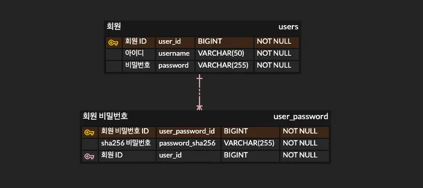
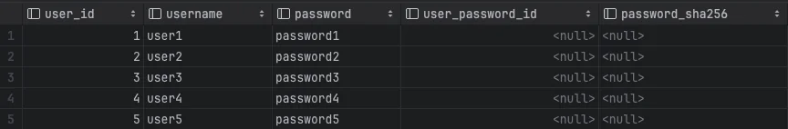
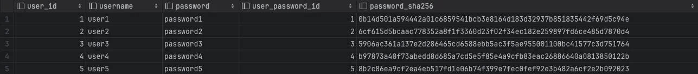
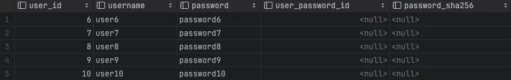
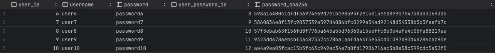

## Introduction

Encryption broadly comes in two kinds: two-way and one-way.

| Type | Decryption | Example |
|---|---|---|
| Two-way | The ciphertext can be turned back into plaintext | AES |
| One-way | It can't be turned back into plaintext | SHA-256 |

That's why, for security certifications like ISMS (Korea's national information security management certification), sensitive personal data such as passwords must be protected one way.

This post covers the query I used to move existing passwords to SHA-256 without stopping the service, and the plan I put together so I could run it without mistakes. The examples follow the ERD below. The existing `users.password` stays as it is, and the hash goes into a new table, `user_password.password_sha256`.

{: width="706" height="314" }

## 1. The plan 📃

{: width="1100" height="480" }

A query that changes production data will go wrong unless you plan it carefully.

I split the testing into **before the query** and **after the query**. Before, I run the query on specific rows only and confirm they migrate correctly. After running the main query, I use the auth server logs and the data in the DB to confirm everything moved correctly and the service still works.

So the test accounts get split in half. With 10 test accounts (IDs 1–10):

| Test accounts | When they're migrated | What they verify |
|---|---|---|
| IDs 1–5 | **Before** the main query, via an `IN` clause | That the query itself is correct |
| IDs 6–10 | **Together with** everyone else by the main query | That the main query actually migrated them |

## 2. Pre-run test 🧐

**① Check the targets.** Confirm IDs 1–5 aren't in `user_password` yet.

```sql
SELECT u.user_id, u.username, u.password, up.user_password_id, up.password_sha256
FROM users u
LEFT JOIN user_password up ON up.user_id = u.user_id
WHERE up.user_password_id IS NULL AND
    u.user_id IN (1, 2, 3, 4, 5);
```

{: width="864" height="142" }

**② Migrate only the targets.** Run the same query as the main one, with just an `IN` clause added.

```sql
INSERT INTO user_password(user_id, password_sha256)
(
    SELECT u.user_id, SHA2(u.password, 256)
    FROM users u
    LEFT JOIN user_password up ON up.user_id = u.user_id
    WHERE up.user_id IS NULL AND
        u.user_id IN (1, 2, 3, 4, 5)
);
```

**③ Check in the DB.** This time, query without the `IS NULL` condition to see that the hashes are there.

```sql
SELECT u.user_id, u.username, u.password, up.user_password_id, up.password_sha256
FROM users u
LEFT JOIN user_password up ON up.user_id = u.user_id
WHERE u.user_id IN (1, 2, 3, 4, 5);
```

{: width="1287" height="137" }

**④ Check in the service.** Log in with IDs 1–5 in the actual app or website and confirm everything works with the migrated data.

## 3. Running the main query 🛠️

**① Count the rows to migrate.** Count how many rows the main query will insert, so you can match it against the affected row count afterward. In this example it's 6.

```sql
SELECT COUNT(u.user_id)
FROM users u
LEFT JOIN user_password up ON up.user_id = u.user_id
WHERE up.user_password_id IS NULL;
```

{: width="221" height="45" }

**② Check the post-run accounts.** Confirm IDs 6–10 haven't been migrated yet.

```sql
SELECT u.user_id, u.username, u.password, up.user_password_id, up.password_sha256
FROM users u
LEFT JOIN user_password up ON up.user_id = u.user_id
WHERE up.user_password_id IS NULL AND
    u.user_id IN (6, 7, 8, 9, 10);
```

{: width="861" height="136" }

**③ Run the migration query.** It's the pre-run test query with the `IN` clause removed.

```sql
INSERT INTO user_password(user_id, password_sha256)
(
    SELECT u.user_id, SHA2(u.password, 256)
    FROM users u
    LEFT JOIN user_password up ON up.user_id = u.user_id
    WHERE up.user_id IS NULL
);
```

{: width="1100" height="500" }

`LEFT JOIN … WHERE up.user_id IS NULL` picks only users with no match in `user_password`. IDs 1–5, migrated during the pre-run test, already have a match and naturally drop out, and if the query gets cut off and rerun, users already migrated won't be inserted twice. That's why I wrote the pre-run test and the main query in the same shape.

## 4. Post-run check ✅

**① Check in the DB.** See whether the main query migrated IDs 6–10.

```sql
SELECT u.user_id, u.username, u.password, up.user_password_id, up.password_sha256
FROM users u
LEFT JOIN user_password up ON up.user_id = u.user_id
WHERE u.user_id IN (6, 7, 8, 9, 10);
```

{: width="1284" height="141" }

**② Check in the service.** Log in with IDs 6–10 in the app or website and make sure the auth server logs look clean.

## 5. Worth knowing 🧱

- **`SHA2(str, 256)` returns a 64-character hex string.** The column holding the hash needs at least 64 characters. If the first argument is `NULL`, so is the result.
- **There's no salt.** With `SHA2()` alone, the same password always produces the same hash, which makes it easier to recover the original from a precomputed hash table. Adding a per-user salt or using a password-specific hash like bcrypt is safer.
- **`INSERT … SELECT` locks the source rows.** At InnoDB's default isolation level (REPEATABLE READ), the `users` rows read by the `SELECT` get shared locks, so requests that modify those rows may wait while it runs. With a lot of users, consider running it during low traffic or splitting it into ranges.

## Wrapping up

- Sensitive personal data like passwords should be protected one way. You can migrate it without a batch job, using only MySQL's `SHA2()` and `INSERT … SELECT`.
- For queries that change production data, plan first: a pre-run test, the main query, and a post-run check.
- Split the test accounts in half. One half verifies the query is correct; the other verifies the main query actually migrated them.
- Selecting targets with `LEFT JOIN … IS NULL` makes reruns safe from duplicates. Write the test query and the main query in the same shape, and the test doubles as verification of the main query.
- Count the target rows beforehand and match them against the affected row count afterward.

> References
> - [MySQL 8.0 Reference Manual: Encryption and Compression Functions (`SHA2()`)](https://dev.mysql.com/doc/refman/8.0/en/encryption-functions.html#function_sha2)
> - [MySQL 8.0 Reference Manual: Locks Set by Different SQL Statements in InnoDB](https://dev.mysql.com/doc/refman/8.0/en/innodb-locks-set.html)
{: .prompt-info }
