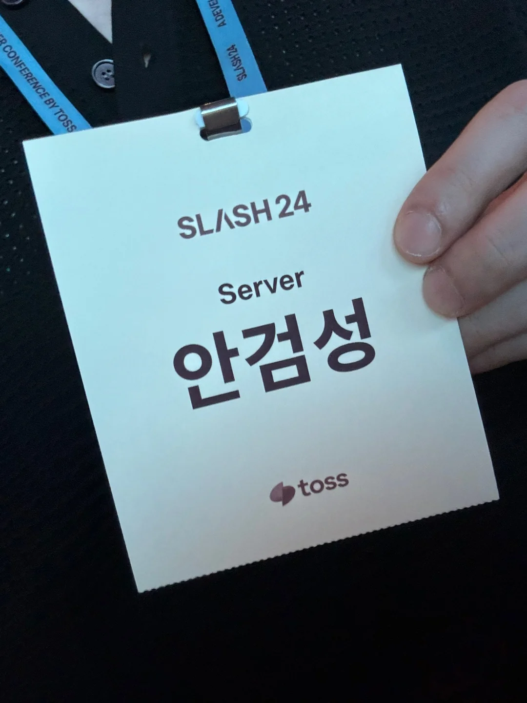
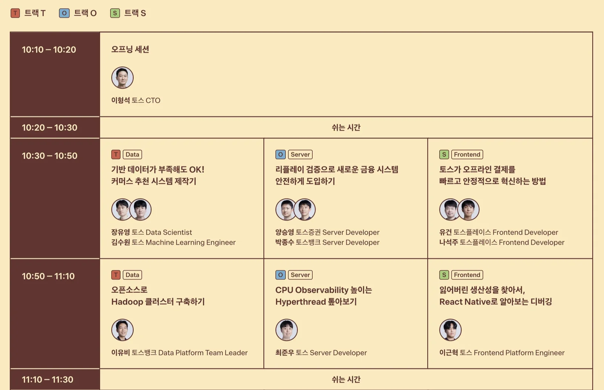
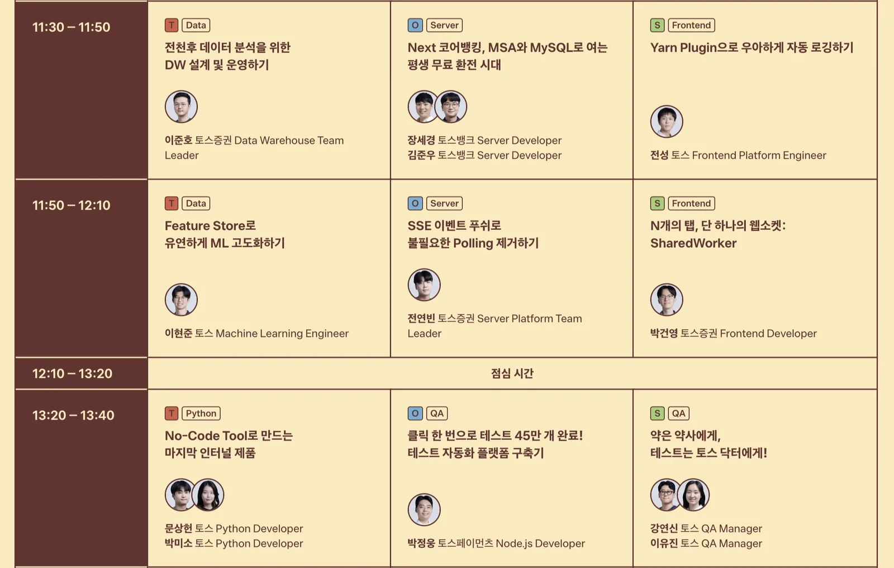
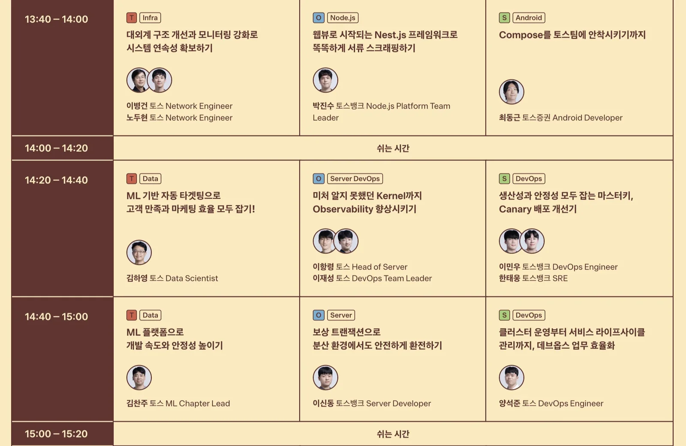
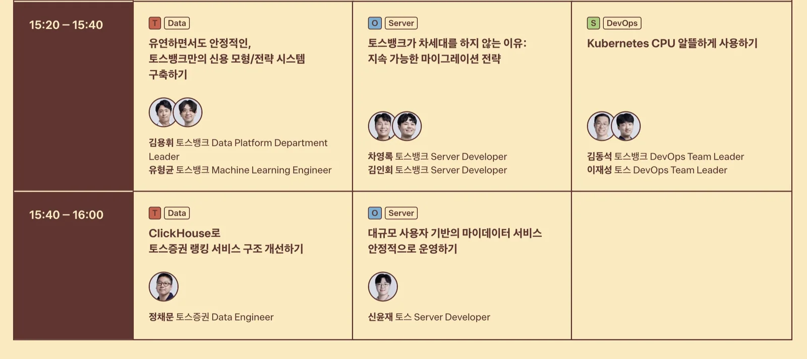
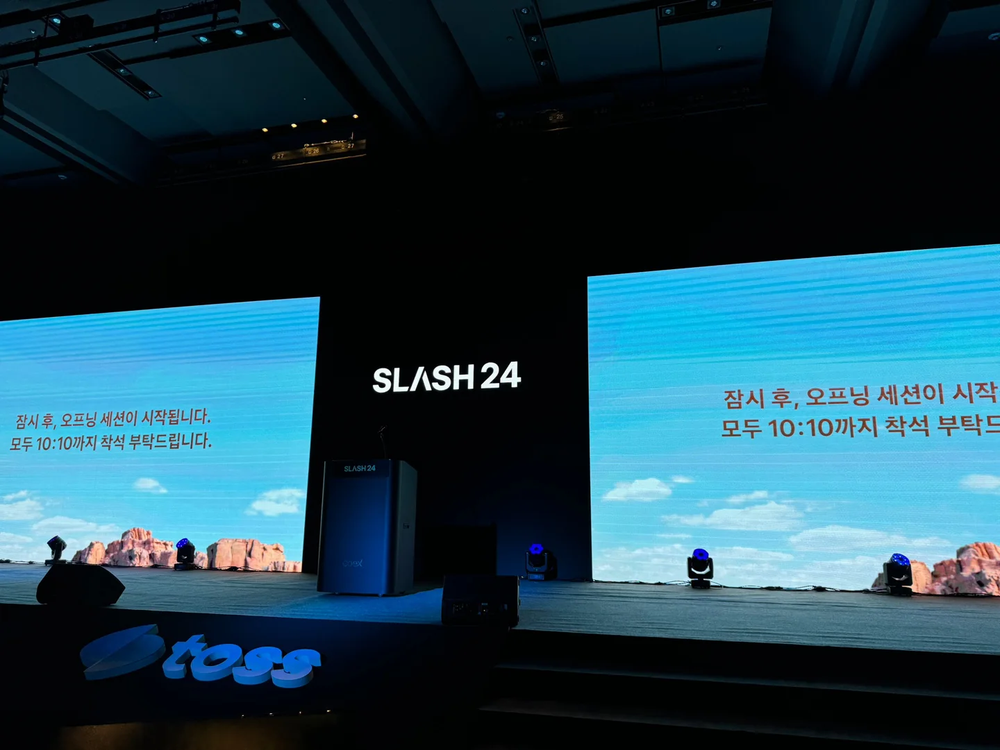
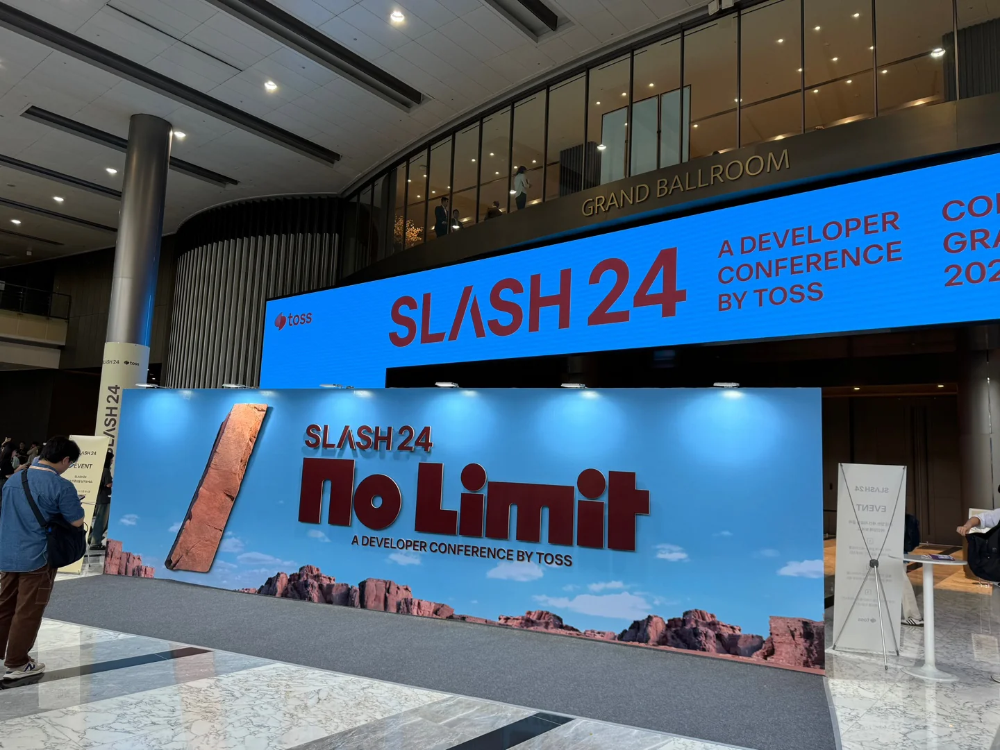

## 들어가며

저도 Lucky Vicky하게 토스 컨퍼런스 SLASH24에 당첨됐습니다!

{: width="1080" height="1440" }

이 글은 서버 파트 세션을 들으며 흥미로웠던 주제와 느낀 점을 정리한 후기입니다. 자세히 정리한 세션은 아래 세 개입니다.

| # | 세션 | 발표자 | 핵심 |
|---|---|---|---|
| 2 | 리플레이 검증으로 새로운 금융 시스템 안전하게 도입하기 | 양승영님, 박종수님 | Read/Write Verifier로 전환 검증 자동화 |
| 3 | Next 코어뱅킹, MSA와 MySQL로 여는 평생 무료 환전 시대 | 장세경님, 김준우님 | Oracle 대신 MySQL, 애플리케이션 레이어 트랜잭션 |
| 4 | 보상 트랜잭션으로 분산 환경에서도 안전하게 환전하기 | 이신동님 | Orchestration Saga와 보상 트랜잭션 |

## 1. 타임테이블 🕐

저는 서버 개발자이므로 당연히 서버 파트 발표에 구독 버튼을 세게 눌렀습니다.

{: width="1600" height="1034" }

{: width="1600" height="1018" }

{: width="1600" height="1043" }

{: width="1600" height="713" }

## 2. 리플레이 검증으로 새로운 금융 시스템 안전하게 도입하기 🔁

> 발표: 양승영님, 박종수님

거대한 C 언어 기반 모놀리식 원장을 Kotlin 기반 MSA 원장으로 전환하는 과정에 대한 발표였습니다. 마이그레이션이기 때문에 API 스펙, DB 스키마, 주요 비즈니스 로직은 그대로 유지되어야 한다는 것이 핵심입니다.

마이그레이션을 조금 더 수월하게 할 방법을 고민하다가 **테스트와 검증, 확인**을 자동화했고, 그 자동화의 핵심이 **Read Verifier**와 **Write Verifier**였습니다.

### Read Verifier

1. 요청이 들어오면 Gateway를 거쳐 기존 C 언어 기반 모놀리식 서버가 응답한다.
2. 모놀리식 서버의 응답이 오면 Gateway가 Kafka를 통해 Verifier에게 해당 요청과 응답을 보낸다.
3. Verifier는 Kotlin 기반 MSA 서버에 같은 요청을 보내고 응답을 받는다.
4. 마지막으로 Verifier가 두 응답이 같은지 확인하고 기록한다.

### Write Verifier

1. 요청이 Gateway로 들어오면 Kotlin 기반 MSA 서버가 요청을 가로챈다(Intercept).
2. MSA 서버는 처리 결과를 저장하고, CUD 쿼리를 조회 쿼리로 바꿔 함께 저장한다.
3. MSA 서버는 트랜잭션을 롤백하고 Gateway로 응답을 보낸다.
4. Gateway가 기존 모놀리식 서버로 요청을 보내고 응답을 받는다.
5. Gateway는 클라이언트에 응답하면서 Verifier에게 검증을 요청한다.
6. Verifier는 Redis에서 처리 결과와 조회 쿼리를 가져와 실제 DB에 반영된 데이터와 비교한다.

DB 자체를 두 벌 운영하며 데이터를 비교하는 방법도 있지만, 데이터를 저장하고 유지하는 비용 부담이 있다고 합니다. 또 Write Verifier는 동기식으로 동작해 실서비스에 영향을 주기 때문에 개발 환경에서만 진행했다고 합니다.

> 쿼리 수집은 [P6Spy](https://github.com/p6spy/p6spy)로 하고, CUD 쿼리를 분석해 조회 쿼리로 바꾸는 데는 [ANTLR](https://github.com/antlr/antlr4)를 활용했다고 합니다.
{: .prompt-tip }

### 검증을 돕는 장치

정확한 검증을 위해 검증 수행 이력을 확인하는 어드민 기능을 만들고, 엣지 케이스를 발견하기 위해 주기적으로 리포팅하는 봇도 만들었다고 합니다.

### 내가 가져간 것

- 마이그레이션은 "같은 요청에 같은 응답을 하는가"를 자동으로 비교할 수 있으면 훨씬 안전해진다.
- 쓰기 검증은 실제로 쓰지 않고 롤백한 뒤, 조회 쿼리로 바꿔 결과를 비교하는 방식으로 풀 수 있다.

## 3. Next 코어뱅킹, MSA와 MySQL로 여는 평생 무료 환전 시대 🏦

> 발표: 장세경님, 김준우님

다른 은행들처럼 토스뱅크도 안정성을 이유로 Oracle을 쓰고 있었습니다. Oracle은 신뢰성, 안정성, 확장성, 성능, 오랜 기간 축적된 노하우라는 장점이 있습니다. 하지만 단일 장애 지점이 존재하고, 비용이 비싸고, 스케일 아웃이 제한적입니다.

그래서 토스뱅크는 Oracle을 대체하기 위해 Redis 분산 락, Kafka를 활용한 SAGA 패턴 같은 애플리케이션 레이어 기술로 트랜잭션을 효율적으로 관리하기로 합니다.

마침 외화 서비스를 기획하면서 Oracle이 아닌 MySQL로 구축해 보기로 결정합니다. 여기서 핵심은 **트랜잭션 아키텍처**입니다. 발표에서는 환전 거래의 금원 흐름을 예로 들었는데, 환전 요청은 아래 서버들을 거칩니다.

| 서버 | 처리 방식 |
|---|---|
| 외환 서버 | 고객 요청을 받고 응답 |
| 수신 원화예금 서버 | 동기 (원화 출금) |
| 수신 외화예금 서버 | 동기 (외화 입금) |
| 손익 처리 서버 | Kafka 비동기 |
| 회계 처리 서버 | Kafka 비동기 |

### 환전 요청 트랜잭션

1. 고객이 외환 서버로 환전 요청을 보낸다.
2. 외환 서버가 수신 원화예금 서버로 원화 출금 요청을 보내고 응답을 받는다.
3. 외환 서버가 다시 수신 외화예금 서버로 외화 입금 요청을 보내고 응답을 받는다.
4. 외환 서버가 고객의 요청에 응답한다.
5. 이후 거치는 서버들은 내부 회계 처리를 위한 동작이므로 Kafka로 비동기 처리한다.

기존 방식대로 환전을 처리했다면 이 모든 과정이 하나의 트랜잭션으로 묶여 환전이 매우 느렸을 것입니다.

### 내가 가져간 것

- 고객 응답에 꼭 필요한 단계만 동기로 묶고, 내부 처리는 비동기로 떼어 내면 트랜잭션 범위가 작아진다.
- DB가 해 주던 트랜잭션 보장을 애플리케이션 레이어(분산 락, SAGA)로 옮기는 선택지도 있다.

## 4. 보상 트랜잭션으로 분산 환경에서도 안전하게 환전하기 💱

> 발표: 이신동님

이 발표도 환전 서비스에 대한 내용이고, 핵심은 **보상 트랜잭션**입니다.

### 2PC vs SAGA

**Two Phase Commit (2PC)**

- Coordinator가 두 개 이상의 서버에 Commit 가능 여부를 묻고(Voting), 서버들은 가능 여부를 응답한다.
- 모든 서버가 ack, 즉 Commit을 허용한다고 응답하면 Commit을 진행한다.

**Saga 패턴**

- 각 서비스의 작은 트랜잭션들을 차례로 실행한다.
- 특정 단계에서 실패하면 보상 트랜잭션을 실행한다.

|     | 2 Phase Commit | Saga |
| --- | --- | --- |
| 장점 | 강한 일관성 | 높은 가용성 높은 확장성 |
| 단점 | 낮은 가용성 낮은 확장성 | 중간 상태 노출 보상 트랜잭션 구현 필요 |

발표자분의 팀은 Saga 패턴을 선택했다고 합니다. Saga에도 두 가지 방식이 있습니다.

- **Choreography Saga**: Message Broker를 통해 각 서비스에 메시지를 전달한다.
- **Orchestration Saga**: Orchestrator 역할을 하는 서버가 나머지 서버들에 메시지를 전달하는, Master/Slave 노드 방식이다.

Orchestration을 맡을 수 있는 환전 서버가 있었기 때문에 Orchestration Saga를 선택했다고 합니다. 즉 Orchestrator인 환전 서버가 원화 계좌 서버, 외화 계좌 서버와 통신하는 형태입니다.

### SAGA를 이용한 환전 구현

1. 환전 요청이 오면 환전 서버가 원화 계좌 서버로 출금 요청을 보낸다.
2. 출금에 성공했다는 응답을 받으면 외화 계좌 서버로 입금 요청을 보낸다.

### 보상 트랜잭션

환전 과정에서는 정상적이든 비정상적이든 입출금 실패에 대한 처리를 해야 합니다. 이때 보상 트랜잭션을 씁니다. 입출금 실패는 다음과 같은 이유로 일어날 수 있습니다.

| 정상적인 실패 | 비정상적인 실패 (에러) |
| --- | --- |
| 잔액 부족 잔액 증명서 출력 계좌 해지 고객/계좌 거래 제한 | 서버 에러 (5XX 응답/타임아웃) 네트워크 에러 메시지 produce/consume 실패 |

보상 트랜잭션은 다음과 같은 상황에서 일어납니다.

1. 환전 서버가 원화 계좌 서버로 출금 요청을 보내고 성공 응답을 받는다.
2. 외화 계좌 서버로 입금 요청을 보냈지만 실패한다.
3. 원화 계좌 서버에 보상 트랜잭션, 즉 1단계에서 출금한 금액을 다시 입금 처리한다.

1, 2단계는 HTTP로 동기 처리하지만, 클라이언트에 빠르게 실패 응답을 보내기 위해 출금 취소는 Kafka로 비동기 처리했다고 합니다. 잔액 정합성만 보장하면 되기 때문에 Kafka 메시징 방식을 골랐다고 합니다.

> 반드시 입금이 아니라 출금부터 해야 합니다. 외화 입금을 먼저 했는데 원화 출금이 실패해 입금을 취소해야 할 때, 그 사이 카드사에서 출금 요청이 들어와 외화를 써 버리면 입금 취소 때문에 외화 계좌가 마이너스가 될 수 있기 때문입니다.
{: .prompt-warning }

### 내가 가져간 것

- 보상 트랜잭션에서는 순서가 중요하다. 되돌릴 때 문제가 생기지 않는 쪽(출금)을 먼저 한다.
- 실패 응답은 빠르게 돌려주고, 보상은 비동기로 처리해도 정합성을 지킬 수 있다.

## 5. 그 외 세션 📝

사실 모든 발표가 주옥같았지만, 제 지식의 한계로 전부 소화하지는 못했습니다. 아래 두 세션은 키워드 위주로 남겨 둡니다.

### 미처 알지 못했던 Kernel까지 Observability 향상시키기

> 발표: 이항령님, 이재성님

컴퓨팅 리소스를 효율적으로 쓰기 위해 커널 레벨까지 내려가 분석하는, 아주 로우 레벨로 들어간 발표였는데 매우 인상적이었습니다. 제가 가져간 키워드는 다음과 같습니다.

- eBPF가 커널 분석에 도움을 준다.
- page fault가 시간을 많이 잡아먹는다.
- NUMA를 통해 메모리 액세스를 모니터링할 수 있다.
- iptables가 문제가 되어 IPVS로 바꿨다.

### 대규모 사용자 기반의 마이데이터 서비스 안정적으로 운영하기

> 발표: 신윤재님

마지막 발표로, 서킷 브레이커에 대한 내용을 다뤘습니다. 제가 가져간 키워드는 다음과 같습니다.

- 외부로 나가는 트래픽을 관리하기 위해 Coordinator를 개발했다.
- Resilience라는 서킷 브레이커를 썼지만 문제가 있었다.
- 서킷 브레이커를 별도의 서버로 구현했다.

## 6. 현장 사진 📸

{: width="1440" height="1081" }

{: width="1440" height="1081" }

## 마무리

예전에 컨퍼런스에 갔을 때와 달리 이번에는 비교적 많은 걸 이해할 수 있었습니다. 그만큼 성장했다고 뿌듯해할 수도 있겠지만... 현타가 세게 왔습니다. 역시 토스에는 고수분들이 많았습니다. 그분들이 겪은 시행착오와 어디까지 집요하게 파고들었는지를 들으며 자아 성찰과 반성의 시간이 됐습니다.

- 레거시 전환은 같은 요청을 두 시스템에 흘려 결과를 비교하는 자동 검증으로 안전하게 만들 수 있다.
- 트랜잭션은 고객 응답에 필요한 부분만 동기로 묶고, 나머지는 비동기로 뗀다.
- 분산 환경에서는 2PC 대신 Saga와 보상 트랜잭션을 고를 수 있고, 보상은 순서가 핵심이다.
- 이해할 수 있는 발표가 늘었다는 것과, 그 너머에 파고들 것이 훨씬 많다는 것을 동시에 느꼈다.

> 참고
> - SLASH24 - 토스
{: .prompt-info }
