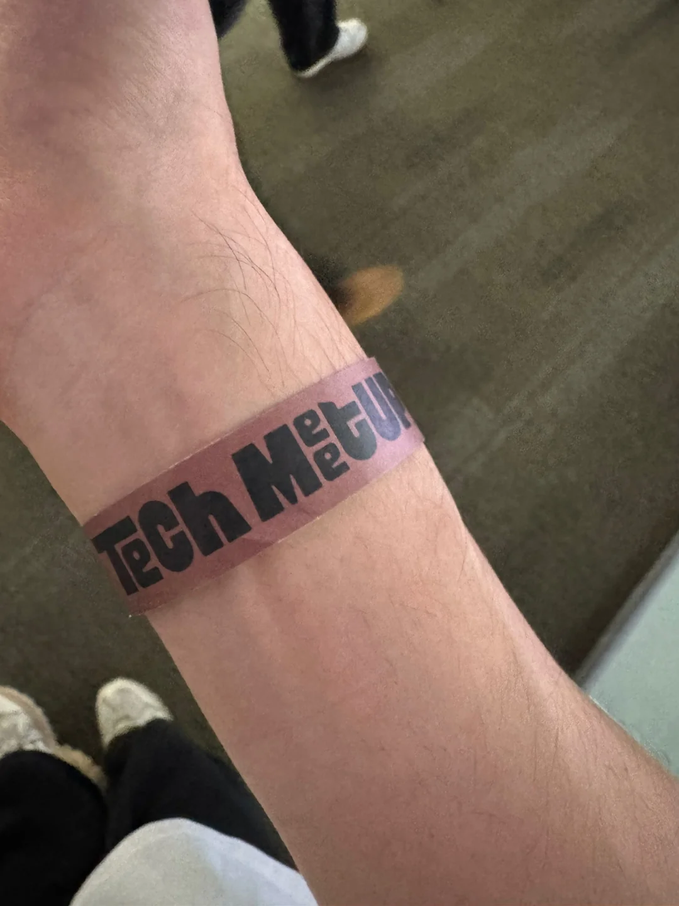
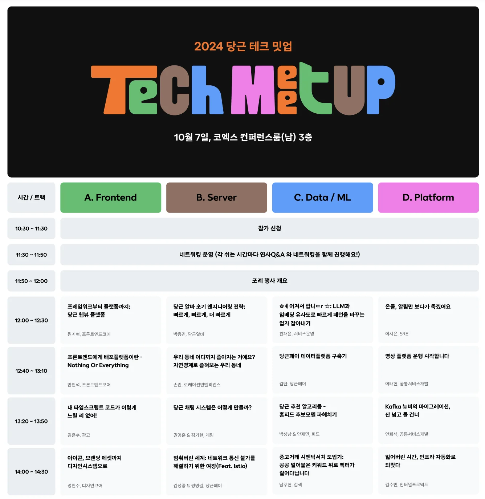
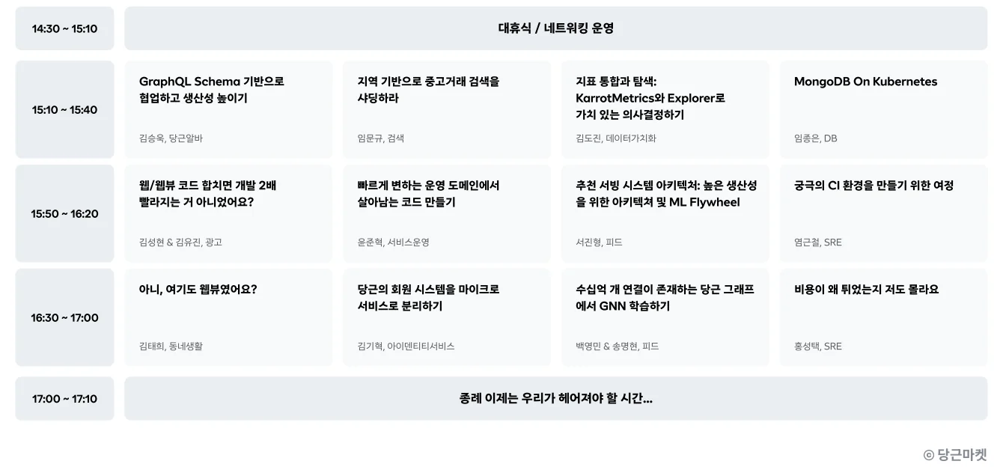
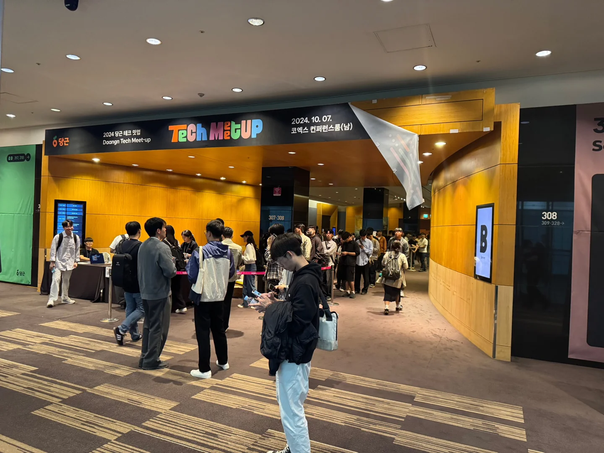
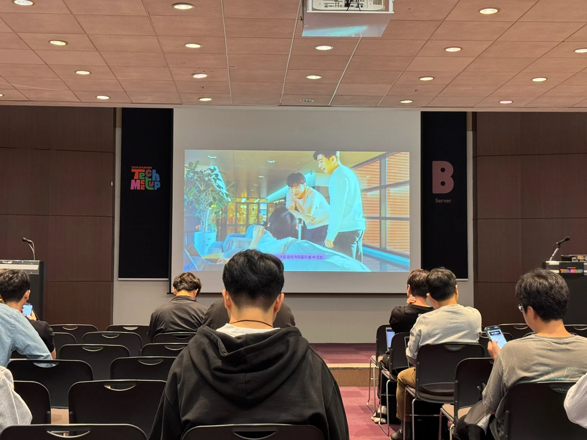
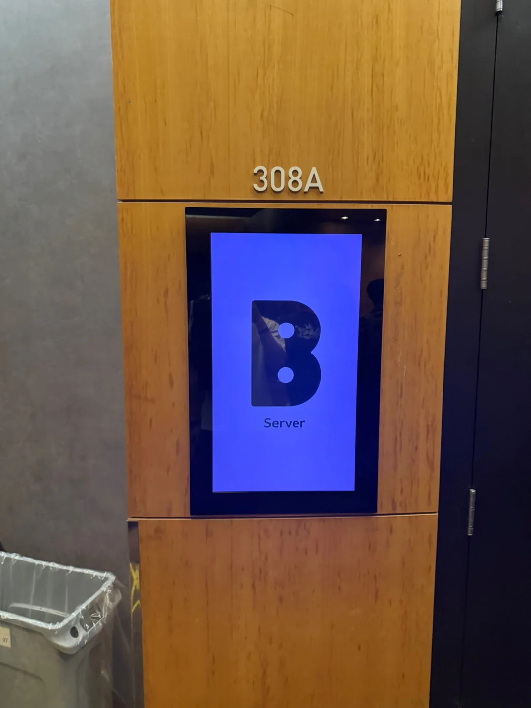

## 들어가며

올해 토스 컨퍼런스에 이어 당근 테크 밋업까지 당첨되어 다녀왔습니다! 🕺🏻

발표 세션과 네트워킹 세션이 함께 진행됐고, 저는 네트워킹 세션 두 개에 참여했습니다.

{: width="1080" height="1440" }

이 글에서 정리한 세션은 다음과 같습니다.

| 구분 | 세션 | 발표자 |
|---|---|---|
| 발표 | 당근알바 초기 엔지니어링 전략: 빠르게, 빠르게 더 빠르게 | 박용진님 |
| 발표 | 당근 채팅 시스템은 어떻게 만들까? | 권영훈님, 김기현님 |
| 발표 | 멈춰버린 세계: 네트워크 통신 불가를 해결하기 위한 여정(Feat. Istio) | 김성종님, 정명길님 |
| 네트워킹 | 당근페이 머니서비스팀 | 윈터님, 윌리엄님 |
| 네트워킹 | 당근페이 어카운트 서비스팀 | 우즈님 |

## 1. 타임테이블 🕐

{: width="1336" height="1374" }

{: width="1336" height="632" }

## 2. 당근알바 초기 엔지니어링 전략: 빠르게, 빠르게 더 빠르게 🏃

> 발표: 박용진님

초기에는 제품을 정말 빠르게 개발하면서 동시에 분석도 해야 해서 고민이 많았다고 합니다.

### 데이터 분석에 드는 비용

데이터 분석에 드는 비용을 두 가지로 정의했습니다.

- 데이터 분석을 위한 엔지니어링 비용
- 데이터 분석 활동에 드는 비용

데이터 분석에는 기존 데이터를 추출하고 분석용 데이터를 따로 만드는 번거로움이 있습니다. 그래서 데이터를 따로 추출하지 않고 이벤트 기반 분석 서비스를 활용했다고 합니다. 이벤트 기반 분석 서비스의 장점은 다음과 같습니다.

- 데이터 분석을 위한 별도 저장 공간이 필요 없다.
- 원하는 시점에 API를 호출하는 것만으로 간편하게 데이터를 저장한다.
- SQL이 아니라 웹에서 직관적으로 데이터를 조합한다.

### 데이터 분석으로 얻은 생산성

- 사용자 피드백을 빠르게 확인해 가설과 실험에 대한 의사 결정 비용이 줄었다.
- 분석 결과로 쌓은 사용자 이해를 바탕으로 팀원 간 의사소통이 효율적이 됐다.

여기서 팁은 데이터 분석 요청자와 수행자를 두 명이 아니라 한 명이 맡게 해서, 분석에 드는 불필요한 의사소통 비용을 없앴다는 점이었습니다.

## 3. 당근 채팅 시스템은 어떻게 만들까? 💬

> 발표: 권영훈님, 김기현님

당근의 채팅 시스템은 크게 세 가지 컴포넌트로 구성되어 있습니다.

- 챗 서버
- 푸시 서버
- 데이터베이스 서버

### 1:1 채팅

서버가 한 대일 때의 흐름은 다음과 같습니다.

1. 유저가 채팅 서버에 접속한다.
2. 채팅 서버에 User ID와 User Session ID를 키-값 쌍으로 저장한다.
3. 유저가 채팅 서버로 메시지를 보낸다.
4. 상대의 User ID로 User Session ID를 조회해 메시지를 전달한다.

서버가 두 대 이상이면 유저마다 접속한 서버가 다를 수 있어서, 서버 로컬 메모리에 상대의 세션 ID가 없을 수 있습니다. 이를 해결하는 방법은 두 가지입니다.

- 공유 메모리를 써서 유저가 접속한 서버 IP를 저장한다.
- 유저 ID 기반으로 Pub/Sub한다.

서버가 10대 이상으로 늘어나면 서버 간 그물망 연결이 생겨 복잡도가 커지고 확장에도 불리해집니다. 그래서 메시지 큐를 활용한다고 합니다. 메시지가 오면 큐에 넣고, Consumer가 메시지를 전달하는 메시지 릴레이 요청을 만들어 비동기로 수행합니다.

| 서버 수 | 세션 찾기 |
|---|---|
| 1대 | 서버 로컬 메모리의 키-값 |
| 2대 이상 | 공유 메모리(접속 서버 IP) 또는 유저 ID 기반 Pub/Sub |
| 10대 이상 | 메시지 큐 + Consumer의 비동기 메시지 릴레이 |

### 푸시 알림

- **미접속 유저**: 키-값 조회 결과가 없으면 푸시 서버로 메시지 요청을 보낸다.
- **잘못된 데이터(서버에 유저 세션이 없을 때)**: 키-값이 틀린 경우 키-값 스토리지에서 데이터를 지우고 푸시 서버로 요청을 보낸다.

### 그룹 채팅

기존 구조를 그대로 쓰면, 유저가 1,000명인 그룹 채팅에서는 Consumer가 서버로 요청을 1,000개 보내게 됩니다. 그래서 유저 ID를 묶어서 보냅니다. 다만 한 번에 묶으면 타임아웃 같은 문제가 생길 수 있어서, 청크 단위로 나눠 수행하도록 개발했다고 합니다.

## 4. 멈춰버린 세계: 네트워크 통신 불가를 해결하기 위한 여정(Feat. Istio) 🌐

> 발표: 김성종님, 정명길님

### DB와 Redis 커넥션을 잃다

트래픽이 늘면서 DB와 Redis 커넥션이 끊기는 현상이 생겼다고 합니다.

**추정 원인**

- 애플리케이션 스레드 고갈
- JVM GC Pause Time 증가
- Redis, Database 장애
- AWS Maintenance
- CoreDNS 장애

**해결 방법**

1. Internal Service Segregation
2. Event Streaming Pattern
3. ZGC 적용
4. SQL Query Optimization
5. API Performance Optimization
6. Connection, Read Timeout 조정

이 과정을 통해 CPU 사용률, 쿼리 시간 등 여러 지표를 안정화했습니다. 하지만 문제는 계속 발생했습니다. 그래도 이번에 다시 분석해 보니 문제 발생 시점이 배포 시점과 일치해서 Istio 문제라고 판단했다고 합니다.

### 추가 해결

확인해 보니 Kubernetes 환경에서 CPU Limit을 설정해 두었는데, 이를 제거하자 Latency와 Throttle이 사라졌다고 합니다.

## 5. 네트워킹: 당근페이 머니서비스팀 🥕

> 진행: 윈터님, 윌리엄님

네트워킹 세션은 종류가 다양했는데, 6명에서 10명 정도의 소수 인원으로 진행돼서 정말 빠르게 마감됐습니다. 다행히 오픈런(?)을 해서 두 세션에 참여할 수 있었습니다.

이 세션은 주최자분들 주도로 다양한 이야기를 나눴고, 참여자분들도 대부분 핀테크 업계에서 일하고 계셨습니다.

### "당근페이로만 거래해요"

기억에 남는 건 한 참여자분이 본인은 당근페이로만 거래하고, 판매 글에도 그렇게 적어 둔다고 하신 이야기였습니다. 당근페이를 쓰지 않으면 거래할 때 계좌번호도 물어봐야 해서 번거로운데, 당근페이가 이를 간단하게 해결해 준다는 것이었습니다.

그때 윈터님과 윌리엄님 표정이 너무 좋아 보였습니다 ㅋㅋㅋ 머니서비스팀이 의도한 대로 서비스가 잘 쓰이고 있고, 우연히 그걸 칭찬하는 유저 피드백을 직접 들었으니 무척 흡족하셨던 것 같습니다. 저였어도 너무 행복했을 것 같아서, 한편으로는 부러우면서도 다른 한편으로는 대단하다고 생각했습니다.

### 코틀린 전환

필요에 따라 몇몇 서비스를 코틀린으로 전환했다고 하셔서, 팀원들을 어떻게 설득했는지 여쭤봤습니다. 머니서비스팀은 새로운 기술에 매우 열려 있고, 누군가 주도적으로 리드하면 다른 팀원들이 잘 따라와 주는 문화라고 설명해 주셨습니다.

## 6. 네트워킹: 당근페이 어카운트 서비스팀 🔐

> 진행: 우즈님

### 어카운트 마스터

우즈님은 어카운트 마스터라고 부를 만한 커리어를 갖고 계셨습니다. 저도 지금 회사에서 어카운트 서비스를 다루고 있어서, 예전에 겪었고 지금도 맞닥뜨리고 있는 문제들을 끊임없이 여쭤봤습니다. 이런 커리어를 가진 분을 만날 기회가 흔치 않아서 정말 많이 질문했고, 다음과 같은 이야기를 주고받았습니다.

- JWT 토큰들은 어떻게 관리하고 있는지
- 핀테크 특성상 JWT 외에 사용자 요청을 처리할 때 별도의 추가 인증이 있는지

15분 넘게 이야기를 나눈 것 같은데, 깊이 고민하면서 친절하게 답해 주셔서 정말 감사했습니다. 🥹 제 질문과 관련해 나중에 찾아볼 키워드도 알려 주셨습니다.

- TLS Token Binding
- HMAC Key

## 7. 현장 사진 📸

{: width="1440" height="1081" }

{: width="1440" height="1080" }

{: width="1080" height="1440" }

## 마무리

- 초기 제품은 분석용 데이터를 따로 만들기보다 이벤트 기반 분석으로 분석 비용 자체를 줄이는 쪽이 빠르다.
- 채팅 시스템은 서버 수에 따라 세션을 찾는 방식이 로컬 메모리에서 공유 메모리·Pub/Sub, 그리고 메시지 큐로 바뀐다.
- 원인을 하나씩 지워도 장애가 계속되면 발생 시점을 다시 본다. 배포 시점과 겹친다는 단서가 Istio와 CPU Limit으로 이어졌다.
- 내가 만든 서비스를 칭찬하는 유저를 직접 만나는 경험은 부러울 만큼 큰 보람이다.
- 같은 도메인(어카운트)을 오래 다룬 사람에게 직접 물어볼 기회는 흔치 않다. TLS Token Binding과 HMAC Key는 다음에 찾아볼 키워드로 남았다.

> 참고
> - 당근 테크 밋업 2024
{: .prompt-info }
