## 들어가며

사내 서비스 웹앱들은 Next.js App Router로 만들고, 브라우저는 같은 출처의 BFF 라우트(`app/api/...`)만 부릅니다. BFF가 쿠키의 토큰을 `Authorization` 헤더로 바꿔 백엔드에 넘기는 구조입니다. 로그인하면 BFF가 `access_token`과 `refresh_token` 쿠키를 심습니다.

어제부터 한 서비스에서 이상한 보고가 이어졌습니다. 어떤 사용자는 페이지가 끝없이 새로고침되고, 어떤 사용자는 **로그인 응답이 200인데 로그인이 안 됩니다.** 오늘 하루 PR 네 개로 세 가지 원인을 걷어냈고, 마지막 원인은 Next.js 쿠키 API의 동작 하나였습니다. 순서대로 적습니다.

## 1. 401 무한 루프: 같은 이름의 쿠키가 둘 🔁

{: width="1100" height="560" }

첫 보고는 액세스 토큰이 만료된 뒤 BFF 호출 세 개(내비게이션, 최근 공지, 월간 통계)가 401을 돌려주고 페이지가 재시도를 반복하는 현상이었습니다. 개발자 도구를 열어 보니 `refresh_token` 쿠키가 **두 개** 있었습니다.

| 이름 | Domain | 출처 |
|---|---|---|
| `refresh_token` | `.example.com` | 예전 공유 쿠키 방식 |
| `refresh_token` | `svc-a.example.com` | 이번에 바꾼 서비스별 호스트 쿠키 |

브라우저는 쿠키를 **(이름, 도메인, 경로)** 세 가지로 식별합니다(RFC 6265 §5.3). Domain이 다르면 다른 쿠키라서 둘이 공존하고, `svc-a.example.com`에 요청할 때 둘 다 `Cookie` 헤더에 실립니다.

반면 Next.js의 `req.cookies`는 이름으로 찾습니다. `RequestCookies`는 `Cookie` 헤더를 파싱해 **이름을 키로 하는 Map**에 넣으므로, 같은 이름이 둘이면 하나만 남습니다. 어느 쪽이 남는지는 브라우저가 헤더에 적는 순서에 달려 있고, 이번엔 옛 토큰이 읽혔습니다. 재발급 라우트는 그 옛 토큰을 백엔드에 넘기고 401을 받습니다. 어제 넣은 수정(재발급 실패 시 쿠키 삭제)은 **호스트 쿠키만** 지우므로 옛 apex 쿠키는 그대로 남고, 다음 요청이 또 같은 길을 갑니다.

```ts
// app/api/account/auth/token/route.ts
const refreshToken = getRefreshToken(req);                 // req.cookies.get → 이름 기준 Map → 둘 중 하나
headers.set("Refresh-Token", `Bearer ${refreshToken}`);
const response = await customFetch(req, `${ACCOUNT_API}/auth/token`, { method: "POST", headers });
```

해결은 분명했습니다. 토큰 쿠키를 쓸 때마다 **옛 apex 쿠키를 만료시키는 헤더를 함께 보낸다.** 사용자가 한 번만 로그인이나 재발급을 거치면 옛 쿠키가 사라지도록요.

```ts
export const expireLegacyApexTokens = (req?: NextRequest, res?: NextResponse) => {
    if (process.env.NODE_ENV !== "production") return;
    const apex = toApexDomain(convertDomain(req));          // svc-a.example.com → .example.com
    if (!apex || !res) return;
    const expired = { path: "/", secure: true, domain: apex, expires: new Date(0) };
    res.cookies.set(COOKIES.ACCESS_TOKEN, "", expired);     // ← 살아 있는 토큰과 같은 "이름"
    res.cookies.set(COOKIES.REFRESH_TOKEN, "", expired);
};

export const setTokens = (req, res, accessToken?, refreshToken?) => {
    setCookie(COOKIES.ACCESS_TOKEN, accessToken, hostOptions, res);   // 호스트 쿠키
    setCookie(COOKIES.REFRESH_TOKEN, refreshToken, hostOptions, res);
    expireLegacyApexTokens(req, res);                                 // 바로 뒤에 호출
};
```

점심 전에 머지했고, 오후에 두 번째 보고가 들어왔습니다.

## 2. 자기 삭제: 로그인 200, 쿠키 없음 (1차) 🫥

운영 환경 변수에 쿠키 Domain을 apex(`.example.com`)로 지정한 배포에서 **로그인 응답은 200인데 쿠키가 하나도 저장되지 않았습니다.** 미들웨어는 토큰이 없으니 `/home`을 로그인 페이지로 되돌립니다.

원인은 1번 수정 자체였습니다. 활성 Domain이 apex면 `setTokens`가 토큰을 apex에 심고, 바로 뒤의 `expireLegacyApexTokens`가 **같은 (이름, 도메인)** 을 만료시킵니다. 한 응답에 "심기"와 "지우기"가 같은 쿠키를 가리키면 브라우저는 마지막 것을 따르고, 결과는 삭제입니다.

```ts
// expireLegacyApexTokens 안에 추가한 가드
const active = cookieDomain(req);
if (active && active.replace(/^\./, "") === apex.replace(/^\./, "")) return;   // 같은 쿠키를 지우게 되므로 건너뛴다
```

같은 PR에서 미들웨어가 환경 변수를 무시하고 Host에서만 Domain을 계산하던 불일치도 맞췄습니다. 회귀 테스트도 넣었습니다. `res.cookies.set`을 `jest.fn()`으로 바꿔 끼우고 호출 기록을 검사하는 테스트였습니다.

```ts
const setMock = jest.fn();
const res = { cookies: { set: setMock } } as any as NextResponse;
setTokens(reqWithHost("svc-a.example.com"), res, "access-token", "refresh-token");

const accessSet = setMock.mock.calls.find(c => c[0] === "access_token" && c[1] === "access-token");
expect(accessSet?.[2]?.domain).toBe("svc-a.example.com");    // 통과: 호출은 있었다
const purged = setMock.mock.calls.filter(c => c[1] === "" && c[2]?.domain === ".example.com");
expect(purged.length).toBeGreaterThan(0);                     // 통과: 호출은 있었다
```

초록불을 보고 머지했습니다. 1시간 19분 뒤, 같은 증상이 **dev**에서 났습니다.

## 3. 자기 삭제 (2차): Map은 이름만 본다 🗝️

dev는 환경 변수가 비어 있어 Domain을 Host로 계산하는 **호스트 격리 모드**입니다. 활성 Domain은 `svc-a-dev.example.com`, apex는 `.example.com`. 2번의 가드는 둘이 다르니 통과시키고, 정리 코드는 그대로 실행됩니다. 그런데도 토큰이 사라졌습니다.

`NextResponse.cookies`의 구현을 열어 봤습니다. Next.js에 번들된 `@edge-runtime/cookies`의 `ResponseCookies`입니다.

```js
var ResponseCookies = class {
  constructor(responseHeaders) {
    this._parsed = new Map();                       // ← 키는 쿠키 "이름"
    for (const cookieString of cookieStrings) {
      const parsed = parseSetCookie(cookieString);
      if (parsed) this._parsed.set(parsed.name, parsed);
    }
  }
  set(...args) {
    const [name, value, cookie] = args.length === 1 ? [args[0].name, args[0].value, args[0]] : args;
    this._parsed.set(name, normalizeCookie({ name, value, ...cookie }));   // ← 같은 이름이면 덮어쓴다
    replace(this._parsed, this._headers);
    return this;
  }
};
function replace(bag, headers) {
  headers.delete("set-cookie");                     // ← Set-Cookie 헤더를 전부 지우고
  for (const [, value] of bag) headers.append("set-cookie", stringifyCookie(value));   // ← Map에서 다시 쓴다
}
```

{: width="1100" height="640" }

브라우저는 (이름, 도메인, 경로)로 쿠키를 구분하지만, `ResponseCookies`는 **이름 하나로** 구분합니다. 이 API는 WICG Cookie Store의 `set()` 모양을 따른 것이라, 한 응답에 같은 이름의 쿠키를 두 개 쓰는 상황을 애초에 상정하지 않습니다.

그래서 일어난 일은 이렇습니다.

1. `res.cookies.set("access_token", 실제토큰, { domain: "svc-a-dev.example.com" })` → Map의 `access_token` 슬롯에 들어간다.
2. `res.cookies.set("access_token", "", { domain: ".example.com", expires: 0 })` → **같은 슬롯을 덮어쓴다.** Domain이 달라도 상관없다.
3. `replace()`가 헤더를 지우고 Map에서 다시 쓴다. 전선에 나가는 `Set-Cookie`는 만료된 apex 쿠키 하나뿐이다.

로그인은 성공했고 백엔드는 토큰을 발급했지만, 그 토큰은 응답 헤더에 실리지 못했습니다. 1번과 2번 사고도 사실은 이 동작 위에서 일어난 것이었습니다. 2번의 "같은 (이름, 도메인)" 분석은 결과적으로 맞았지만 조건이 너무 좁았던 셈입니다.

### 수정: 두 번째 쿠키는 Map을 거치지 않는다

같은 이름의 쿠키를 한 응답에 두 개 실으려면 `cookies.set`을 쓸 수 없습니다. 만료 헤더는 **원시 `Set-Cookie` 헤더로 직접 붙입니다.** 그리고 반드시 모든 `cookies.set` **뒤에** 붙여야 합니다. `replace()`가 `headers.delete("set-cookie")`로 기존 헤더를 전부 지우기 때문에, 먼저 붙인 원시 헤더는 다음 `cookies.set` 한 번에 사라집니다.

```diff
     } else if (res) {
-        const expired = { path: "/", secure: true, domain: apex, expires: new Date(0) };
-        res.cookies.set(COOKIES.ACCESS_TOKEN, "", expired);
-        res.cookies.set(COOKIES.REFRESH_TOKEN, "", expired);
+        // res.cookies.set 은 쿠키 "이름"으로 키잉된 Map 이다(@edge-runtime/cookies).
+        // Domain 이 달라도 같은 이름이면 방금 발급한 토큰을 덮어쓴다.
+        // 만료는 원시 Set-Cookie 헤더로 따로 보내고, 모든 res.cookies.set 뒤에 실행해야 한다
+        // (ResponseCookies.replace() 가 set-cookie 헤더 전체를 다시 쓰기 때문).
+        res.headers.append("set-cookie", expiredApexCookie(COOKIES.ACCESS_TOKEN, apex));
+        res.headers.append("set-cookie", expiredApexCookie(COOKIES.REFRESH_TOKEN, apex));
     }
 };
+
+const expiredApexCookie = (name: string, domain: string): string =>
+    `${name}=; Path=/; Domain=${domain}; Secure; Expires=${new Date(0).toUTCString()}`;
```

## 4. 테스트가 버그를 숨긴 이유 🧪

2번에서 넣은 회귀 테스트는 이 버그가 있는 상태에서도 초록이었습니다. `res.cookies.set`을 `jest.fn()`으로 바꿨기 때문입니다. 모킹은 **호출이 있었다**는 사실만 기록하고, Map이 같은 이름을 합친다는 동작은 흉내 내지 않습니다. 검증하려던 것은 "토큰이 전선에 나가는가"였는데, 검증한 것은 "set이 불렸는가"였습니다.

테스트를 실제 `NextResponse`로 바꾸고 **헤더에 무엇이 실리는지**를 봅니다.

```ts
const res = NextResponse.json({});
setTokens(reqWithHost("svc-a.example.com"), res, "access-token", "refresh-token");
const cookies = res.headers.getSetCookie();

// 회귀: 살아 있는 토큰이 덮어쓰이지 않고 나가야 한다
expect(cookies.find(c => c.startsWith("access_token=access-token"))).toContain("Domain=svc-a.example.com");
expect(cookies.find(c => c.startsWith("refresh_token=refresh-token"))).toContain("Domain=svc-a.example.com");
// 옛 apex 만료도 별도 헤더로 나가야 한다
expect(cookies.filter(c => /^access_token=;/.test(c) && c.includes("Domain=.example.com")).length).toBeGreaterThan(0);
```

이 테스트는 수정 전 코드에서 첫 `expect`가 실패합니다. `access_token=access-token`으로 시작하는 헤더가 없기 때문입니다. 비로소 버그를 잡는 테스트가 됐습니다.

두 가지 디테일이 있습니다. 환경 변수를 모듈 로드 시점에 읽으므로 `jest.isolateModules`로 매 테스트 다시 로드하고, `NODE_ENV`는 `Object.defineProperty`로 `production`을 흉내 냅니다. 그리고 jsdom 환경에서는 `window`가 있어 코드가 브라우저 분기(js-cookie)로 가 버리므로 `@jest-environment node`가 필요합니다.

> 외부 라이브러리의 자료구조가 관여하는 경계에서는 그 라이브러리를 모킹하지 말고 실제 객체로 결과물을 검증한다. 모킹은 "불렀다"를 증명할 뿐, "일어났다"를 증명하지 않는다.
{: .prompt-tip }

## 5. 오늘의 결정들 정리 📝

하루 동안 바뀐 것을 한 표로 정리합니다.

| 시각 | 변경 | 증상 |
|---|---|---|
| 12:19 | 서비스별 호스트 쿠키로 전환, 옛 apex 쿠키 만료 추가 | 401 루프 |
| 13:56 | Domain 규칙을 환경 변수 → Host 폴백 한 함수로 통일 | (리팩터링) |
| 16:18 | 활성 Domain이 apex면 정리 건너뛰기, 미들웨어 Domain 일치 | 로그인 200, 쿠키 없음 (운영) |
| 17:37 | 만료 쿠키를 원시 `Set-Cookie`로, 모든 `cookies.set` 뒤에 | 로그인 200, 쿠키 없음 (dev) |

Domain 규칙 함수는 이렇게 남았습니다. 공유 env 템플릿에 빈 문자열이 들어오는 경우 때문에 `??`가 아니라 `?.trim() ||`입니다.

```ts
export const cookieDomain = (req?: NextRequest): string | undefined => {
    if (process.env.NODE_ENV !== "production") return undefined;
    return process.env.SERVICE_A_COOKIE_DOMAIN?.trim() || convertDomain(req);   // 명시 env → 없으면 Host
};
```

Host에서 apex를 뽑는 `toApexDomain`은 마지막 두 레이블을 자르는 단순한 함수입니다. `example.com`에는 맞지만 `co.uk` 같은 공용 접미사에는 틀립니다. 지금 도메인에선 문제가 없어 그대로 두었고, 범용으로 쓸 코드는 아닙니다.

## 마무리

- 브라우저는 쿠키를 (이름, 도메인, 경로)로 구분하지만, Next.js의 `RequestCookies`와 `ResponseCookies`는 **이름만으로** 구분한다. 같은 이름의 쿠키가 둘 이상 오가는 전환기에는 이 차이가 곧 사고다.
- 읽기 쪽: 같은 이름이 둘이면 하나만 읽힌다. 쓰기 쪽: 같은 이름을 두 번 `set`하면 마지막 것만 나가고, `replace()`가 헤더를 전부 다시 쓰므로 먼저 붙인 원시 헤더도 지워진다.
- 한 응답에 같은 이름의 쿠키를 둘 실어야 하면 **원시 `Set-Cookie` 헤더를 모든 `cookies.set` 뒤에** 붙인다.
- 라이브러리 경계를 모킹한 테스트는 버그 위에서도 초록이었다. 실제 `NextResponse`와 `headers.getSetCookie()`로 바꾸자 비로소 빨간불이 켜졌다.

> 참고
> - [RFC 6265 §5.3 Storage Model](https://datatracker.ietf.org/doc/html/rfc6265#section-5.3)
> - [MDN `Set-Cookie`](https://developer.mozilla.org/en-US/docs/Web/HTTP/Headers/Set-Cookie)
> - [MDN `Headers.getSetCookie()`](https://developer.mozilla.org/en-US/docs/Web/API/Headers/getSetCookie)
> - [Next.js `NextResponse`](https://nextjs.org/docs/app/api-reference/functions/next-response)
> - [`@edge-runtime/cookies` 소스](https://github.com/vercel/edge-runtime/tree/main/packages/cookies)
> - [WICG Cookie Store API](https://wicg.github.io/cookie-store/)
{: .prompt-info }
