## 들어가며

사내 웹 메신저는 Next.js 프론트엔드가 Spring의 STOMP SimpleBroker에 WebSocket으로 직접 붙습니다. 클라이언트는 `@stomp/stompjs`, 연결 상태는 zustand 스토어에 두고, 끊기면 상단에 "연결이 끊겼습니다. 재연결 중..." 배너가 뜹니다.

이 배너가 6월 중순부터 오늘까지 **네 번** 문제가 됐습니다. 매번 같은 배너였지만 원인은 전부 달랐고, 하나를 고치면 다음 것이 드러나는 식이었습니다. 라이브러리 의미론, 서버 설정, 브라우저 정책, 상태 모양 네 층을 한 번씩 건너는 과정이라 한 글로 묶습니다.

| 날짜 | 증상 | 원인 층 |
|---|---|---|
| 06-14 | 배너가 모든 방에서 동시에 깜빡임 | stompjs `deactivate()` 의미론 |
| 06-23 | 탭과 무관하게 자주 끊김 | 서버 하트비트 협상 `0,0` |
| 07-14 | 숨긴 탭에서 끊기면 영구 DISCONNECTED | 브라우저 타이머 스로틀링 |
| 07-24 | 첫 입장 직후부터 배너 고착, 입력창 비활성 | 상태 위치와 도착 순서 레이스 |

## 1. 플래핑: deactivate()가 재연결을 다시 부른다 🔁

{: width="1100" height="600" }

처음 구현은 stompjs의 자체 재연결을 꺼 두고(`reconnectDelay: 0`) `onWebSocketClose`에서 지수 백오프로 직접 재연결했습니다.

```ts
const MAX_RECONNECT_ATTEMPTS = 10;
let reconnectAttempt = 0;

const config: StompConfig = {
  brokerURL,
  reconnectDelay: 0,                         // 자체 재연결 OFF, 재연결은 전부 우리 코드
  onConnect: () => {
    reconnectAttempt = 0;                    // 성공마다 리셋
    onStatusChange?.("CONNECTED");
  },
  onWebSocketClose: () => {
    onStatusChange?.("DISCONNECTED");
    if (reconnectAttempt >= MAX_RECONNECT_ATTEMPTS) { onReconnectAbort?.(); return; }
    const delay = computeReconnectDelay(reconnectAttempt);   // 1s → 2s → … → 30s
    reconnectAttempt += 1;
    setTimeout(() => {
      onStatusChange?.("CONNECTING");
      client.deactivate().then(() => client.activate());     // ← 문제의 한 줄
    }, delay);
  },
};
```

네트워크가 한 번 끊기면 배너가 **반복해서** 떴다 사라졌습니다. 재연결은 되는데 멈추지 않는 것입니다.

stompjs 소스를 보면 `deactivate()`는 소켓이 닫히길 기다리면서 **앱이 등록한 `onWebSocketClose`를 보존해 그대로 호출**합니다.

```ts
// @stomp/stompjs src/client.ts (7.3.0)
public async deactivate(options: { force?: boolean } = {}): Promise<void> {
  this._changeState(ActivationState.DEACTIVATING);        // 이 시점부터 client.active === false
  if (this._stompHandler && this.webSocket.readyState !== StompSocketState.CLOSED) {
    const origOnWebSocketClose = this._stompHandler.onWebSocketClose;
    retPromise = new Promise<void>((resolve) => {
      this._stompHandler.onWebSocketClose = evt => {
        origOnWebSocketClose(evt);                        // ← 앱 콜백까지 호출된다
        resolve();
      };
    });
  }
  // ...
}
```

그러니 재연결 타이머 안의 `deactivate()`가 `onWebSocketClose`를 다시 부르고, 그 안에서 또 타이머가 걸립니다. 동시에 `.then(() => activate())`로 실제 연결도 되고 `onConnect`가 `reconnectAttempt = 0`으로 되돌려서, 10회 상한은 영원히 차지 않습니다. 끊김과 연결이 서로를 부르는 루프입니다. 컴포넌트 언마운트의 `deactivate()`도 같은 길로 재연결을 예약해서, 화면은 없는데 소켓은 다시 열리는 좀비도 생겼습니다.

열쇠는 `client.active`였습니다.

```ts
get active(): boolean { return this.state === ActivationState.ACTIVE; }
// enum ActivationState { ACTIVE, DEACTIVATING, INACTIVE }
```

이 상태는 `activate()`와 `deactivate()` 호출로만 바뀌고, **소켓이 끊겨도 바뀌지 않습니다.** 즉 "의도한 종료 중인가(DEACTIVATING)"와 "네트워크가 끊겼는가(ACTIVE인데 close)"를 이 값 하나로 구분할 수 있습니다.

```diff
     onWebSocketClose: () => {
       onStatusChange?.("DISCONNECTED");
+      // 의도적 종료(언마운트, 또는 재연결 루틴 자신의 deactivate)면 재연결을 걸지 않는다.
+      // client.active 는 activate/deactivate 상태만 반영하고 소켓 끊김으로는 false 가 되지 않는다.
+      if (!client.active) return;
       ...
       setTimeout(() => {
+        if (!client.active) return;          // 대기 중 언마운트됐으면 좀비 재연결 방지
         onStatusChange?.("CONNECTING");
```

## 2. 하트비트 0,0: 한쪽이 0이면 양쪽이 꺼진다 💓

플래핑을 잡고 열흘 뒤, 이번엔 탭을 바꾸지 않아도 배너가 **그냥 자주** 떴습니다. 메시지를 주고받지 않는 방을 열어 두면 1분쯤 뒤 끊기고 재연결됩니다.

하트비트가 없었습니다. 그런데 stompjs는 기본값으로 10초 하트비트를 갖고 있습니다. 왜 꺼져 있었을까요. **STOMP 하트비트는 협상제**이기 때문입니다.

{: width="1100" height="620" }

클라이언트는 CONNECT 프레임에 `heart-beat:10000,10000`을 보내지만, 서버의 CONNECTED 프레임이 `heart-beat:0,0`이면 stompjs는 두 방향 모두 포기합니다.

```ts
// @stomp/stompjs src/stomp-handler.ts
const [serverOutgoing, serverIncoming] = headers['heart-beat'].split(',').map(v => parseInt(v, 10));
if (this.heartbeatOutgoing !== 0 && serverIncoming !== 0) {   // 서버가 0 → PING 안 보냄
  const ttl = Math.max(this.heartbeatOutgoing, serverIncoming);
  this._pinger = new Ticker(ttl, this._client.heartbeatStrategy, this.debug);
}
if (this.heartbeatIncoming !== 0 && serverOutgoing !== 0) {   // 서버가 0 → PONG 감시 안 함
  const ttl = Math.max(this.heartbeatIncoming, serverOutgoing);
  this._ponger = setInterval(() => { /* ttl × 2 넘게 조용하면 끊는다 */ }, ttl);
}
```

Spring 쪽을 보면 왜 `0,0`이었는지 나옵니다. `SimpleBrokerMessageHandler`의 Javadoc에 적혀 있습니다. *"By default this is set to "0, 0" unless the taskScheduler is set, in which case the default becomes "10000,10000"."* 그리고 `enableSimpleBroker("/topic")`만 쓰면 Spring은 `messageBrokerTaskScheduler` 빈을 SimpleBroker에 **주입하지 않습니다.** 설정값만 넣고 스케줄러를 안 넣으면 기동 시 Assert로 터지기까지 합니다.

```java
// SimpleBrokerMessageHandler.startInternal() (Spring Framework 7.0.x 기준, 로직은 4.2부터 동일)
if (this.taskScheduler != null) {
    Duration interval = initHeartbeatTaskDelay();
    if (interval.toMillis() > 0) this.heartbeatFuture = this.taskScheduler.scheduleWithFixedDelay(new HeartbeatTask(), interval);
} else {
    Assert.isTrue(getHeartbeatValue() == null || (getHeartbeatValue()[0] == 0 && getHeartbeatValue()[1] == 0),
            "Heartbeat values configured but no TaskScheduler provided");
}
```

둘 다 넣어야 합니다.

```kotlin
// backend WebSocketConfig.kt
val heartbeatScheduler = ThreadPoolTaskScheduler().apply {
    setPoolSize(1)                                   // Kotlin에서 threadNamePrefix = ... 는 컴파일 오류, setter 호출
    setThreadNamePrefix("messenger-ws-heartbeat-")
    initialize()
}

override fun configureMessageBroker(registry: MessageBrokerRegistry) {
    registry.enableSimpleBroker("/topic")
        .setHeartbeatValue(longArrayOf(25_000, 25_000))   // 25초 양방향
        .setTaskScheduler(heartbeatScheduler)             // 둘 다 있어야 동작
    registry.setApplicationDestinationPrefixes("/app")
}
```

클라이언트도 `heartbeatIncoming: 25_000, heartbeatOutgoing: 25_000`으로 맞춰 협상 결과가 25초가 되게 했습니다. 25초로 잡은 이유는 앞단 프록시의 idle 타임아웃이 보통 60초 전후라는 가정이었고, 그 가정 자체를 로그로 확인한 건 아닙니다. 하트비트가 흐른 뒤로 idle 끊김은 사라졌습니다.

배너도 손봤습니다. 끊김 직후 1.5초는 기다렸다가 보여 주고, 회복은 즉시 숨깁니다. 초기 표시 상태를 CONNECTED로 둬서 마운트 직후의 깜빡임도 흡수합니다.

```tsx
const BANNER_DEBOUNCE_MS = 1_500;
const [displayStatus, setDisplayStatus] = useState<StompConnectionStatus>("CONNECTED");

useEffect(() => {
  clearTimer();
  if (status === "CONNECTED") { setDisplayStatus("CONNECTED"); return; }      // 회복은 즉시
  timerRef.current = setTimeout(() => setDisplayStatus(status), BANNER_DEBOUNCE_MS);
  return clearTimer;
}, [status]);
```

## 3. 숨긴 탭: 타이머가 늦어지면 재연결도 포기한다 🌙

3주쯤 조용했습니다. 그러다 "다른 탭에서 한참 작업하고 돌아오면 메신저가 끊긴 채로 있고, 새로고침하지 않으면 안 돌아온다"는 보고가 왔습니다. 액세스 토큰이 만료된 뒤면 거의 확실히 재현됐습니다.

브라우저는 숨긴 탭의 메인 스레드 타이머를 억제합니다. Chrome은 숨긴 뒤 5분이 지나면 연쇄 타이머를 분당 1회까지 늦춥니다. 그러면 연쇄가 이렇게 이어집니다.

1. 25초 PING `setInterval`이 밀린다. 서버는 `max(클라 송신, 서버 수신) × 3` 동안 조용하면 세션을 끊는다.
2. `onWebSocketClose` → 재연결 백오프 `setTimeout`도 밀린다.
3. 토큰이 만료돼 있으면 CONNECT가 거부되고, 그게 10번 반복되면 `onReconnectAbort` → **영구 DISCONNECTED.**
4. 탭으로 돌아와도 아무 이벤트가 재연결을 건드리지 않는다.

네 가지를 바꿨습니다.

```ts
import { Client, TickerStrategy } from "@stomp/stompjs";

const MAX_RECONNECT_DELAY_MS = 30_000;
const computeReconnectDelay = (attempt: number) => Math.min(1000 * 2 ** attempt, MAX_RECONNECT_DELAY_MS);

const reconnect = async () => {
  if (!client.active) return;
  if (getStompAuthHeader() === "" || isAccessTokenExpired()) {        // ① 만료 토큰으로 CONNECT 반복 = 거부만 반복
    const refreshed = await handleRefreshTokens();
    if (!refreshed) { scheduleReconnect(); return; }
  }
  if (!client.active) return;
  originalDeactivate().then(() => client.activate()).catch(() => undefined);
};

function scheduleReconnect() {
  clearReconnectTimer();
  const delay = computeReconnectDelay(reconnectAttempt);
  reconnectAttempt += 1;                                             // ② 상한 없음. 메신저는 포기하면 안 된다
  reconnectTimer = setTimeout(() => void reconnect(), delay);
}

const reconnectIfDropped = () => {                                   // ③ 밀린 백오프를 기다리지 않고 즉시
  if (!client.active || client.connected) return;
  reconnectAttempt = 0; clearReconnectTimer(); void reconnect();
};
document.addEventListener("visibilitychange", () => { if (document.visibilityState === "visible") reconnectIfDropped(); });
window.addEventListener("online", reconnectIfDropped);

const config: StompConfig = {
  brokerURL, reconnectDelay: 0,
  heartbeatIncoming: 25_000, heartbeatOutgoing: 25_000,
  heartbeatStrategy: TickerStrategy.Worker,                          // ④ PING 타이머를 Web Worker로
  onWebSocketClose: () => { onStatusChange?.("DISCONNECTED"); if (!client.active) return; scheduleReconnect(); },
};
```

**① 재연결 전 토큰 검사.** 만료 30초 전부터는 먼저 재발급을 받고 CONNECT합니다. 재발급 실패는 "세션 만료"인지 "일시 네트워크 오류"인지 구분할 수 없어 백오프를 유지하며 계속 시도합니다. 진짜 세션 만료는 REST 쪽이 로그인으로 보냅니다.

**② 상한 제거.** 10회 포기는 "영원히 끊긴 메신저"를 만들 뿐이었습니다. 백오프 상한 30초는 그대로 두고 횟수 상한만 없앴습니다.

**③ 복귀 즉시 재연결.** `visibilitychange`와 `online`에서 끊긴 상태면 밀린 타이머를 취소하고 바로 붙습니다.

**④ Worker 하트비트.** stompjs의 `TickerStrategy.Worker`는 PING 타이머를 Blob URL로 만든 Web Worker 안에서 돌립니다. Worker가 없는 환경(Node, jsdom)에서는 자동으로 `setInterval`로 돌아갑니다.

```ts
// @stomp/stompjs src/ticker.ts
private shouldUseWorker(): boolean {
  return typeof Worker !== 'undefined' && this._strategy === TickerStrategy.Worker;
}
private runWorker(tick) {
  this._worker = new Worker(URL.createObjectURL(new Blob([this._workerScript], { type: 'text/javascript' })));
  this._worker.onmessage = message => tick(message.data);
}
```

정확히 말하면 Worker로 옮겨지는 것은 **송신 PING만**입니다. 수신 감시(ponger)는 여전히 메인 스레드 `setInterval`이라, 숨긴 탭에서 늦게 깨어난 감시가 "서버가 조용했다"고 오판해 스스로 끊는 경로는 남아 있습니다. ③의 복귀 즉시 재연결이 그 경로를 덮습니다.

구현에서 한 번 넘어진 곳이 있습니다. 외부(언마운트)용 `client.deactivate`는 재연결 타이머와 `visibilitychange`·`online` 리스너까지 정리하도록 래핑했는데, 내부 재연결에서도 그 래핑된 함수를 쓰면 리스너가 함께 사라져 복귀 재연결이 죽습니다. 내부 재연결은 원본 `deactivate`를 써야 합니다.

## 4. 첫 입장 레이스: 상태를 잘못된 곳에 두었다 🏁

열흘 뒤 오늘, 가장 이상한 보고가 왔습니다. 사이트에 **처음 들어오면** 배너가 떠 있고 입력창이 비활성인데, 다른 방으로 옮기면 멀쩡하다는 것입니다. 네트워크 탭에서는 WebSocket이 정상적으로 연결되어 있습니다.

연결 상태를 어디에 두었는지가 문제였습니다.

```ts
// 수정 전: 대화별 엔트리 안에 연결 상태
type ConversationState = { messages: MessageResponse[]; connectionStatus: StompConnectionStatus; readState: ReadState };
const defaultConversationState = (): ConversationState =>
  ({ messages: [], connectionStatus: "DISCONNECTED", readState: {} });

setConnectionStatus: (status) => set((state) => {
  const updated = {} as Record<ConversationKey, ConversationState>;
  (Object.keys(state.conversations) as ConversationKey[]).forEach((key) => {   // ← 엔트리가 없으면 아무 일도 안 한다
    updated[key] = { ...state.conversations[key], connectionStatus: status };
  });
  return { conversations: updated };
}),
```

엔트리는 REST 히스토리 응답(`mergeHistory`)이 처음 만들고, 기본값은 `DISCONNECTED`입니다. 방에 들어가는 훅은 REST 요청을 쏘고 곧바로 `client.activate()`를 호출합니다.

```ts
fetchAndMergeLatest(conversationKey);     // REST: 브라우저 → BFF → 백엔드 → DB
const client = createStompClient({ onStatusChange: setConnectionStatus });
client.activate();                        // WS: 브라우저 → 백엔드 직결
```

{: width="1100" height="600" }

첫 입장에서는 **WebSocket CONNECTED가 REST보다 먼저** 옵니다. REST는 2홉(브라우저 → BFF 라우트 → 백엔드)이고 DB 조회에 멘션·첨부·반응 조립까지 하는 반면, WebSocket은 백엔드에 1홉으로 직결되고 서버는 CONNECT에서 JWT 서명만 검증합니다. 첫 진입에는 BFF 라우트 콜드 스타트와 커넥션 수립 비용까지 REST 쪽에 얹힙니다.

그래서 순서가 이렇게 됩니다.

1. WS CONNECTED → `setConnectionStatus("CONNECTED")`가 **빈** `conversations`를 순회한다. 아무 일도 안 일어난다.
2. REST 응답 → `mergeHistory`가 엔트리를 `DISCONNECTED` 기본값으로 만든다.
3. 연결은 이미 CONNECTED라 상태 이벤트는 다시 오지 않는다. 배너는 영원히 떠 있고, `disabled={connectionStatus !== "CONNECTED"}`인 입력창은 잠긴다.

두 번째 방부터는 BFF가 워밍되어 REST가 빨라지고 WebSocket은 매번 새로 TLS와 Upgrade를 하므로 순서가 뒤집혀 정상 동작했습니다. 이 워밍 설명은 코드 구조에서 나온 추론이고 타이밍을 측정한 것은 아닙니다. 다만 "처음 들어왔을 때만"이라는 재현 조건과 정확히 맞았습니다.

수정은 상태를 **맞는 자리로 옮기는 것**이었습니다. 연결 상태는 대화의 속성이 아니라 클라이언트의 속성입니다.

```ts
// 수정 후: 스토어 최상위 필드
type MessageStore = { conversations: Record<ConversationKey, ConversationState>; connectionStatus: StompConnectionStatus; /* ... */ };
connectionStatus: "DISCONNECTED",
setConnectionStatus: (status) => set({ connectionStatus: status }),

// 훅
const connectionStatus = useMessageStore((s) => s.connectionStatus);
```

엔트리가 있든 없든 기록되므로 레이스 자체가 사라집니다. 1번에서 "배너가 모든 방에서 동시에 깜빡인다"고 했던 증상도 사실 같은 뿌리였습니다. 연결 단위 상태를 리소스별 맵 안에 복제해 두었기 때문에, 한 번은 전부에 쓰여 깜빡였고 한 번은 아무 데도 안 쓰여 고착됐습니다.

> 연결 단위 상태를 리소스별 맵 안에 넣으면 "맵 엔트리 생성"과 "상태 이벤트 도착"의 순서 레이스가 생긴다. 상태는 그것이 속한 단위에 둔다.
{: .prompt-tip }

## 마무리

- **라이브러리 의미론.** `deactivate()`는 앱의 `onWebSocketClose`를 그대로 호출한다. `client.active`는 소켓 상태가 아니라 activate/deactivate 의도라서, 의도한 종료와 네트워크 드롭을 가르는 가드가 된다.
- **서버 협상.** STOMP 하트비트는 한쪽이 0이면 그 방향이 꺼진다. Spring SimpleBroker는 `setHeartbeatValue`와 `setTaskScheduler`가 **둘 다** 있어야 0,0이 아니다.
- **브라우저 정책.** 숨긴 탭의 타이머는 늦어진다. PING은 Worker로, 재연결은 포기하지 않되 복귀 시 즉시, 토큰은 CONNECT 전에 확인한다.
- **상태 모양.** 연결 상태는 클라이언트 단위다. 대화별 엔트리에 넣자 도착 순서에 따라 유실됐다.

네 번 모두 배너 문구는 같았습니다. 증상이 같다고 원인이 같을 거라 생각하지 않는 것, 그리고 라이브러리 소스를 열어 보는 것이 이번 6주의 교훈입니다.

> 참고
> - [STOMP 1.2 Specification: Heart-beating](https://stomp.github.io/stomp-specification-1.2.html#Heart-beating)
> - [@stomp/stompjs Client API](https://stomp-js.github.io/api-docs/latest/classes/Client.html)
> - [Spring Framework: STOMP Simple Broker](https://docs.spring.io/spring-framework/reference/web/websocket/stomp/handle-simple-broker.html)
> - [Spring `SimpleBrokerRegistration`](https://docs.spring.io/spring-framework/docs/current/javadoc-api/org/springframework/messaging/simp/config/SimpleBrokerRegistration.html)
> - [Chrome: Heavy throttling of chained JS timers beginning in Chrome 88](https://developer.chrome.com/blog/timer-throttling-in-chrome-88)
> - [MDN Page Visibility API](https://developer.mozilla.org/en-US/docs/Web/API/Page_Visibility_API)
{: .prompt-info }
