## 들어가며

사내 메신저와 메일 웹앱은 Spring STOMP 브로커에서 실시간 프레임을 받습니다. 둘 다 사이드바에 **안읽음 배지**가 있고, 둘 다 처음에는 같은 방식으로 만들었습니다. 프레임이 오면 `+1`.

그 배지가 6월 중순부터 오늘까지 세 번 틀렸습니다. 처음은 설계의 한계였고, 두 번째는 서버의 팬아웃을 클라이언트가 두 번 들은 것이었고, 세 번째는 원인을 하나로 못 박지 못한 채 **방식 자체를 바꿔서** 끝냈습니다. 세 번 모두 "이벤트 도착 횟수"를 "읽지 않은 개수"로 착각한 데서 왔다는 점에서 같은 뿌리입니다.

| 날짜 | 앱 | 증상 |
|---|---|---|
| 06-16 | 메신저 | 새로고침하면 배지가 0으로 시작 |
| 07-24 | 메신저 | DM 1건에 배지가 2 증가 |
| 07-28 | 메일 | 실제 1통인데 배지 4, 읽어도 안 줄어듦 |

## 1. 설계: 배지 = 이 세션에서 받은 프레임 수 🧮

{: width="1100" height="620" }

첫 버전의 안읽음은 **로컬에 로드된 메시지**를 세는 것이었습니다. 열어 본 방의 메시지 중 내 읽음 커서 이후 것만 셀 수 있으니, 열어 보지 않은 방은 영원히 0이었습니다. 서버에 안읽음 집계 API가 없던 시점이라 6월 16일에 이렇게 바꿨습니다.

```ts
// stores/unreadStore.ts
export const useUnreadStore = create<UnreadStore>((set) => ({
  counts: {},                              // ← 초깃값 없음. 새로고침하면 0
  activeKey: null,
  increment: (key) =>
    set((state) => {
      if (state.activeKey === key) return state;                                         // 보고 있는 방은 세지 않음
      return { counts: { ...state.counts, [key]: (state.counts[key] ?? 0) + 1 } };        // ← 메시지 id 를 모른다
    }),
  setActiveKey: (key) => set((state) => ({ activeKey: key, counts: key ? withoutKey(state.counts, key) : state.counts })),
}));
```

전역 훅 `useGlobalUnread`가 참여 중인 모든 채널·DM 토픽을 구독하고, 프레임이 올 때마다 `increment`를 부릅니다. 보고 있는 방이면 무시하고, 방에 들어가면 그 방 카운트를 지웁니다.

이 설계에는 세 가지 한계가 **처음부터** 있었습니다.

1. 초깃값이 없다. 새로고침하면 안읽음이 5건이어도 0으로 시작한다.
2. 다른 기기에서 읽어도 줄지 않는다. 읽음 상태는 서버에 있지만 클라이언트는 묻지 않는다.
3. 증가가 "프레임 도착"에 묶여 있다. **같은 메시지의 프레임이 두 번 오면 카운트도 두 번** 는다.

1번은 알고 넘어간 것이고, 3번이 이후 두 사건의 공통 원인이 됩니다.

## 2. DM 1건에 +2: 서버는 두 토픽으로 보낸다 📡

7월 24일, DM을 하나 보내면 받는 쪽 배지가 **2** 올라간다는 보고가 왔습니다. 3건 보내면 6. 말풍선은 1개씩 정상인데 숫자만 두 배입니다. 채널은 정상이었습니다.

서버 쪽 DM 전송 코드를 보면 **의도적으로** 두 토픽에 보냅니다.

```kotlin
// MessageService.sendToDm
val response = buildMessageResponse(message, senderUserId, ...)

// ① 방 토픽 — 채팅창을 열어 둔 사람용
messageBroadcaster.publish(MessengerTopics.dmMessages(dmRoomId), response)            // /topic/dm.{id}

// ② 수신자별 user 토픽 — 채팅창을 안 연 수신자의 알림·DM 목록 갱신용
publishMessageUserEvents(
    recipientIds = allDmMemberIds.filter { it != senderUserId },
    type = UserEventType.DM_MESSAGE,                                                 // /topic/user.{uid}
    conversationType = ConversationType.DM, conversationId = dmRoomId, messageId = message.id,
)
```

방 토픽은 채팅창을 연 사람만 구독하므로, 창을 닫아 둔 수신자에게 알림을 주고 DM 목록을 갱신하려면 user 토픽이 필요합니다. 설계로는 맞습니다.

문제는 전역 훅이 **둘 다** 구독한다는 점이었습니다. 참여 중인 DM 방 토픽 전부와 내 user 토픽을 함께 구독하니, 이미 구독 중인 방에 메시지가 오면 두 경로에서 같은 메시지가 도착합니다.

```ts
const handleFrame = (type, id) => (frame) => {
  const msg = JSON.parse(frame.body) as MessageResponse;
  if (msg.senderUserId === currentUserId || msg.parentMessageId != null) return;
  increment(makeConversationKey(type, id));                       // ← ① /topic/dm.{id} 의 +1
};

const handleUserEvent = (frame) => {
  const event = JSON.parse(frame.body) as UserConversationEvent;
  if (event.type === "DM_MESSAGE") {
    queryClient.invalidateQueries({ queryKey: dmKeys.all });
    increment(makeConversationKey("dm", event.conversationId));   // ← ② /topic/user.{me} 의 +1, 같은 메시지
  }
};
```

말풍선이 하나인 이유는 메시지 스토어가 id로 중복을 제거하기 때문입니다. 카운터는 id를 받지 않으니 제거할 수 없습니다. "카운트만 두 배"라는 비대칭이 여기서 나옵니다.

수정은 **한 경로만 세기**입니다. user 이벤트는 아직 목록에 없는 신규 DM 방(그 방은 방 토픽 구독이 없어 다른 경로가 없음)만 세고, 기존 방은 방 토픽에 맡깁니다.

```diff
         if (event.type === "DM_MESSAGE") {
           queryClient.invalidateQueries({ queryKey: dmKeys.all });
-          increment(makeConversationKey("dm", event.conversationId));
+          // 이미 구독 중인 방은 handleFrame(/topic/dm.{id}) 이 센다. 여기서 또 세면 이중 집계.
+          // 아직 목록에 없는 신규 DM 만 user 이벤트로 센다 — invalidate 로 곧 재구독된다.
+          if (!dIds.includes(event.conversationId)) {
+            increment(makeConversationKey("dm", event.conversationId));
+          }
```

> 서버가 한 이벤트를 여러 경로로 보내면, 두 경로를 모두 듣는 클라이언트 로직은 중복을 제거하거나 한 경로만 집계해야 한다.
{: .prompt-tip }

## 3. 메일 1통이 배지 4: 원인을 좁혀 가다 🔍

나흘 뒤 오늘, 메일 앱에서 보고가 왔습니다. 받은메일함에 안 읽은 메일이 1통인데 배지는 **4**이고, 읽어도 줄지 않습니다.

메일 앱의 배지는 메신저보다 더 단순한 카운터였습니다.

```ts
// stores/mailEventStore.ts
unreadCount: 0,                                                        // (a) 초깃값 없음
incrementUnread: () => set((s) => ({ unreadCount: s.unreadCount + 1 })),
resetUnread: () => set({ unreadCount: 0 }),                            // (b) 운영 코드에서 부르는 곳: 0건
```

`git grep`으로 확인하니 `resetUnread`를 부르는 운영 코드가 **한 줄도 없었습니다.** 테스트에만 있었습니다. 즉 이 배지는 "안읽음 수"가 아니라 **"이 세션에서 받은 NEW_MAIL 프레임 수"** 였습니다. 세션 중 4통 받고 3통 읽었다면 실제 1, 배지 4가 그대로 나옵니다. 이것만으로도 보고는 설명됩니다.

하지만 "읽어도 안 줄어든다"는 설명되고 "4"는 우연일 수 있어서, 프레임이 중복 도착하는 경로가 있는지 더 봤습니다.

### 3-1. 폴더를 바꿀 때마다 소켓을 갈아 끼운다

```ts
// hooks/useMailRealtime.ts (수정 전)
const backfill = useCallback(() => {
  void queryClient.invalidateQueries({ queryKey: mailListKeys.byFolder(currentFolder) });
}, [queryClient, currentFolder]);                                      // (c) 폴더마다 새 함수

useEffect(() => {
  backfill();
  const client = createStompClient({ onConnect: () => { subscribe(client); backfill(); } });
  client.activate();
  return () => { subscriptionRef.current?.unsubscribe(); client.deactivate(); };
}, [userId, enabled, subscribe, backfill]);                              // (c) backfill 이 바뀌면 cleanup + 재실행
```

`backfill`이 `currentFolder`에 의존하니 받은메일함 → 보낸메일함 → 받은메일함 이동마다 기존 STOMP 클라이언트를 `deactivate`하고 새 클라이언트를 `activate`합니다. 소켓 교체 자체는 비효율이지만 구독도 함께 정리되니 중복은 아닙니다. 중복이 생기려면 **정리된 클라이언트가 살아 있어야** 합니다.

### 3-2. StrictMode를 의심했다

`reactStrictMode: true`라서 개발 모드에서는 effect가 마운트 → 정리 → 마운트로 두 번 돕니다. "첫 마운트의 클라이언트가 정리되기 전에 연결돼 구독이 남는다"가 첫 가설이었습니다.

소스를 열어 보니 성립하지 않았습니다. React 18.3.1은 이 세 단계를 `flushPassiveEffectsImpl` 안에서 **동기적으로** 연속 실행합니다. 사이에 마이크로태스크가 끼어들 틈이 없습니다. 그리고 stompjs의 `_connect()`는 `await this.beforeConnect(this)` 뒤에 `if (!this.active) return`을 다시 검사합니다. `activate()` 직후 동기적으로 `deactivate()`가 불리면 첫 클라이언트는 **소켓을 열지도 않고** 끝납니다. StrictMode는 결백했습니다. 의심을 소스로 기각하는 데 걸린 시간이 이날 가장 값진 시간이었습니다.

### 3-3. 좀비 소켓: 이식되지 않은 가드

메일 앱의 `stompClient.ts`는 6월 14일 메신저에 넣은 **`client.active` 가드가 없는** 옛 버전이었습니다. 닫힐 때의 핸들러가 이렇습니다.

```ts
// frontend/apps/mail/lib/stompClient.ts (수정 전) — 메신저의 가드가 이식되지 않음
onWebSocketClose: () => {
  onStatusChange?.("DISCONNECTED");
  // (if (!client.active) return; 이 없다)
  if (reconnectAttempt >= MAX_RECONNECT_ATTEMPTS) return;
  const delay = computeReconnectDelay(reconnectAttempt);   // attempt 0 → 1000ms
  reconnectAttempt += 1;
  setTimeout(() => {
    client.deactivate().then(() => client.activate());     // 언마운트로 닫힌 클라이언트도 1초 뒤 되살아난다
  }, delay);
},
```

{: width="1100" height="660" }

연쇄는 이렇습니다.

1. 폴더 이동 → effect 정리 → `A.deactivate()`. A는 연결 상태라 `DISCONNECT` 프레임을 보낸다.
2. Spring이 `RECEIPT`로 답하고 소켓이 닫히면 stompjs가 앱의 `onWebSocketClose`를 호출한다. [WebSocket 글]()에서 다룬 그 동작이다.
3. 가드가 없으니 1초 뒤 `A.deactivate().then(() => A.activate())`. **A가 좀비로 재접속한다.**
4. A의 `onConnect`는 옛 effect의 클로저라 `subscribe(A)`를 부르고, `handleEvent → incrementUnread`가 다시 연결된다.

같은 훅 인스턴스 안에서는 `subscriptionRef`를 공유해 좀비가 새 클라이언트의 구독을 가로채는 정도지만, 이 Provider는 메일함·관리·설정 **세 레이아웃에 각각 마운트**돼 있었습니다. 섹션을 옮기면 Provider 자체가 언마운트되고, 언마운트된 인스턴스의 클라이언트는 자기 ref로 영구 구독자가 됩니다. 이동 1회당 구독자 +1. NEW_MAIL 1통에 `incrementUnread`가 (1 + 좀비 수)번 불립니다.

정확히 4를 만든 경로가 (b)인지 (c)+(e)인지는 로그로 확정하지 못했습니다. 둘 다 코드로 성립하고, 어느 쪽이든 결론은 같았습니다. **클라이언트가 세는 한 틀린다.**

## 4. 숫자는 서버가 센다, 이벤트는 무효화만 한다 🛠️

{: width="1100" height="560" }

클라이언트 카운터를 전부 지우고 서버에 집계 쿼리를 넣었습니다.

```kotlin
// MailMessageRepositoryImpl.kt
override fun countUnreadGroupedByFolder(ownerUserId: Long): Map<Long, Long> =
    queryFactory
        .select(mailMessageEntity.folderId, mailMessageEntity.count())
        .from(mailMessageEntity)
        .where(
            mailMessageEntity.ownerUserId.eq(ownerUserId),
            mailMessageEntity.status.eq(Status.ACTIVE),
            mailMessageEntity.direction.eq(MailDirection.INBOUND),   // 보낸·임시 메일은 read 플래그가 없어 전부 미읽음으로 잡힌다
            readFlagExists(ownerUserId).not(),
        )
        .groupBy(mailMessageEntity.folderId)
        .fetch()
        .associate { t -> (t.get(mailMessageEntity.folderId) ?: 0L) to (t.get(mailMessageEntity.count()) ?: 0L) }

private fun readFlagExists(ownerUserId: Long): BooleanExpression =
    JPAExpressions.selectOne().from(mailMessageFlagEntity)
        .where(mailMessageFlagEntity.messageId.eq(mailMessageEntity.id),
               mailMessageFlagEntity.ownerUserId.eq(ownerUserId),
               mailMessageFlagEntity.isRead.isTrue)
        .exists()
```

폴더 목록 응답에 `unreadCount`가 실리고, 사이드바는 그 값을 그대로 보여 줍니다. 받은메일함뿐 아니라 모든 폴더에 배지가 생긴 것은 부수 효과입니다.

```tsx
function UnreadBadge({ count }: { count: number }) {
  if (count <= 0) return null;
  return <span aria-label={`읽지 않은 메일 ${count}개`}>{count > 99 ? "99+" : count}</span>;
}
// FolderNav: <UnreadBadge count={folder.unreadCount} />
```

실시간 이벤트는 더 이상 숫자를 건드리지 않습니다. **쿼리를 무효화**해서 서버에 다시 묻게 할 뿐입니다.

```diff
         case "NEW_MAIL":
-          useMailEventStore.getState().incrementUnread();
           void queryClient.invalidateQueries({ queryKey: mailListKeys.byFolder("INBOX") });
+          void queryClient.invalidateQueries({ queryKey: folderKeys.all });   // 배지는 서버에 다시 물어본다
           break;
         case "MAIL_STATE_CHANGED":
+          void queryClient.invalidateQueries({ queryKey: folderKeys.all });
 // useMarkRead.onSuccess
+      void queryClient.invalidateQueries({ queryKey: folderKeys.all });
```

이렇게 하면 1절의 세 한계가 한 번에 사라집니다. 초깃값은 첫 조회가 채우고, 다른 기기에서 읽으면 다음 무효화 때 줄어들고, 프레임이 몇 번 오든 숫자는 서버의 집계 하나입니다. 좀비 소켓이 있어도 무효화를 몇 번 더 할 뿐 숫자는 틀리지 않습니다. 좀비 소켓 자체는 별개 이슈로 남겨 두었습니다.

작은 함정 하나. 폴더 목록 API는 공용 `ListResponse` 래퍼라 SpringDoc 스펙에 필드가 드러나지 않아, 프론트의 수기 타입에 `unreadCount`를 직접 추가해야 했습니다.

## 마무리

- "프레임이 오면 +1"은 안읽음이 아니라 **이벤트 도착 횟수**다. 초깃값이 없고, 다른 기기의 읽음을 모르고, 같은 메시지가 두 번 오면 두 번 센다.
- 서버가 한 이벤트를 두 토픽으로 팬아웃하면 클라이언트는 한 경로만 세야 한다.
- StrictMode를 의심했지만 React와 stompjs 소스가 결백을 증명했다. 진짜 중복 경로는 이식되지 않은 `client.active` 가드가 만든 좀비 소켓이었다.
- 결론은 모델 교체였다. **숫자는 서버가 세고, 실시간 이벤트는 "다시 물어보라"는 신호일 뿐이다.** 메일 앱은 오늘 그렇게 바꿨고, 메신저는 아직 1절의 카운터를 쓰고 있다.

## 업데이트 (2026-11-03)

메신저도 같은 모델로 바꿨습니다. 메시지 테이블과 읽음 커서 테이블을 조인해 "커서 이후, 내가 보낸 것 제외, 답글 제외" 메시지 수를 대화별로 집계하고, 채널·DM 목록 응답에 `unreadCount`를 실었습니다.

```kotlin
.leftJoin(readStateEntity).on(/* 같은 대화, 같은 사용자 */)
.where(
    messageEntity.status.eq(Status.ACTIVE),
    messageEntity.parentMessageId.isNull,
    messageEntity.senderUserId.ne(userId),
    messageEntity.id.gt(readStateEntity.lastReadMessageId.coalesce(0L)),   // 읽음 커서 이후만
)
.groupBy(messageEntity.conversationId)
```

클라이언트의 `unreadStore`는 목록이 갱신될 때마다 서버값으로 **통째로 교체**(`replaceCounts`)하고, 프레임은 낙관적 `+1` 뒤 목록을 무효화해 곧 서버값으로 덮입니다. 읽음 토픽도 구독해 다른 기기에서 읽으면 줄어듭니다.

읽음 **보고** 쪽도 고쳤습니다. 숨긴 탭에 열려 있던 방이 메시지를 받으면 자동으로 읽음 처리되던 것을, `!document.hidden && document.hasFocus()`일 때만 보고하고 탭이 숨겨지면 활성 방 키를 비워 그 방도 카운트되게 했습니다. 읽음은 사람이 실제로 본 창에서만 일어나야 합니다.

> 참고
> - [React `<StrictMode>`](https://react.dev/reference/react/StrictMode)
> - [TanStack Query: Query Invalidation](https://tanstack.com/query/latest/docs/framework/react/guides/query-invalidation)
> - [@stomp/stompjs Client API](https://stomp-js.github.io/api-docs/latest/classes/Client.html)
> - [STOMP 1.2 Specification](https://stomp.github.io/stomp-specification-1.2.html)
> - [MDN `Document.hasFocus()`](https://developer.mozilla.org/en-US/docs/Web/API/Document/hasFocus)
> - [백그라운드 탭에서 WebSocket이 조용히 죽는 이유]()
{: .prompt-info }
