## 들어가며

사내 서비스 웹앱은 Next.js 15 App Router 앱 6개와 로그인 포털 1개입니다. 포털은 `example.com`에, 서비스는 각자 `svc-a.example.com`, `messenger.example.com` 같은 서브도메인에 있었습니다. 전부 한 서버의 Caddy 뒤에서 컨테이너로 돕니다.

이틀 전 주소를 통일하기로 했습니다. 서비스는 `example.com/<svc>`로, dev는 `dev.example.com/<svc>`로. 이유는 셋이었습니다. 포털과 서비스가 같은 출처가 되면 로그인 쿠키 하나로 SSO가 되고, 호스트 7개 분량의 CORS·쿠키 Domain·인증서 설정이 사라지고, 데스크톱 셸과 모바일 앱이 다룰 주소가 하나가 됩니다. API 게이트웨이 제품을 들이는 대신 Caddy 설정을 늘리는 쪽을 택했습니다.

이 글은 그 이전을 **서비스를 멈추지 않고** 하기 위해 정한 순서와, Next.js의 `basePath`가 알아서 해 주지 않는 것들을 정리한 글입니다.

## 1. 네 단계: 두 주소가 동시에 살아 있어야 한다 🪜

{: width="1100" height="600" }

핵심 제약은 "앱 이미지 배포와 Caddy 리로드가 같은 순간에 일어날 수 없다"는 것입니다. 둘 사이의 몇 분 동안도 서비스는 열려 있어야 합니다. 그래서 각 단계가 끝난 상태에서 **옛 주소와 새 주소가 모두 동작**하도록 순서를 짰습니다.

| 단계 | 바꾸는 것 | 끝난 뒤 상태 |
|---|---|---|
| ① 앱 | `basePath: "/svc"` + 접두 없는 요청을 접두 아래로 보내는 리다이렉트 | 옛 서브도메인에서 `/x` → 307 → `/svc/x`. 계속 동작 |
| ② Caddy | 포털 호스트에 `/svc/*` → 서비스 컨테이너 핸들 추가 (접두 유지) | 옛 주소와 `example.com/svc` 둘 다 동작 |
| ③ 링크 | 공유 패키지의 서비스 목록 토글로 링크 생성을 새 주소로 | 사용자는 새 주소로 유입, 옛 주소는 여전히 응답 |
| ④ 정리 | Caddy에서 옛 호스트 블록 제거 | 새 주소만 남음 |

①을 가능하게 하는 것이 Next의 `redirects()`에서 `basePath: false`를 주는 규칙입니다. 이 규칙은 접두가 **없는** 요청에 매칭됩니다.

```ts
// apps/admin/next.config.ts
const BASE_PATH = "/admin";

const nextConfig: NextConfig = {
    basePath: BASE_PATH,
    env: { NEXT_PUBLIC_BASE_PATH: BASE_PATH },        // 브라우저 번들에서도 접두를 알 수 있게
    async redirects() {
        return [
            // 접두 없는 요청 → 접두 아래. 옛 서브도메인 북마크와 컨테이너 직접 호출(/health)이 계속 동작한다.
            // 307 은 메서드와 바디를 유지한다.
            { source: "/", destination: BASE_PATH, basePath: false, permanent: false },
            { source: "/:path((?!admin(?:/|$)).*)", destination: `${BASE_PATH}/:path`, basePath: false, permanent: false },
        ];
    },
};
```

Caddy 쪽은 포털 호스트 블록에 서비스별 경로 매처를 추가합니다. `handle_path`가 아니라 `handle`이라 접두를 **벗기지 않고** 넘기고, 앱이 `basePath`로 받습니다. 매처는 `/svc-a /svc-a/*`로 써서 `/svc-ax` 같은 경로는 포털로 가게 했습니다.

```caddyfile
example.com {
	@svc-a path /svc-a /svc-a/*
	handle @svc-a {
		import web_edge_apex 10101
	}
	@messenger path /messenger /messenger/*
	handle @messenger {
		import web_edge_apex 10102
	}
	# ... mail 10103, svc-b 10104, admin 10105, ops 10106
	handle {
		import web_edge_apex 10100     # 포털
	}
}
```

③의 토글은 공유 인증 패키지의 상수 하나입니다. 서비스 간 링크를 만들던 복사본 5개를 함수 하나로 모으고, 이 배열에 든 서비스만 경로 주소로 만듭니다.

```ts
// @app/auth/portal.ts
// [] (10-02) → ["admin", "ops"] (10-03 03:06) → 6개 전부 (10-03 10:22)
export const PATH_HOSTED_SERVICES: readonly WebServiceId[] = ["svc-a", "messenger", "mail", "svc-b", "admin", "ops"];

export function serviceBaseUrl(id: WebServiceId, host: string | null | undefined): string {
  const h = hostOnly(host ?? "");
  const basePath = PATH_HOSTED_SERVICES.includes(id) ? `/${id}` : "";
  if (isLocalHost(h)) return `http://localhost:${SERVICE_LOCAL_PORTS[id]}${basePath}`;
  const dev = isDevWebHost(h);
  if (basePath) return `https://${dev ? "dev.example.com" : "example.com"}${basePath}`;   // 새 주소
  return `https://${id}${dev ? "-dev" : ""}.example.com`;                                   // 옛 주소
}
```

주소를 환경 변수가 아니라 **요청의 Host에서 유도**하는 것도 의도입니다. dev와 prd, 로컬이 같은 코드로 돌아가고, 설정 파일을 환경마다 맞출 필요가 없습니다.

실제 순서는 이랬습니다. 10월 2일 밤 관리자 앱으로 ①을 시작했고, 10월 3일 새벽 관리자·운영 앱 둘만 ③까지 보낸 뒤, 나머지 넷을 한 PR로 ①을 적용하고 오전에 여섯 개 전부 ③, 오후에 ④를 했습니다. 넷을 한 PR로 묶은 이유는 5절에서 나옵니다.

## 2. Next가 접두를 붙여 주는 곳과 안 붙여 주는 곳 🧭

{: width="1100" height="640" }

`basePath`를 설정하면 Next는 `next/link`, 라우터 내비게이션, 서버 `redirect()`, `_next/*` 에셋, import한 `next/image` 소스에 접두를 붙입니다. 여기까지는 문서대로입니다. 붙여 주지 **않는** 것이 문제입니다.

| 자동 | 수동 |
|---|---|
| `<Link href="/x">` | `fetch("/api/x")` |
| `router.push("/x")` | ``, `next/image`의 문자열 `src`, `<audio src>` |
| `redirect("/x")` (서버) | `<a href="/api/download">` |
| `_next/static/*` | `window.location = "/login"`, `window.open` |
| import한 이미지 | 미들웨어에서 만드는 절대 URL |

### 2-1. fetch는 전역으로 한 번만

브라우저 코드의 `fetch("/api/...")`는 관리자 앱만 70곳, 전체로는 수백 곳입니다. 하나씩 고치는 대신 하이드레이션 전에 실행되는 `instrumentation-client.ts`에서 `window.fetch`를 한 번 감쌉니다.

```ts
// @app/utils/basePath.ts
function prefixedSameOriginUrl(raw: string, base: string, origin: string): string | null {
  const isPath = raw.startsWith("/");
  if (!isPath && !/^https?:/i.test(raw)) return null;
  let url: URL;
  try { url = new URL(raw, origin); } catch { return null; }           // 브라우저와 같은 규칙으로 판정
  if (url.origin !== origin || isUnderBasePath(url.pathname, base)) return null;   // 다른 출처, 이미 접두 있음 → 건드리지 않음
  return isPath ? `${base}${raw}` : `${url.origin}${base}${url.pathname}${url.search}${url.hash}`;
}

export function installBasePathFetch(host = typeof window === "undefined" ? undefined : window) {
  const base = basePath();
  if (!base || !host) return () => {};
  const original = host.fetch, origin = host.location.origin;
  host.fetch = (input, init) => {
    if (typeof input === "string") return original.call(host, prefixedSameOriginUrl(input, base, origin) ?? input, init);
    if (input instanceof URL) { /* 같은 처리 */ }
    const next = prefixedSameOriginUrl(input.url, base, origin);
    if (!next) return original.call(host, input, init);
    return withUrl(input, next).then((request) => original.call(host, request, init));   // 바디가 있는 Request 는 다시 만든다
  };
}
```

```ts
// instrumentation-client.ts
import { installBasePathFetch } from "@app/utils/basePath";
installBasePathFetch();   // 이 앱은 경로 접두 아래에 산다. fetch("/api/…") 를 하이드레이션 전에 한 번 감싼다.
```

세 가지가 중요했습니다. 첫째, 문자열 비교가 아니라 `new URL(raw, origin)`으로 판정합니다. `"/\host"` 같은 문자열은 브라우저가 다른 출처로 해석하므로, `startsWith("/")`로만 보면 잘못 접두를 붙입니다. 보안 리뷰에서 나온 지적입니다. 둘째, 이미 접두가 있는 요청(Next가 보내는 RSC 요청)은 건드리지 않습니다. 셋째, 바디가 있는 `Request`는 스트림을 읽어 새 `Request`로 만듭니다. 일부 브라우저가 스트림 바디로 `Request`를 복제하지 못하기 때문입니다.

### 2-2. 나머지는 `withBasePath()`

문자열 `src`, 다운로드 링크, `window.location`은 헬퍼로 감쌉니다. 상대 경로, `https:`, `data:`, `//host`는 그대로 둡니다.

```ts
export function withBasePath(path: string): string {
  const base = basePath();
  if (!base) return path;
  if (!path.startsWith("/") || path.startsWith("//")) return path;
  return `${base}${path}`;
}
```

### 2-3. 미들웨어의 pathname에는 접두가 없다

가장 놓치기 쉬운 곳입니다. 미들웨어의 `req.nextUrl.pathname`은 **basePath가 벗겨진** 값입니다. 로그인 리다이렉트의 `next=` 복귀 URL처럼 절대 URL을 만들 때 접두를 다시 붙여야 합니다.

```diff
 function loginRedirectUrl(req: NextRequest, loginPath: string) {
-    const { pathname, search = "" } = req.nextUrl;
+    const { pathname, search = "", basePath = "" } = req.nextUrl;   // pathname 에는 접두가 없다
     if (!pathname.startsWith("/api/")) {
-        const portal = portalRedirectFor(host, `${webOrigin(host)}${pathname}${search}`);
+        const portal = portalRedirectFor(host, `${webOrigin(host)}${basePath}${pathname}${search}`);
         if (portal) return portal;
     }
-    return new URL(loginNoticePath(loginPath), req.url);
+    return new URL(`${basePath}${loginNoticePath(loginPath)}`, req.url);
 }
```

## 3. 누락을 찾는 법: 리다이렉트가 실수를 가린다 🔎

①의 리다이렉트는 양날입니다. 옛 서브도메인에서는 접두를 빼먹은 `fetch("/api/x")`가 307으로 `/svc/api/x`에 가서 **멀쩡히 동작**합니다. 포털 호스트에서는 같은 요청이 **포털**에 가서 404나 로그인 리다이렉트를 받습니다. 그리고 Jest는 basePath 없이 돌아서 렌더 테스트로는 잡히지 않습니다.

그래서 검증은 이렇게 했습니다. `next build && next start` 앞에 **`/svc/*`만 넘기고 나머지는 전부 404를 돌려주는** 작은 프록시를 두고, 스텁 백엔드와 함께 Chrome으로 화면을 전부 돌아본 뒤 프록시 로그의 404를 봅니다. 메신저 앱에서 채널·DM·답글·활동·설정·안내·로그아웃을 돌았을 때 접두 밖으로 나간 요청이 0건이 되는 것을 확인하고 머지했습니다. 이 프록시는 임시 스크립트라 저장소에 남기지 않았습니다.

저장소에 남긴 것은 **소스 텍스트를 grep하는 테스트**입니다. `src=`, `window.open`, `<a href>`, XHR에 접두 없는 `"/…"` 리터럴이 있으면 실패합니다. 렌더로 못 잡는 걸 텍스트로 잡는 타협입니다.

```ts
/**
 * basePath 가드. Next 는 next/link · router · redirect() · _next 에셋에 접두를 붙이고, 브라우저 fetch 는
 * installBasePathFetch() 가 붙인다. 그 외 — 문자열 src, window.open/location, <a href>, XHR — 의 "/…" 는
 * 접두를 잃는다. 옛 서브도메인에선 307 이 가려 주고, 포털 호스트에선 포털의 404 로 깨진다.
 * Jest 는 basePath 없이 돌아 렌더 테스트로 못 잡으므로 소스 텍스트를 검사한다.
 */
```

관리자 앱의 첫 배포에서는 다른 종류의 문제도 겪었습니다. Docker 런타임 이미지에 `next.config`가 없어서 `next start`가 basePath를 몰랐고, 리다이렉트만 동작해 `/admin/*`이 전부 404가 됐습니다. dev 환경이 약 1시간 멈춘 뒤 핫픽스로 복구했는데, 이건 Next의 빌드 시점 설정과 런타임 설정 이야기라 별도 글로 적겠습니다.

## 4. 쿠키: Domain을 아예 쓰지 않는다 🍪

여섯 서비스가 한 호스트에 모이자 쿠키 `Domain` 속성이 필요 없어졌습니다. 오히려 해롭습니다. `Domain=example.com`으로 심으면 `dev.example.com`에도 전송되어 **환경이 섞입니다.** 그래서 운영 로그인 쿠키는 전부 host-only로 바꾸고, 쿠키를 쓰는 응답마다 옛 apex 쿠키를 만료시키는 헤더를 함께 보냅니다. 같은 이름의 쿠키를 한 응답에 둘 실을 때 `NextResponse.cookies`가 덮어쓰는 문제는 [6월 글]()에서 겪었던 것이라, 이번엔 공유 패키지에서 처음부터 원시 헤더로 처리했습니다.

한 번 틀린 것이 있습니다. 운영자 세션 쿠키는 모든 서비스 앱이 상단 바에서 읽는데, 운영 앱이 `/ops` 아래로 가면서 처음엔 `Path=/ops`로 심어 다른 서비스가 읽지 못했습니다. 공유해야 하는 쿠키의 `Path`는 `/`여야 합니다.

같은 출처가 된다는 것은 보안 경계가 하나 사라진다는 뜻이기도 합니다. 한 서비스의 XSS가 다른 서비스의 BFF를 같은 출처로 부를 수 있고, 서비스 간 CORS 경계도 없어집니다. 보안 리뷰는 이 점을 설계 수준의 높은 위험으로 적었고, 알고 받아들였습니다. 보상책으로 바로 다음 작업이 CSP 강제입니다. 이전 직후 위반 보고 수집을 시작했고 오늘 `script-src`부터 강제에 들어갔습니다.

## 5. 서비스워커 4개가 토큰을 서로 지웠다 🔔

{: width="1100" height="620" }

여섯 중 넷은 FCM 웹 푸시를 씁니다. 각 앱이 `/<svc>/firebase-messaging-sw.js`를 등록하면 scope가 `/<svc>/`인 서비스워커 4개가 **같은 출처**에 생깁니다. 관리자·운영 앱만 먼저 옮긴 뒤 나머지 넷을 하나씩 옮겼다면 여기서 사고가 났을 겁니다.

Firebase Messaging은 출처당 토큰 레코드를 IndexedDB에 **appId 키로 하나** 저장합니다. 그리고 `getToken` 때 현재 서비스워커 등록의 PushSubscription(endpoint, auth, p256dh)과 저장된 것을 비교해, 다르면 **서버의 기존 토큰을 지우고 새로 발급**합니다.

```js
// @firebase/messaging (0.12.x)
const tokenDetails = await dbGet(messaging.firebaseDependencies);          // 출처 + appId 당 레코드 하나
if (!tokenDetails) return getNewToken(...);
if (!isTokenValid(tokenDetails.subscriptionOptions, subscriptionOptions)) {
    await requestDeleteToken(messaging.firebaseDependencies, tokenDetails.token);   // 이전 토큰 삭제
    return getNewToken(messaging.firebaseDependencies, subscriptionOptions);
}
function isTokenValid(db, cur) {
    return cur.vapidKey === db.vapidKey && cur.endpoint === db.endpoint && cur.auth === db.auth && cur.p256dh === db.p256dh;
}
```

서비스워커 등록이 다르면 PushSubscription도 다릅니다. 사용자가 서비스 A에서 메신저로 옮기면 메신저가 A의 토큰을 지우고 자기 토큰을 만들고, 다시 A로 돌아오면 반대가 됩니다. 넷 중 마지막에 연 앱만 푸시를 받습니다.

해결은 **서비스워커 하나**입니다. 포털이 루트 `/firebase-messaging-sw.js`(scope `/`)를 서빙하고, 포털 호스트의 모든 앱이 그 하나를 등록합니다. 소스 파일은 공유 패키지에 하나만 두고 각 앱 `public/`으로 동기화합니다. 알림을 클릭하면 어느 서비스로 보낼지는 페이로드의 `data.service`로 정합니다. 자기 출처의 다른 scope에 남은 옛 등록은 해제합니다.

```ts
// @app/push/serviceWorker.ts
export function serviceWorkerPath(host = window.location.host): string {
  const path = `/${SERVICE_WORKER_FILE}`;
  return isPortalHost(host) ? path : withBasePath(path);   // 포털 호스트면 루트 하나, 그 외(로컬)는 자기 접두 아래
}

async function unregisterStale(current: ServiceWorkerRegistration) {
  const registrations = await navigator.serviceWorker.getRegistrations();
  await Promise.all(registrations
    .filter((r) => r.scope !== current.scope && isOurWorker(r))   // 우리 워커의 다른 scope 등록만
    .map((r) => r.unregister()));
}
```

서비스워커는 `PATH_HOSTED_SERVICES` 토글을 모릅니다. 그래서 푸시를 쓰는 넷은 ①과 ③을 **한 번에** 옮겨야 했고, 이것이 1절에서 넷을 한 PR로 묶은 이유입니다. 메신저와 메일의 WebSocket은 백엔드 CORS 허용 출처에 포털 호스트를 먼저 추가해야 핸드셰이크가 403에서 101로 바뀌었는데, 이것도 ③ 전에 끝내야 하는 선행 작업이었습니다.

## 마무리

- 앱 배포와 프록시 반영이 같은 순간일 수 없으니, **각 단계가 끝난 상태에서 옛 주소와 새 주소가 모두 동작**하도록 순서를 짠다. `redirects()`의 `basePath: false`가 그 열쇠다.
- Next는 `Link`·라우터·`redirect()`·에셋에는 접두를 붙이지만 `fetch`·문자열 `src`·`window.location`에는 붙이지 않고, 미들웨어 `pathname`에서는 벗겨 낸다. `fetch`는 전역 패치 하나로, 나머지는 헬퍼로, 미들웨어는 `nextUrl.basePath`를 다시 붙인다.
- 리다이렉트가 누락을 가린다. **접두 밖은 전부 404인 프록시** 뒤에서 화면을 돌려 보고, 소스 grep 테스트로 재발을 막는다.
- 한 호스트가 되면 쿠키 `Domain`은 버린다. 공유 쿠키의 `Path`는 `/`다. 같은 출처가 되며 사라진 보안 경계는 CSP로 메운다.
- 같은 출처에 서비스워커를 여러 개 두면 FCM 토큰을 서로 지운다. 루트 서비스워커 하나를 공유하고, 푸시 앱은 한 번에 옮긴다.

> 참고
> - [Next.js `basePath`](https://nextjs.org/docs/app/api-reference/config/next-config-js/basePath)
> - [Next.js `redirects` (`basePath: false`)](https://nextjs.org/docs/app/api-reference/config/next-config-js/redirects)
> - [Next.js `instrumentation-client.js`](https://nextjs.org/docs/app/api-reference/file-conventions/instrumentation-client)
> - [Caddy `handle` / `handle_path`](https://caddyserver.com/docs/caddyfile/directives/handle)
> - [Firebase Cloud Messaging JS 클라이언트](https://firebase.google.com/docs/cloud-messaging/js/client)
> - [MDN `ServiceWorkerContainer.register()` (scope)](https://developer.mozilla.org/en-US/docs/Web/API/ServiceWorkerContainer/register)
> - [로그인은 200인데 쿠키가 사라진다]()
{: .prompt-info }
