## 들어가며

pnpm 모노레포의 Next.js 15 앱 열두 개는 전부 같은 모양의 2단계 Dockerfile로 빌드됩니다. 빌더 스테이지에서 `pnpm install`과 `next build`를 하고, 러너 스테이지에서 `pnpm install --prod`를 한 뒤 `.next`와 `public`만 복사해 `next start`로 띄웁니다. 흔한 패턴이고 두 달 동안 문제가 없었습니다.

그 두 달 사이 이 러너 스테이지가 세 번 멈춰 섰습니다. 아직 출시 전이라 영향은 개발 환경과 팀 안에서 끝났지만, 출시 뒤였다면 그대로 장애가 됐을 일들입니다. 세 번 모두 로컬에서는 재현되지 않았고, 세 번 모두 "컨테이너 안의 `next start`는 내가 생각한 것과 다른 것을 본다"는 한 문장으로 요약됩니다. 오늘 세 번째를 겪고 나서 Next.js 소스를 열어 **어떤 설정이 빌드 산출물에 들어가고, 어떤 설정을 `next start`가 런타임에 다시 읽는지** 확인했습니다.

| 날짜 | 증상 (모두 dev 환경) | 원인 |
|---|---|---|
| 08-27 | 회사 소개 사이트 4곳의 CMS 이미지가 `/_next/image` 400 | 런타임에 `images.remotePatterns`가 기본값 `[]` |
| 10-02 | 관리자 앱 `/admin/*` 전부 404, 약 1시간 | 런타임에 `basePath`가 `""` |
| 10-20 | 컨테이너가 기동 로그에서 멈춤. 다른 앱은 로그인 뒤 모든 API가 HTML 500 | 비루트 전환 뒤 `$HOME` 캐시 미스, 루트 소유 디렉터리 |

## 1. 첫 번째: 이미지가 400, 설정은 분명히 있었다 🖼️

8월 말, 회사 소개 사이트 네 곳에서 CMS(S3)에 올린 이미지가 전부 깨졌습니다. `/_next/image?url=https://...` 요청이 400 `"url" parameter is not allowed`를 돌려줍니다. `next.config.ts`의 `images.remotePatterns`에는 그 호스트가 분명히 있었고, 로컬 `next build && next start`에서는 잘 나왔습니다.

GHCR의 `latest-dev` 이미지를 받아 로컬에서 띄우니 재현됐습니다. 러너 스테이지를 다시 보면 답이 있습니다.

```dockerfile
FROM node:20-slim AS runner
WORKDIR /app
RUN corepack enable
ENV NODE_ENV=production
COPY package.json pnpm-lock.yaml pnpm-workspace.yaml ./
COPY apps/site-a/package.json apps/site-a/package.json
# ... 워크스페이스 package.json 들 ...
RUN pnpm install --frozen-lockfile --filter site-a... --prod

COPY --from=builder /app/apps/site-a/.next apps/site-a/.next
COPY --from=builder /app/apps/site-a/public apps/site-a/public
# ← next.config.* 가 없다

CMD ["pnpm", "--filter", "site-a", "run", "start"]
```

`next start`는 현재 디렉터리에서 `next.config.{js,mjs,ts}`를 **다시 찾아 읽습니다.** 없으면 오류도 경고도 없이 기본값으로 뜹니다. `remotePatterns`는 `[]`, 이미지 최적화기는 모든 외부 URL을 거부합니다.

처음 든 의문은 "`.next/required-server-files.json`에 설정이 전부 들어 있는데 왜 안 읽나"였습니다. 이건 2절에서 소스로 확인합니다. 당시의 수정은 설정 파일을 러너에 복사하는 것이었습니다.

```diff
 COPY --from=builder /app/apps/site-a/.next apps/site-a/.next
 COPY --from=builder /app/apps/site-a/public apps/site-a/public
+# next start 는 기동 시 next.config 를 다시 읽는다 — 런타임 스테이지에 없으면 images.remotePatterns 등이
+# 기본값으로 떨어져 CMS(S3) 이미지가 _next/image 에서 400 ("url" parameter is not allowed) 이 된다.
+COPY --from=builder /app/apps/site-a/next.config.ts apps/site-a/next.config.ts
+COPY --from=builder /app/apps/site-a/lib/site.ts apps/site-a/lib/site.ts
+COPY --from=builder /app/apps/site-a/lib/mediaHosts.ts apps/site-a/lib/mediaHosts.ts
+# next.config.ts 를 읽으려면 런타임에 typescript 가 필요하다(--prod 설치에는 없음).
+COPY --from=builder /app/node_modules/.pnpm/typescript@*/node_modules/typescript apps/site-a/node_modules/typescript
```

마지막 줄이 함정이었습니다. 설정이 `.ts`이면 Next는 `typescript`를 resolve하고, 없으면 **패키지 매니저를 호출해 설치하려** 합니다.

```js
// next/dist/build/next-config-ts/transpile-config.js
async function verifyTypeScriptSetup(cwd, configFileName) {
    try { require.resolve('typescript', { paths: [cwd] }); }
    catch (error) {
        if (error.code === 'MODULE_NOT_FOUND') {
            warn(`Installing TypeScript as it was not found while loading "${configFileName}".`);
            await installDependencies(cwd, [{ pkg: getTypeScriptPackageSpec('typescript') }], true);
```

`--prod`로 설치한 pnpm 워크스페이스 안에서 이 자동 설치는 `ERR_PNPM_INCLUDED_DEPS_CONFLICT`로 죽었습니다. 그래서 심볼릭 링크가 아닌 **실제 패키지 디렉터리**를 빌더에서 복사해 넘겼습니다. 동작했지만, 런타임 이미지에 TypeScript 컴파일러를 싣는 게 맞는 일인가 하는 찜찜함은 남았습니다.

## 2. 두 번째: basePath가 사라졌는데 리다이렉트는 살아 있었다 🧩

10월 2일 밤, [서비스를 경로 접두 아래로 옮기는 작업]()의 첫 앱으로 관리자 앱에 `basePath: "/admin"`을 넣어 배포했습니다. 배포 직후 `/admin/*`이 **전부 404**였습니다. 이 앱의 Dockerfile은 8월의 수정이 적용되지 않은 쪽이라 러너에 설정 파일이 없었습니다.

흥미로운 건 증상의 모양이었습니다. 설정이 없으니 `basePath`를 모르는 건 이해가 되는데, 같은 설정 파일에 적은 `redirects()`는 **동작했습니다.** 접두 없는 `/health`를 치면 307로 `/admin/health`에 갔고, 거기서 404가 났습니다. 미들웨어는 접두가 붙은 pathname을 받아 공개 경로 판정을 틀렸습니다.

{: width="1100" height="640" }

Next 15.5 소스에서 확인한 내용입니다.

**`next start`가 설정을 읽는 곳.** `loadConfig()`는 현재 디렉터리에서 `next.config.{js,mjs,ts}`를 `findUp`으로 찾습니다. 없으면 기본값을 복제해 쓰고, 경고는 없습니다. 지원하지 않는 확장자(`.cjs`, `.json` 등)일 때만 오류입니다.

```js
// next/dist/server/config.js — loadConfig()
const path = await findUp(CONFIG_FILES, { cwd: dir });       // ['next.config.js','next.config.mjs','next.config.ts']
if (path?.length) { /* 읽어서 transpile */ }
else { /* 지원하지 않는 이름만 throw. 아니면 조용히 아래로 */ }
const clonedDefaultConfig = cloneObject(defaultConfig);
const completeConfig = assignDefaults(dir, { ...clonedDefaultConfig, configFileName }, silent);
```

**`required-server-files.json`은 한 키만 읽힌다.** 이 파일에는 빌드 시점 설정이 전부 직렬화되어 있지만, 일반 `next start`는 거기서 실험 플래그 하나만 가져옵니다.

```js
// next/dist/server/next.js
const config = await loadConfig(PHASE_PRODUCTION_SERVER, dir, { customConfig: this.options.conf, silent: true });
if (!this.options.dev) {
    try {
        const serializedConfig = require(path.join(dir, config.distDir, SERVER_FILES_MANIFEST)).config;
        config.experimental.isExperimentalCompile = serializedConfig.experimental.isExperimentalCompile;   // ← 이것만
    } catch (_) { /* next.config.js 로 폴백 */ }
}
```

**리다이렉트는 빌드 산출물에서 온다.** `redirects()`, `headers()`, `rewrites()`는 빌드 때 실행되어 `.next/routes-manifest.json`에 구워지고, 운영 라우터는 설정이 아니라 **이 매니페스트**에서 커스텀 라우트를 읽습니다. 그래서 설정 파일이 없어도 리다이렉트는 살아 있었습니다.

```js
// next/dist/server/lib/router-utils/filesystem.js (production)
customRoutes = { redirects: routesManifest.redirects, rewrites: routesManifest.rewrites, headers: routesManifest.headers };
```

**basePath와 images는 로드된 설정에서 온다.**

```js
req.url = removePathPrefix(req.url, this.nextConfig.basePath);   // base-server.js
const imagesConfig = this.nextConfig.images;                      // next-server.js (이미지 최적화기)
```

정리하면 이렇습니다. 확인한 범위에서의 예시이고 전체 목록은 아닙니다.

| 어디서 결정되나 | 설정 키 |
|---|---|
| 빌드 산출물 (`routes-manifest.json`, `middleware-manifest.json`, 번들) | `redirects()`, `headers()`, `rewrites()`, 미들웨어 `matcher`, `env` (번들에 인라인), `transpilePackages`, `output`, `webpack`, `compiler.*` |
| 런타임에 설정 파일에서 다시 읽음 | `basePath`, `images`, `i18n`, `trailingSlash`, `assetPrefix`, `poweredByHeader`, 대부분의 `experimental.*` |

`routes-manifest.json`에 `basePath` 값도 **복사**되어 있습니다. 서버가 라우팅에 그 복사본을 쓰지는 않지만, 그 덕에 핫픽스가 가능했습니다. 빌드 뒤 매니페스트에서 `basePath`를 꺼내 런타임용 `.mjs` 설정을 만들어 이미지에 넣는 21줄짜리 스크립트입니다. `.mjs`라 TypeScript도 필요 없습니다.

```js
// scripts/write-runtime-next-config.mjs
const manifest = JSON.parse(readFileSync(join(appDir, ".next", "routes-manifest.json"), "utf8"));
const basePath = typeof manifest.basePath === "string" ? manifest.basePath : "";
writeFileSync(join(appDir, "next.config.runtime.mjs"), `export default ${JSON.stringify({ basePath })};\n`);
```

```diff
 RUN pnpm --filter admin run build
+# 런타임 스테이지엔 next.config.ts 가 없다 — next start 가 basePath 를 모르면 /admin 아래가 전부 404 다.
+RUN node scripts/write-runtime-next-config.mjs apps/admin
 ...
+COPY --from=builder /app/apps/admin/next.config.runtime.mjs apps/admin/next.config.mjs
```

머지에서 핫픽스 머지까지 46분, 배포 시간을 더해 약 1시간 동안 dev 환경이 멈춰 있었습니다. 이후 같은 날 옮긴 앱 다섯 개는 처음부터 이 단계를 넣었습니다. 8월의 "TS 설정 + TypeScript 복사"와 10월의 "매니페스트에서 생성한 .mjs", 두 가지 우회가 저장소에 공존하게 됐습니다.

## 3. 세 번째: 루트가 빌드하고 node가 실행한다 🔐

오늘 아침, 보안 후속 작업으로 Dockerfile 열두 개에 `USER node`를 넣고 `.next`를 `chown`한 변경이 배포됐습니다. 그러자 두 종류의 문제가 났습니다.

{: width="1100" height="640" }

### 3-1. 컨테이너가 기동 로그에서 멈춘다

메일 앱과 관리자 앱 컨테이너가 떴는데 응답이 없습니다. 로그는 이 한 줄에서 멈춰 있었습니다.

```
! Corepack is about to download https://registry.npmjs.org/pnpm/-/pnpm-9.15.9.tgz
```

러너의 `pnpm install --prod`는 **root**로 실행됐고, corepack은 내려받은 pnpm을 `$HOME/.cache/node/corepack`, 즉 root의 홈에 둡니다. `USER node`로 바뀐 뒤 `CMD pnpm ... start`는 node의 홈을 보고, 캐시가 비어 있으니 `packageManager` 필드의 pnpm을 다시 받으러 나갑니다. dev 호스트는 그 다운로드가 막혀 있어서 영원히 기다립니다. `next start`에는 도달하지도 못했습니다. `node:20-slim`에 `packageManager`만 넣은 최소 이미지로 재현됐습니다.

```dockerfile
# pnpm install 때 받은 pnpm 이 USER node 뒤에도 보이도록 corepack 캐시를 root 홈 밖으로
ENV COREPACK_HOME=/opt/corepack
RUN corepack enable
# ...
# 런타임엔 네트워크가 없다 — 캐시가 비면 조용히 멈추지 말고 바로 실패하라
ENV COREPACK_ENABLE_NETWORK=0
USER node
```

`COREPACK_ENABLE_NETWORK=0`은 두 번째 줄이 더 중요합니다. 캐시 미스가 다시 생겨도 "멈춤"이 아니라 "즉시 종료"가 되어 헬스체크가 바로 실패합니다. 조용히 걸려 있는 컨테이너가 가장 찾기 어렵습니다.

### 3-2. 헬스체크는 초록인데 모든 API가 500

오후에 두 번째 보고가 왔습니다. 서비스 A와 관리자 앱은 기동도 되고 `/health`도 200이고 포털 리다이렉트도 정상인데, **로그인하면 모든 API 호출이 500**입니다. 응답 바디가 JSON이 아니라 Next의 HTML 오류 페이지였습니다.

두 앱만 쓰는 파일 로거(`winston-daily-rotate-file`)가 원인이었습니다. 이 로거는 **모듈 로드 시점에** `<cwd>/log` 디렉터리를 만듭니다. `apps/<app>`은 `COPY`로 들어와 root 소유인데 `.next`만 `chown`했으니, node 사용자의 `mkdir`이 EACCES로 실패하고 로거를 import하는 모든 라우트 모듈이 로드에 실패합니다. 핸들러 안에서 던진 예외는 JSON 오류로 나오지만, **모듈 로드 실패는 Next의 HTML 500**으로 나옵니다. 이 차이가 "내 코드가 던졌다"와 "모듈이 안 올라왔다"를 가르는 단서였습니다.

`/health`는 로거를 import하지 않는 페이지 라우트라 멀쩡했습니다. 바깥에서 보는 헬스체크로는 잡을 수 없었고, 로그인해서 네트워크 탭을 보고서야 알았습니다.

```dockerfile
# 비루트. next start 는 .next/cache 를 쓰고(이미지 최적화 출력), 로거는 모듈 로드 때 <cwd>/log 를 만든다 — 둘 다 node 소유여야 한다.
RUN mkdir -p /app/apps/service-a/log && chown -R node:node /app/apps/service-a/.next /app/apps/service-a/log
```

비루트 전환 점검 목록으로 남긴 것은 셋입니다. **`$HOME`에 의존하는 캐시**(corepack, npm, pnpm store)는 공유 경로로 빼거나 런타임에 쓰지 않는다. **cwd 아래 쓰기가 필요한 디렉터리**(`.next/cache`, 로그, 업로드 임시)는 미리 만들고 소유권을 준다. **헬스체크는 실제 의존성을 지나는 경로**로 둔다. 세 번째는 아직 못 했습니다.

## 4. 세 번의 공통점 🧭

세 번의 문제는 겉보기엔 다르지만 모두 "빌드 스테이지가 알던 것을 런타임 스테이지는 모른다"는 한 문장입니다. 설정 파일, basePath, 패키지 매니저 바이너리, 디렉터리 소유권. 2단계 빌드의 장점은 런타임 이미지를 작게 유지하는 것인데, 작게 만드는 과정에서 빠뜨린 것이 매번 조용히 기본값으로 떨어졌습니다.

그리고 세 번 모두 로컬 재현이 안 됐습니다. 로컬에는 설정 파일이 있고, 사용자는 하나이고, 네트워크는 열려 있으니까요. 8월 이후 **GHCR 이미지를 받아 로컬에서 띄우는 것**을 배포 전 점검에 넣었고, 10월의 둘은 그렇게 재현했습니다.

가장 근본적인 해법은 알고 있었습니다. Next의 `output: "standalone"`은 빌드 때 설정을 `server.js` 안에 직렬화해 넣으므로 런타임에 설정 파일도, pnpm도, TypeScript도 필요 없습니다. 모노레포에서 공유 패키지 추적(`outputFileTracingRoot`)을 맞추는 작업이 필요해 미뤄 두었는데, 오늘로 미룰 이유가 없어졌습니다.

## 마무리

- `next start`는 **현재 디렉터리의 `next.config.*`를 다시 읽고**, 없으면 경고 없이 기본값으로 뜬다. `required-server-files.json`에 설정이 다 있어도 거기서는 실험 플래그 하나만 읽는다.
- `redirects`·`headers`·`rewrites`·미들웨어 매처·`env`는 빌드 산출물에 구워지고, `basePath`·`images`·`i18n` 등은 런타임에 설정에서 읽는다. 그래서 설정이 없으면 "리다이렉트는 되는데 basePath는 모르는" 반쪽 상태가 된다.
- `.ts` 설정을 런타임에 읽으려면 TypeScript가 필요하고, 없으면 Next가 설치를 시도한다. 매니페스트에서 `.mjs`를 생성하면 피할 수 있다.
- 비루트 전환은 `$HOME` 캐시와 cwd 소유권을 같이 봐야 한다. `COREPACK_ENABLE_NETWORK=0`으로 "멈춤"을 "즉시 실패"로 바꾼다. 모듈 로드 실패는 JSON이 아니라 HTML 500으로 온다.
- 로컬에서 재현되지 않는 컨테이너 문제는 **레지스트리의 이미지를 받아** 띄워 본다.

## 업데이트 (2026-11-04)

열두 앱 전부 `output: "standalone"`으로 바꿨습니다. `outputFileTracingRoot`를 워크스페이스 루트로 두어 공유 패키지가 추적되게 했고, 러너는 `.next/standalone`과 `.next/static`, `public`만 복사해 `node apps/<app>/server.js`로 띄웁니다. 매니페스트에서 설정을 생성하던 스크립트, 런타임의 corepack·pnpm·TypeScript는 전부 사라졌습니다.

```dockerfile
# builder
RUN --mount=type=secret,id=frontend_env,target=/app/apps/service-a/.env,required=true \
    pnpm --filter service-a-frontend run build \
    && find apps/service-a/.next/standalone -name '.env*' -delete   # standalone 이 .env 를 복사한다 — 같은 RUN 에서 지워 레이어에 남기지 않는다

# runner
FROM node:20-slim AS runner
WORKDIR /app
ENV NODE_ENV=production HOSTNAME=0.0.0.0 PORT=3000                  # server.js 는 HOSTNAME 에 바인딩한다. 기본값은 컨테이너 id
COPY --from=builder --chown=node:node /app/apps/service-a/.next/standalone ./
COPY --from=builder --chown=node:node /app/apps/service-a/.next/static apps/service-a/.next/static
COPY --from=builder --chown=node:node /app/apps/service-a/public apps/service-a/public
RUN mkdir -p apps/service-a/log && chown node:node apps/service-a/log
USER node
CMD ["node", "apps/service-a/server.js"]
```

`server.js`가 설정을 `__NEXT_PRIVATE_STANDALONE_CONFIG` 환경 변수로 넣어 주면 `loadConfig()`는 파일을 찾지 않고 그 값을 그대로 씁니다. 이미지 크기는 1~1.6GB에서 약 300MB로 줄었습니다(로컬 측정 339/312/310MB). 두 가지는 주의가 필요했습니다. standalone 출력이 `.env`를 복사하므로 빌드와 **같은 `RUN`에서** 지워야 레이어에 남지 않고, `server.js`는 `HOSTNAME`에 바인딩하므로 `0.0.0.0`을 명시해야 합니다.

> 참고
> - [Next.js `next.config.js` Options](https://nextjs.org/docs/app/api-reference/config/next-config-js)
> - [Next.js `output` (standalone)](https://nextjs.org/docs/app/api-reference/config/next-config-js/output)
> - [Next.js `images.remotePatterns`](https://nextjs.org/docs/app/api-reference/components/image#remotepatterns)
> - [Next.js with-docker 예제](https://github.com/vercel/next.js/tree/canary/examples/with-docker)
> - [Corepack 환경 변수](https://github.com/nodejs/corepack#environment-variables)
> - [Node Docker Best Practices: non-root user](https://github.com/nodejs/docker-node/blob/main/docs/BestPractices.md#non-root-user)
> - [서브도메인 6개를 한 호스트의 basePath로 옮기기]()
{: .prompt-info }
