## 요약

- **문제**: iPhone에서 통화 중 홈으로 나가면 **음성이 끊기고 다이나믹 아일랜드도 뜨지 않았습니다.** Android 14+에서도 백그라운드에서 마이크가 끊겼습니다.
- **원인**: OS에 "통화"로 등록되는 경로가 **VoIP 푸시로 받은 착신 하나뿐**이었습니다. 직접 건 통화와 앱 안 화면에서 받은 통화는 OS 입장에서 그냥 백그라운드로 내려간 앱이었습니다.
- **해결**: 통화 상태가 바뀔 때마다 OS 통화(iOS CallKit, Android Telecom + 포그라운드 서비스)를 맞추는 리포터를 두고, iOS 오디오 세션은 **CallKit이 켜고 끄도록** LiveKit을 외부 통화 시스템 모드로 돌렸습니다.
- **덤**: 웹은 레이아웃이 바뀌면 상대 소리만 끊겼고(오디오 엘리먼트가 문서에서 빠짐), 영상통화는 iPhone이 백그라운드로 가면 상대 화면에 마지막 장면이 멈춰 있었습니다. 둘 다 같은 날 고쳤습니다.

## 들어가며

사내 메신저에 LiveKit으로 음성·영상 통화를 붙인 이야기는 [LiveKit 통화 종료 정산 경합]() 글에서 한 번 다뤘습니다.
그때는 백엔드의 통화 수명주기가 주제였고, 이번에는 **앱이 백그라운드로 내려갔을 때** 이야기입니다.

계기는 App Store 심사 반려였습니다.
Info.plist에 `UIBackgroundModes`로 `audio`를 선언해 두었는데, 심사관이 "이 모드가 실제로 쓰이는 걸 확인하지 못했다"(Guideline 2.5.4)며 실기기 영상을 요청했습니다.
영상을 찍으려고 iPhone으로 통화를 걸고 홈으로 나갔는데, **음성이 그대로 끊겼습니다.** 다이나믹 아일랜드에 통화 표시도 없었습니다.

심사 회신보다 앱을 먼저 고쳐야 하는 상황이었습니다.

> 스택: Flutter 앱(`flutter_callkit_incoming` 3.1.6, `livekit_client` 2.11), Next.js 웹(`livekit-client` 2.22), 자체 호스팅 LiveKit SFU

## 백그라운드 통화 음성이 끊기는 이유 — OS가 그 통화를 모른다 📵

**iOS와 Android는 OS에 등록된 통화만 백그라운드에서 오디오를 계속 쥐게 해 줍니다.** `UIBackgroundModes`에 `audio`와 `voip`를 넣어 두는 건 "그럴 수 있는 앱"이라는 선언일 뿐이고, 실제로 지금 통화 중이라는 걸 OS에 알리는 건 CallKit(iOS)과 Telecom/포그라운드 서비스(Android)입니다.

{: width="1100" height="560" }

통화가 시작되는 경로를 하나씩 따라가 보니 이랬습니다.

| 통화 경로 | OS 등록 | 홈으로 나가면 |
|---|---|---|
| 앱이 꺼져 있을 때 VoIP 푸시로 와서 **OS 착신 화면에서 수락** | ✅ CallKit | 음성 유지, 아일랜드 표시 |
| **내가 직접 건** 통화 | ❌ | iOS 음성 끊김, Android 14+ 마이크 끊김 |
| 앱이 떠 있을 때 **앱 안 착신 화면에서 수락** | ❌ | 위와 같음 |

처음 통화를 붙일 때 "백그라운드 착신"만 생각해서 PushKit → CallKit 경로만 만들었고, 앱이 앞에 떠 있는 동안 시작된 통화는 OS에 알릴 생각을 못 했던 겁니다.
테스트도 주로 앱을 켜 둔 채로 했으니 드러나지 않았습니다.

플랫폼별로 조금 더 보면:

- **iOS**: CallKit에 보고하는 코드가 `AppDelegate`의 PushKit 착신(`showCallkitIncoming(..., fromPushKit: true)`) 하나뿐이었고, 발신용 `CXStartCallAction`은 없었습니다. 게다가 LiveKit이 `AVAudioSession`을 직접 켜고 있어서, CallKit 통화일 때도 세션 주인이 둘이 되는 문제가 숨어 있었습니다(뒤에서 다룹니다).
- **Android**: `flutter_callkit_incoming`은 통화를 등록하면 `foregroundServiceType="phoneCall|microphone|camera"`인 알림 서비스를 포그라운드로 띄웁니다. 등록을 안 하니 포그라운드 서비스도 없었고, **Android 14부터는 포그라운드 서비스 없이 백그라운드에서 마이크를 쓸 수 없습니다.**

결국 두 플랫폼 모두 답은 같았습니다. **어떤 경로로 시작했든, 통화가 시작되면 OS에 등록한다.**

## 앱 상태와 OS 통화를 맞추는 리포터 만들기 🔁

**통화 상태기계를 구독하는 리포터 하나가 OS 통화를 등록·연결·음소거·종료까지 맞추게 했습니다.** 통화를 시작하는 곳마다 CallKit 호출을 끼워 넣는 대신, 상태가 바뀌면 그 상태에 맞게 OS 쪽을 따라가게 만든 겁니다.

{: width="1100" height="600" }

```dart
// 통화 상태기계(Riverpod)를 구독해 OS 통화를 맞춘다
ref.listen(callControllerProvider, (prev, next) {
  final call = next.call;
  if (call != null && (next.isOutgoing || next.isActive)) {
    _register(call);                          // 아직 OS에 없으면 등록
    if (next.isActive) _setConnected(call);   // 연결되면 "통화 중"으로
    if (prev?.micEnabled != next.micEnabled) _mute(call, !next.micEnabled);
  }
  _endStale(keep: call?.id);                  // 등록 목록 기준으로 나머지는 종료
});
```

종료를 "직전 상태가 active였으면 endCall"이 아니라 **"내가 등록한 목록에 있는데 지금 통화가 아니면 endCall"**로 짠 게 포인트입니다.
상태 변화를 하나 놓쳐도 OS에 유령 통화가 남지 않습니다.

### 이미 울리고 있는 OS 착신을 앱에서 받았을 때

등록 분기가 생각보다 까다로웠습니다. 앱이 떠 있는데 VoIP 푸시도 같이 와서 **OS 착신이 이미 울리고 있는 상태**에서 앱 안 화면으로 받을 수 있기 때문입니다.

```dart
final existing = await _findNative(call.id, nativeId); // activeCalls()에서 찾기
if (existing != null && existing.isAccepted) {
  _reported[call.id] = existing.id;          // OS 화면에서 이미 받음 → 재사용
} else if (existing != null && isIOS) {
  _reported[call.id] = existing.id;          // 울리는 CallKit 통화를
  await setConnected(existing.id);           // "응답됨"으로 바꿔 재사용
} else {
  if (existing != null) await hideIncoming(existing); // Android: 알림만 치운다
  _reported[call.id] = nativeId;
  await startCall(_params(call, nativeId));  // 발신 / 앱 안 수락
}
```

Android에서 울리는 착신을 치울 때 `endCall`을 부르면 안 됩니다. 플러그인이 그걸 **거절**로 처리해서 방금 받은 통화가 끊깁니다. 알림만 숨기고(`hideCallkitIncoming`) 진행 중 통화로 다시 등록해야 합니다.

### 서버 ID와 CallKit UUID를 같은 규칙으로

CallKit은 통화 ID로 UUID만 받습니다. 서버의 통화 ID는 숫자라서 **결정적으로 UUID로 바꾸는 규칙**을 정하고, Swift(PushKit 착신)와 Dart(앱 등록)가 같은 함수를 쓰게 했습니다. 그래야 "이미 울리고 있는 그 통화"를 찾을 수 있습니다.

```dart
String nativeCallIdFor(int callId, {required bool isIOS}) {
  if (!isIOS) return '$callId';
  final hex = callId.toRadixString(16).padLeft(16, '0');
  return '00000000-0000-0000-${hex.substring(0, 4)}-${hex.substring(4)}';
}
```

### OS에서 누른 버튼을 앱으로

반대 방향도 필요합니다. 다이나믹 아일랜드나 잠금 화면, Android 알림에서 누른 **종료·음소거**가 앱 상태로 돌아와야 합니다.

```dart
case CallEventActionCallEnded(:final id):
  reporter.onNativeEnded(id);                       // outgoing·active 모두 leave()
case CallEventActionCallToggleMute(:final id, :final isMuted):
  final callId = reporter.callIdFor(id);
  if (callId != null && controller.state.call?.id == callId) {
    unawaited(controller.setMicrophoneEnabled(!isMuted));
  }
```

양방향이 되면 바로 생기는 문제가 **핑퐁**입니다. 앱이 음소거 → OS에 `muteCall` → OS가 TOGGLE_MUTE 이벤트 → 앱이 다시 음소거… 이걸 막으려고 `setMicrophoneEnabled`를 멱등하게 만들었습니다.

```dart
Future<void> setMicrophoneEnabled(bool enabled) async {
  if (state.isIdle || state.micEnabled == enabled) return; // 같은 상태면 아무것도 안 한다
  await _livekit.setMicrophoneEnabled(enabled);
  state = state.copyWith(micEnabled: enabled);
}
```

## iOS 오디오 세션의 주인은 CallKit 하나여야 한다 🎧

**CallKit 통화에서는 `AVAudioSession`을 앱이 아니라 CallKit이 켜고 끕니다.** 앱은 CallKit이 `didActivate`를 알려 준 뒤에 오디오 엔진을 돌려야 하고, 그 전에 직접 세션을 켜면 CallKit과 충돌해서 소리가 안 나거나 백그라운드로 갈 때 세션이 멈춥니다.

LiveKit Flutter SDK에는 이를 위한 모드가 있습니다(아직 experimental입니다).

```dart
// 앱 시작 시 한 번(iOS): 세션 관리는 외부 통화 시스템(CallKit)에 맡긴다
await AudioManager.instance.setAudioSessionManagementMode(
    AudioSessionManagementMode.externalCallSystem);
await AudioManager.instance.setEngineAvailability(AudioEngineAvailability.none);

// CallKit ACTION_CALL_TOGGLE_AUDIO_SESSION(isActive) 이벤트에서
await AudioManager.instance.setEngineAvailability(active
    ? AudioEngineAvailability.defaultAvailability
    : AudioEngineAvailability.none);
```

{: width="1100" height="560" }

여기에 실전용 안전장치 두 개를 붙였습니다.

1. **3초 대체 경로.** 앱이 막 깨어나는 타이밍처럼 `didActivate` 신호를 놓치는 경우가 있습니다. 통화를 등록하고 3초 안에 신호가 없으면 엔진을 직접 엽니다. "통화는 연결됐는데 아무 소리도 안 나는" 최악의 상태를 막기 위해서입니다.
2. **통화 중 비활성화는 무시.** 다른 앱의 오디오가 끼어들면 세션이 비활성화됐다가 다시 활성화되는데, 플러그인 3.1.6은 **연결된 통화의 재활성화를 Dart에 알려 주지 않습니다.** 비활성화 때 엔진을 꺼 버리면 통화가 끝날 때까지 무음이 됩니다. 그래서 통화가 살아 있는 동안 오는 비활성화는 무시합니다.

experimental API 경고는 이 파일 하나에만 `ignore_for_file`로 가두고, "livekit_client를 올릴 때 이 파일과 실기기 백그라운드 음성을 함께 확인할 것"이라는 주석을 남겼습니다.

## 순서가 꼬이는 경우들 🧩

리뷰에서 나온 경계 조건이 꽤 많았습니다. 전부 "비동기 등록이 끝나기 전에 상태가 또 바뀐다"에서 나옵니다.

| 상황 | 문제 | 처리 |
|---|---|---|
| 등록(`startCall`)이 끝나기 전에 통화 종료 | OS에 "종료"가 "시작"보다 먼저 간다 | 등록 중인 통화는 따로 표시하고, 등록이 끝난 뒤 최신 상태를 다시 보고 직접 닫는다 |
| 같은 채널 통화에 다시 참가 | OS 통화 ID가 같아서, 내가 끝낸 통화의 종료 이벤트를 "거절"로 오인 | 벨 정리와 같은 "닫힘 목록"을 공유해 내가 닫은 건 무시 |
| 연결 중에 OS에서 음소거 | LiveKit `connect`가 끝나면서 마이크를 다시 켠다 | 연결 직후 `micEnabled == false`면 다시 끈다(세션 세대 번호로 옛 연결은 무시) |
| 다른 오디오가 끼어듦 | 세션 비활성화 → 엔진 꺼짐 → 무음 | 통화 중 비활성화는 무시 |

## 웹: 레이아웃이 바뀌면 상대 소리만 끊긴다 🔇

**원격 오디오 `<audio>` 엘리먼트를 컴포넌트 DOM에 붙이면, 그 컴포넌트가 다시 마운트될 때 엘리먼트도 같이 문서에서 빠져서 재생이 멈춥니다.** 웹에서는 `/chat`에서 `/download`처럼 레이아웃이 다른 페이지로 갔다 오면 통화는 연결된 채 상대 소리만 안 들렸습니다.

{: width="1100" height="540" }

LiveKit `Room`과 트랙은 모듈 레벨에 있어서 레이아웃이 바뀌어도 살아 있었습니다. 문제는 `TrackSubscribed` 때 `track.attach()`로 만든 `<audio>`를 `CallHost` 컴포넌트 안의 숨김 컨테이너에 붙였다는 점이었습니다.

그래서 원격 오디오 트랙을 `Set`에 들고 있다가, 컨테이너가 바뀌면 **떼었다가 새 컨테이너에 다시 붙입니다.**

```ts
setAudioContainer(el: HTMLElement | null): void {
  this.audioContainer = el;
  if (!el) return;
  for (const track of this.remoteAudioTracks) {
    track.detach().forEach((e) => e.remove()); // 옛 엘리먼트 정리
    el.appendChild(track.attach());            // 새 컨테이너에 다시 붙이기
  }
}
```

하는 김에 **브라우저 자동 재생 정책**도 처리했습니다. `RoomEvent.AudioPlaybackStatusChanged`에서 `room.canPlaybackAudio`가 `false`면, 다음 `pointerdown`/`keydown` 때 한 번만 `room.startAudio()`를 부릅니다. 리스너가 중복으로 붙지 않게 `WeakSet<Room>`으로 막았습니다.

## 영상통화: 백그라운드에서는 카메라를 먼저 끈다 📷

**iOS는 백그라운드 앱의 카메라 캡처를 강제로 멈추지만, 트랙은 publish된 상태로 두고 mute 신호도 보내지 않습니다.** 그래서 상대 화면에는 내가 홈으로 나간 순간의 장면이 멈춘 채 남았습니다.

{: width="1100" height="500" }

iOS에서만 `AppLifecycleListener`로 백그라운드 진입을 감지해서 **앱이 먼저 카메라를 끄고**, 돌아오면 다시 켭니다. `setCameraEnabled(false)`는 트랙을 mute하므로 상대에게 신호가 갑니다.

```dart
Future<void> setAppInBackground(bool background) async {
  final live = state.phase == CallPhase.active || state.phase == CallPhase.outgoing;
  if (background) {
    if (_cameraPausedInBackground || !live || !state.cameraEnabled) return;
    _cameraPausedInBackground = true;
    await _livekit.setCameraEnabled(false);  // 트랙 mute → 상대에게 신호
    return;
  }
  if (!_cameraPausedInBackground) return;
  _cameraPausedInBackground = false;
  if (live && state.cameraEnabled) await _livekit.setCameraEnabled(true);
}
```

사용자가 고른 `cameraEnabled` 값은 건드리지 않습니다. 원래 카메라를 꺼 둔 사람이 앱에 돌아왔다고 카메라가 켜지면 안 되니까요. 여기서도 "연결 중에 백그라운드로 가면 `connect`가 카메라를 다시 켠다"는 순서 문제가 있어서, 연결 직후 한 번 더 확인합니다.

받는 쪽도 고쳤습니다. 앱과 웹 모두 **상대가 카메라 끄기 버튼을 눌러도 멈춘 화면이 남는** 기존 버그가 있었는데, `TrackMuted`/`TrackUnmuted` 이벤트를 받아 muted 트랙은 비디오 타일에서 빼고 아바타를 보여 주게 했습니다.

Android는 앞에서 만든 OS 등록 덕분에 포그라운드 서비스에 `camera` 타입이 붙어서, 백그라운드에서도 계속 송출됩니다.

## 결과와 남은 일 ✨

- 직접 건 통화, 앱 안에서 받은 통화, OS 화면에서 받은 통화가 **모두 같은 방식으로 OS에 등록**됩니다.
- 아일랜드·잠금 화면·알림에서 누른 종료와 음소거가 앱 상태와 맞습니다.
- 웹은 페이지를 오가도 상대 소리가 유지되고, 영상통화는 백그라운드로 가면 상대에게 아바타가 보입니다.
- 단위 테스트는 앱 95.0%, 통화 패키지 91.5%, 웹 95.0% 커버리지로 통과했고, iOS Swift·CallKit 쪽은 CI 빌드로 검증했습니다.

이 글을 쓰는 시점에는 **실기기 체크리스트를 도는 중**입니다. 백그라운드 통화는 시뮬레이터로 확인이 안 되는 영역이라, "걸기/받기 × 홈으로 나가기/다른 앱으로 가기"를 iPhone과 Android 실기기에서 하나씩 확인하고, 그 영상을 그대로 App Store 심사 회신에 붙일 계획입니다.

## 정리

Q. `UIBackgroundModes`에 `audio`를 넣었는데 왜 통화 중 홈으로 나가면 음성이 끊기나요?
A. 선언만으로는 부족하고, 그 통화가 OS에 등록된 통화여야 합니다. iOS는 CallKit, Android는 Telecom과 `microphone` 타입 포그라운드 서비스로 등록해야 백그라운드에서도 오디오가 유지됩니다.

Q. 착신은 CallKit으로 잘 되는데 발신만 끊깁니다.
A. PushKit 착신 경로만 CallKit에 보고하고 있을 가능성이 큽니다. 직접 건 통화와 앱 안 화면에서 받은 통화도 `startCall`로 등록하고, 연결되면 `setCallConnected`를 불러야 합니다.

Q. CallKit에 등록했는데 소리가 안 납니다.
A. 오디오 세션을 앱(WebRTC/LiveKit)과 CallKit이 동시에 관리하고 있을 수 있습니다. LiveKit을 `externalCallSystem` 모드로 두고 `didActivate` 이후에만 오디오 엔진을 켜세요.

Q. 웹 LiveKit 통화에서 페이지를 이동하면 상대 소리만 끊깁니다.
A. `track.attach()`로 만든 `<audio>`가 다시 마운트되는 컴포넌트의 DOM 안에 있으면 함께 사라집니다. 트랙을 따로 보관했다가 새 컨테이너에 다시 붙이세요.

> 참고
> - [LiveKit 통화 종료 정산 경합, REST leave와 webhook이 같은 상태를 바꿀 때]()
> - [Apple — Making and receiving VoIP calls (CallKit)](https://developer.apple.com/documentation/callkit/making-and-receiving-voip-calls)
> - [Android — Foreground service types](https://developer.android.com/develop/background-work/services/fgs/service-types)
> - [flutter_callkit_incoming](https://pub.dev/packages/flutter_callkit_incoming)
