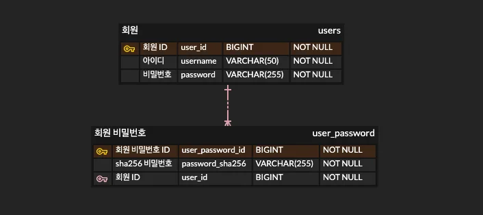
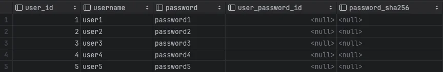
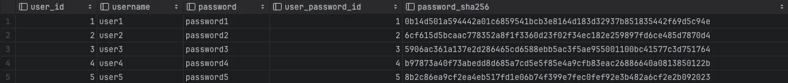
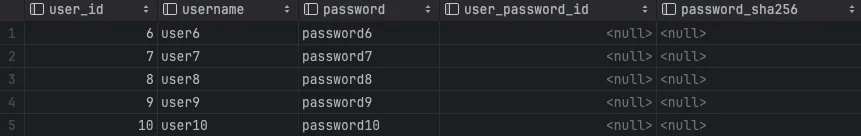
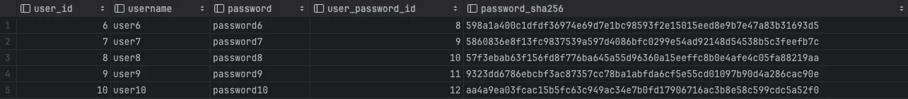

## 들어가며

암호화는 크게 양방향과 단방향으로 나뉩니다.

| 구분 | 복호화 | 예 |
|---|---|---|
| 양방향 | 암호문을 다시 평문으로 되돌릴 수 있다 | AES |
| 단방향 | 평문으로 되돌릴 수 없다 | SHA-256 |

그래서 ISMS 같은 보안 인증을 받을 때 비밀번호 같은 민감한 개인정보는 반드시 단방향 암호화 대상입니다.

이 글은 서비스를 멈추지 않은 채 기존 비밀번호를 SHA-256으로 옮긴 쿼리와, 그 쿼리를 실수 없이 돌리기 위해 세운 실행 계획을 정리한 글입니다. 예시는 아래 ERD를 기준으로 합니다. 기존 `users.password`는 그대로 두고, 해시는 새 테이블 `user_password.password_sha256`에 넣습니다.

{: width="706" height="314" }

## 1. 실행 계획 📃

{: width="1100" height="480" }

운영 데이터를 바꾸는 쿼리는 실행 계획을 철저하게 세우지 않으면 실수하기 마련입니다.

테스트는 크게 **쿼리 실행 전**과 **쿼리 실행 후**로 나눴습니다. 실행 전에는 특정 데이터에만 쿼리를 돌려 정상적으로 옮겨지는지 확인하고, 본 쿼리를 실행한 뒤에는 데이터가 제대로 옮겨졌는지, 서비스에 이상이 없는지를 auth 서버 로그와 DB 데이터로 확인합니다.

그래서 테스트 계정을 반으로 나눕니다. 테스트 계정이 10개(ID 1~10)라면 이렇습니다.

| 테스트 계정 | 언제 옮기나 | 무엇을 확인하나 |
|---|---|---|
| ID 1~5 | 본 쿼리 **전에** `IN` 절로 미리 | 쿼리 자체가 맞는지 |
| ID 6~10 | 본 쿼리가 다른 회원과 **함께** | 본 쿼리가 실제로 옮겼는지 |

## 2. 실행 전 테스트 🧐

**① 테스트 대상 확인.** ID 1~5가 아직 `user_password`에 없는지 봅니다.

```sql
SELECT u.user_id, u.username, u.password, up.user_password_id, up.password_sha256
FROM users u
LEFT JOIN user_password up ON up.user_id = u.user_id
WHERE up.user_password_id IS NULL AND
    u.user_id IN (1, 2, 3, 4, 5);
```

{: width="864" height="142" }

**② 테스트 대상만 옮기기.** 본 쿼리와 같은 쿼리에 `IN` 절만 붙여서 실행합니다.

```sql
INSERT INTO user_password(user_id, password_sha256)
(
    SELECT u.user_id, SHA2(u.password, 256)
    FROM users u
    LEFT JOIN user_password up ON up.user_id = u.user_id
    WHERE up.user_id IS NULL AND
        u.user_id IN (1, 2, 3, 4, 5)
);
```

**③ DB로 확인.** 이번에는 `IS NULL` 조건 없이 조회해서 해시가 들어갔는지 봅니다.

```sql
SELECT u.user_id, u.username, u.password, up.user_password_id, up.password_sha256
FROM users u
LEFT JOIN user_password up ON up.user_id = u.user_id
WHERE u.user_id IN (1, 2, 3, 4, 5);
```

{: width="1287" height="137" }

**④ 서비스로 확인.** 실제 앱 또는 웹에서 ID 1~5로 로그인해 보고, 마이그레이션된 데이터로 정상 작동하는지 확인합니다.

## 3. 본 쿼리 실행 🛠️

**① 적용 대상 개수 세기.** 본 쿼리가 몇 건을 넣을지 미리 세어 둡니다. 실행 뒤 영향받은 행 수와 맞춰 볼 숫자입니다. 예시에서는 6건입니다.

```sql
SELECT COUNT(u.user_id)
FROM users u
LEFT JOIN user_password up ON up.user_id = u.user_id
WHERE up.user_password_id IS NULL;
```

{: width="221" height="45" }

**② 실행 후 확인용 데이터 점검.** ID 6~10이 아직 옮겨지지 않았는지 확인합니다.

```sql
SELECT u.user_id, u.username, u.password, up.user_password_id, up.password_sha256
FROM users u
LEFT JOIN user_password up ON up.user_id = u.user_id
WHERE up.user_password_id IS NULL AND
    u.user_id IN (6, 7, 8, 9, 10);
```

{: width="861" height="136" }

**③ 마이그레이션 쿼리 실행.** 실행 전 테스트와 같은 쿼리에서 `IN` 절만 뺍니다.

```sql
INSERT INTO user_password(user_id, password_sha256)
(
    SELECT u.user_id, SHA2(u.password, 256)
    FROM users u
    LEFT JOIN user_password up ON up.user_id = u.user_id
    WHERE up.user_id IS NULL
);
```

{: width="1100" height="500" }

`LEFT JOIN … WHERE up.user_id IS NULL`은 `user_password`에 짝이 없는 회원만 고릅니다. 실행 전 테스트에서 미리 옮긴 ID 1~5는 이미 짝이 있으니 자연스럽게 빠지고, 중간에 끊겨 다시 실행하더라도 이미 옮긴 회원은 두 번 들어가지 않습니다. 실행 전 테스트와 본 쿼리를 같은 모양으로 짠 이유가 이것입니다.

## 4. 실행 후 확인 ✅

**① DB로 확인.** 본 쿼리가 ID 6~10을 옮겼는지 봅니다.

```sql
SELECT u.user_id, u.username, u.password, up.user_password_id, up.password_sha256
FROM users u
LEFT JOIN user_password up ON up.user_id = u.user_id
WHERE u.user_id IN (6, 7, 8, 9, 10);
```

{: width="1284" height="141" }

**② 서비스로 확인.** ID 6~10으로 앱 또는 웹에서 로그인해 보고, auth 서버 로그에 이상이 없는지 확인합니다.

## 5. 함께 알아 둘 것 🧱

- **`SHA2(str, 256)`은 64자리 16진수 문자열을 돌려줍니다.** 해시를 담는 컬럼은 최소 64자여야 합니다. 첫 번째 인자가 `NULL`이면 결과도 `NULL`입니다.
- **솔트가 없습니다.** `SHA2()`만 쓰면 같은 비밀번호는 언제나 같은 해시가 되어, 미리 계산해 둔 해시 표로 원래 값을 알아내기 쉬워집니다. 회원마다 다른 솔트를 붙이거나 bcrypt처럼 비밀번호 전용 해시를 쓰는 편이 더 안전합니다.
- **`INSERT … SELECT`는 원본 행에 락을 잡습니다.** InnoDB의 기본 격리 수준(REPEATABLE READ)에서는 `SELECT`로 읽는 `users` 행에 공유 락이 걸려, 실행되는 동안 같은 행을 수정하는 요청이 기다릴 수 있습니다. 회원 수가 많다면 사용량이 적은 시간에 돌리거나 범위를 나눠 실행하는 것을 고려합니다.

## 마무리

- 비밀번호처럼 민감한 개인정보는 단방향 암호화 대상이다. 배치 없이도 MySQL의 `SHA2()`와 `INSERT … SELECT`만으로 옮길 수 있다.
- 운영 데이터를 바꾸는 쿼리는 실행 전 테스트, 본 쿼리, 실행 후 확인으로 나눠 계획을 먼저 세운다.
- 테스트 계정은 반으로 나눈다. 절반은 쿼리가 맞는지, 나머지 절반은 본 쿼리가 실제로 옮겼는지를 확인한다.
- `LEFT JOIN … IS NULL`로 대상만 고르면 다시 실행해도 중복되지 않는다. 테스트 쿼리와 본 쿼리를 같은 모양으로 짜면 테스트가 곧 본 쿼리의 검증이 된다.
- 적용 대상 `COUNT`를 미리 세어 두고, 실행 뒤 영향받은 행 수와 맞춰 본다.

> 참고
> - [MySQL 8.0 Reference Manual: Encryption and Compression Functions (`SHA2()`)](https://dev.mysql.com/doc/refman/8.0/en/encryption-functions.html#function_sha2)
> - [MySQL 8.0 Reference Manual: Locks Set by Different SQL Statements in InnoDB](https://dev.mysql.com/doc/refman/8.0/en/innodb-locks-set.html)
{: .prompt-info }
